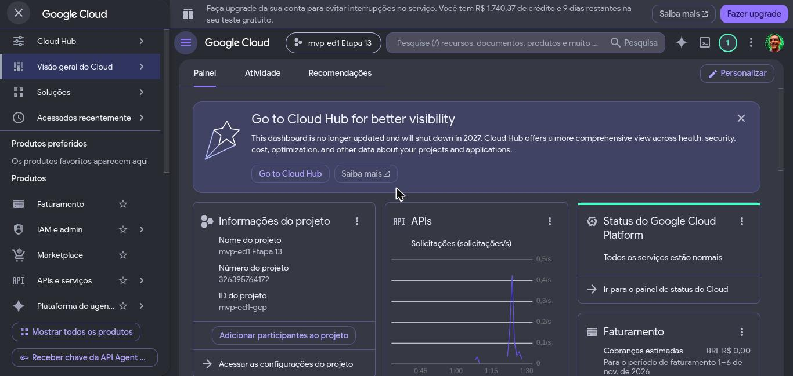

# Registro da fase GCP — o processo de construção da Etapa 13

> **O que vive aqui:** o diário de construção da fase GCP, em ordem cronológica — o que foi feito,
> com que comando, o que saiu, o que se decidiu, o que deu errado e como se resolveu, e quanto
> custou. A infraestrutura da Etapa 13 é **destruída** em 12/11/2026; o que sobrevive é o
> repositório, e este registro é a parte dele que conta como foi.
>
> **O que não vive aqui:** o plano e as suas regras (ver o plano transitório `PLANO_etapa_13.md`
> enquanto existir, e o [Plano de Desenvolvimento](plano_de_desenvolvimento.md#etapa-13--replicação-no-gcp-com-terraform--m6));
> as decisões (ver os [ADRs](adr/README.md) e as [Pendências §2](pendencias.md)); os números de
> custo e capacidade como referência (ver [Capacidade §2.6](capacidade_e_recuperacao.md#26-custo-da-janela-na-nuvem));
> o mapa de paridade (ver [Arquitetura §5](arquitetura.md#5-mapa-de-paridade-local--gcp)). Este
> registro conta a história e aponta para eles; não repete as regras.
>
> Rótulos: **[medido]** tem saída de comando ou página oficial por trás; **[estimado]** não.
> Horários em America/Sao_Paulo. O identificador da conta de faturamento aparece mascarado
> (`0199D3-…`); o projeto é `mvp-ed1-gcp`.

| Campo | Informação |
|---|---|
| Versão | 1.0 |
| Abertura | 06/11/2026 |
| Última revisão | 07/11/2026 — G1, primeira metade: staging inteiro no BigQuery |

---

## 1. Como a etapa foi aberta (06/11/2026)

**A pergunta do Owner:** "Vamos iniciar a etapa 13? Me fale mais dos planos, e avalie se há algo a
mudar, revisar, enviar ao Codex ou enviar ao Gemini."

**O que existia:** a Etapa 13 era uma linha de tabela no plano de desenvolvimento, o mapa de
paridade, o ADR-0024 (Airbyte e Composer em janela curta), o ADR-0025 (*policy tags* por fluxo com
federação de identidade), um guia de estudo (`NAVEGANDO_GCP/`) e uma conversa de custos
(`CONVERSAS_COM_CHAT/ARQUITETURA_E_CUSTOS_GCP.md`). Nenhum Terraform da nuvem.

**A primeira leitura achou um furo no mapa:** a Arquitetura §5 dizia Datastream → Pub/Sub →
`ReadFromPubSub`; a página oficial de destinos do Datastream lista **só** BigQuery, Cloud Storage e
Iceberg. O capítulo 07 do guia de estudo já avisava; o mapa não tinha sido corrigido. Virou o
[ADR-0051](adr/0051-cdc-da-fase-gcp-pelo-debezium-server.md) (§3).

**O Gemini como parecerista:** havia um parecer dele, de 03/11, no `NAVEGANDO_GCP/` e um
`GEMINI.md`. Lidos, eram genéricos — nenhuma recomendação que mudasse o plano, sem o furo do
Datastream, e contando 48 ADRs quando havia 50. O `GEMINI.md` foi reduzido ao papel de
**verificador de fatos com URL oficial**, e o parecer foi arquivado em `CONVERSAS_COM_CHAT/gemini/`.

**Decisões do Owner na abertura:**

- autorizou a Etapa 13 (Termo v1.3 §11);
- a conta é a da **avaliação gratuita**, não convertida — "temos 7 dias para ter tudo ativado e
  desativado, e falhar nisso é falhar no projeto";
- **D68**: sem volume alto — a fase GCP roda no fator `dev` (a premissa estava no Termo §7 e nas
  consequências do ADR-0014 e do ADR-0016, emendados por nota);
- **escopo inteiro**, recusando o corte preventivo; revisões em rodadas com prazo.

**A conta, lida pelo `gcloud` e pela consola** [medido]: uma conta de faturamento compartilhada por
nove projetos; **R$ 1.740,37 de crédito e 9 dias restantes** em 06/11 (fim real ~15/11; o Owner
fixou 13/11 por prudência). Cota de 32 vCPUs em todas as regiões, sem aumento possível na avaliação.

## 2. O Gemini e a cota (06–07/11/2026)

O plano era usar o Gemini CLI para conferir fatos do GCP. O que aconteceu, na ordem:

1. `gemini -p` com as 15 perguntas de uma vez → **429 `RESOURCE_EXHAUSTED`** em todas as buscas:
   ele disparou as buscas em paralelo e estourou o limite.
2. Uma pergunta por chamada, em série, com pausa → 429 do mesmo jeito.
3. Troca de modelo (`gemini-3-pro-preview`, `gemini-3.1-pro-preview`, `gemini-flash-latest`) → 429.
   O "Login with Google" é recusado pela ferramenta nesta conta; só a chave de API funciona, no
   nível gratuito.
4. O Owner sugeriu `gemini-2.5-flash`. Testado direto na API REST: **"This model
   models/gemini-2.5-flash is no longer available to new users"** (404).
5. Teste isolado: chamada **sem** ferramenta funciona; o esgotado é a cota de **busca na web**
   (*grounding*), comum a todos os modelos.
6. **A saída:** a ferramenta `url_context` — o Gemini lê uma URL que se passa a ele — tem outra cota
   e funciona. Conferida com a página do Datastream: confirmou o furo do §1.

Daí o uso que ficou: o Claude Code indica a página oficial, o Gemini lê e cita o trecho. Foi assim
que os preços do §6 foram lidos.

## 3. A revisão do plano pelo Codex (06–07/11/2026)

O plano transitório `PLANO_etapa_13.md` foi revisado **antes de qualquer código**, como o da
Etapa 12. Três rodadas, cada uma com escopo fixo em *commits*:

| Rodada | Conta e esforço | Achados | O que pegou de mais importante |
|---|---|---|---|
| 1 | conta 1, `xhigh` | 11 (9 bloqueantes, 2 ajustes) | o desmonte dependia de passos que podem falhar; a conversão do dbt **não** era "a maior parte `::`" — só 4 a 8 de 106 modelos são *cast* puro, e 81 nascem dos geradores do legado; o catálogo analisa o SQL como PostgreSQL; o caminho quente depende de `on conflict … returning` e do *Producer* do Kafka; a DAG tem `/opt/mvp_ed1` fixo; *authorized views* e Secret Manager sem bloco |
| 2 | conta 2, `xhigh` | 5 (1 bloqueante, 3 ajustes, 1 observação) | transações do BigQuery que só acrescentam **rodam em paralelo** — a idempotência proposta não impedia dois lotes simultâneos de inserir o mesmo movimento; um *pool* regional do GKE teria 6 nós, não 2 |
| 3 | conta 1, `high`, só regressão | 0 | revisão encerrada; o G0 pode começar |

Depois da rodada 1, o Claude Code avaliou que fazer tudo bem feito até segunda era improvável e
ofereceu ao Owner uma janela parcial com segunda janela paga depois. **O Owner manteve o escopo
inteiro.** A consequência ficou escrita no plano: critério que não for provado deixa o M6
**incompleto, sem aceite e sem *tag***, e o desmonte acontece do mesmo jeito.

As decisões tomadas pelo Owner sobre a rodada 1 (07/11) estão nas
[Pendências §2](pendencias.md#d69-a-d74--decididas-em-07112026-na-revisão-do-plano-da-etapa-13):
D69 (Debezium Server → Pub/Sub, ADR-0051), D70 (retenção sem trava — travar põe *lien* no projeto),
D71 (o dbt aplica as *policy tags*, porque substituir tabela no BigQuery as apaga), D72 (Airbyte →
BigQuery sem chave), D73 (`us-central1`, Composer 3 com Airflow 3.2.2), D74 (projeto dedicado e
relógio de emergência).

**Perguntas do Owner no caminho, e as respostas:** qual é a referência GCP — é a de **paridade**
(o mapa), derivada da local; a referência nativa do GCP (Datastream, Workflows, Cloud Run) seria
uma terceira entrega, depois do M6, porque trocá-la agora seria reprojetar o protocolo do legado.
Em custo [estimado, conversa de 15/09], a nativa sairia ~10× mais barata ligada o mês inteiro
(~US$ 30–80 contra ~600–900) e mais leve de operar; a paridade é a que prova portabilidade.

## 4. Ferramentas e contas usadas

- **Codex CLI** `0.166.0`, modelo `gpt-6.1-sol`, duas contas ChatGPT (sem custo de API), sandbox
  com escrita só no `REVISAO.md` e rede para documentação oficial.
- **Gemini** pela API REST com `url_context` (o CLI sem busca não serve para fatos).
- **Terraform** `1.16.1` (`.tools/terraform`), *provider* `hashicorp/google` `~> 8.10`.
- **gcloud** com a conta do Owner; **ADC** de usuário (`authorized_user`), sem chave de conta de
  serviço.

## 5. G0 — fundação (07/11/2026)

**Projeto** [medido]:

```
$ gcloud projects create mvp-ed1-gcp --labels=projeto=mvp-ed1,etapa=13,desmontar-ate=2026-11-12
$ gcloud billing projects link mvp-ed1-gcp --billing-account=0199D3-…
billingEnabled: true
```

**As conferências do relógio de emergência, antes de qualquer recurso** [medido]: o Owner tem
`roles/billing.admin` na conta (pode desligar o faturamento do projeto); a lista de *liens* do
projeto veio vazia (`GET cloudresourcemanager v3 liens` → `{}`; o `gcloud alpha` não estava
instalado, e a API REST respondeu no lugar dele depois de ativada a `cloudresourcemanager`); cota
do projeto novo igual à da conta — `CPUS_ALL_REGIONS` 32, `E2_CPUS` 24 em `us-central1`,
`IN_USE_ADDRESSES` 8.

**ADC** — passo do Owner. Rodado como `! gcloud …` dentro da sessão, não criou o arquivo (o *login*
é interativo); num terminal à parte funcionou, seguido de
`gcloud auth application-default set-quota-project mvp-ed1-gcp`.

**A raiz do Terraform** (`terraform/`): uma raiz só, com um interruptor por degrau de preço
(`enable_cheap`, `enable_cloud_sql`, `enable_gke`, `enable_composer`) — desmontar um degrau é o
mesmo `apply` com o interruptor desligado, então a ordem do desmonte fica declarada. Estado local
(D74), `terraform.tfvars` e planos salvos fora do Git.

**Primeiro `plan` e primeiro `apply`** [medido], pelo rito do plano (§6.3: `plan -out`, leitura,
aprovação do Owner, `apply` do arquivo salvo):

```
Plan: 23 to add, 0 to change, 0 to destroy.     # 22 APIs + 1 orçamento
Apply complete! Resources: 23 added, 0 changed, 0 destroyed.
```

Dois cuidados que só apareceram escrevendo:

- **Os créditos escondem o gasto.** Com o padrão do orçamento, os créditos da avaliação entram no
  cálculo, o gasto líquido fica em zero e nenhum alerta dispara. O orçamento usa
  `credit_types_treatment = "EXCLUDE_ALL_CREDITS"`: teto de R$ 400 na moeda da conta, alertas em
  30, 60 e 90%.
- **O orçamento é da conta, não do projeto** — apagar o projeto não o remove. O `deletion_policy`
  do *provider* tem padrão `DELETE`, mas `ABANDON` ou `PREVENT` o deixariam para trás; ficou
  explícito.

## 6. Preços lidos para a estimativa (07/11/2026)

Lidos pelo Gemini nas páginas oficiais, com o trecho citado; os arquivos de resposta ficam fora do
Git, e os números entram na [Capacidade](capacidade_e_recuperacao.md#26-custo-da-janela-na-nuvem)
como estimativa antes do primeiro `apply` cobrável.

| Serviço | Preço lido | Página |
|---|---|---|
| Composer 3 | US$ 0,06 por DCU-hora; armazenamento do banco US$ 0,000232877/GiB-h; a taxa de ambiente está dentro do DCU | composer pricing |
| Composer 3, preset *small* | *scheduler* 0,5 vCPU/2,5 GB, *triggerer* 0,5/0,5, *DAG processor* 1/2, *web server* 1/2,5, *workers* 1/2 (2 a 4) | environment-scaling |
| GKE | US$ 0,10 por *cluster*-hora; crédito de US$ 74,40/mês por conta, que cobre um *cluster* zonal | kubernetes-engine/pricing |
| Cloud SQL Enterprise | US$ 0,0413 por vCPU-h; US$ 0,007 por GiB-h; SSD US$ 0,17/GiB-mês | sql/pricing |
| Dataflow *streaming* | US$ 0,069 por vCPU-h; US$ 0,003557 por GB-h; Streaming Engine US$ 0,018/GB; máquina padrão `n1-standard-2` | dataflow/pricing |
| Pub/Sub | 10 GiB/mês grátis, depois US$ 40/TiB | pubsub/pricing |
| BigQuery | 1 TiB de consulta e 10 GiB de armazenamento grátis por mês; US$ 6,25/TiB | bigquery/pricing |
| Rede | *forwarding rule* de LB interno US$ 0,025/h; Cloud NAT US$ 0,0014/h por VM | vpc/nat pricing |

**Dois buracos e como foram tapados.** A página de preço de VM carrega a tabela dinamicamente, e
nem o Gemini nem a leitura direta a viram; o preço da `e2-standard-4` saiu da **Cloud Billing
Catalog API**, a fonte oficial por SKU [medido]: E2 US$ 0,021812 por vCPU-h e US$ 0,002924 por
GiB-h; N1 US$ 0,031611 e US$ 0,004237; `pd-balanced` US$ 0,10/GiB-mês. E a conversão do Composer 3
em DCU não está escrita; o que a página traz é um **exemplo oficial** — 12 DCUs para um ambiente
em uso normal, 15 com mais *workers*, a US$ 0,06 —, lido do HTML baixado depois que o Gemini
esgotou também a cota de `url_context` (429, 07/11). A estimativa por serviço está na
[Capacidade §2.14](capacidade_e_recuperacao.md#214-a-estimativa-da-janela-da-etapa-13--07112026).

## 7. As evidências para o portfólio (07/11/2026)

O Owner, no meio do G0: "o produto que terei ao término deste projeto é o processo de construção,
visto que o produto em si construído será destruído" — e o objetivo é **comprovar que consegue
replicar uma estrutura local adequada na nuvem**, mostrando isso no portfólio por código, capturas,
documentos e páginas, em conteúdo humanamente interessante.

Daí três coisas: este registro passou a ser escrito **no momento**, não no fim; o plano ganhou um
roteiro de capturas com a frase que cada uma prova (19 capturas e 2 GIFs, a maioria na quarta, antes
do `destroy`); e o caso de portfólio será redigido aqui e publicado pelo Owner no portfólio depois
do M6. As capturas saem do Chrome do Owner, logado na consola, e ficam em
[`registro_fase_gcp/capturas/`](registro_fase_gcp/capturas/).

**A primeira captura** — o painel do projeto recém-criado; a faixa no alto é a própria consola
contando o crédito e os dias restantes da avaliação:



## 8. G1 — o dbt nos dois alvos, primeira metade (07/11/2026)

**O degrau barato** [medido], com a aprovação do Owner em cada `apply`: os nove *datasets* (plano
02) e uma conta de serviço por papel do ADR-0011, sem chave (plano 03).

**A carga de desenvolvimento** — o bruto local copiado para o BigQuery para o dbt ter o que
transformar antes do Airbyte do GKE: 79 tabelas, 712.861 linhas, `governance` como *fixture*. A
primeira versão usava `COPY … TO STDOUT` e quebrou numa tabela: o formato texto do `COPY` escapa
as barras invertidas, e o JSON chegava estragado ("Parser terminated before end of string"). Leitura
por cursor resolveu.

**O termômetro e o caminho** — `dbt run --target gcp --select staging`, rodada a rodada:

| Rodada | Resultado | O que destravou a seguinte |
|---|---|---|
| 1 | 1 de 78 | as fontes declaravam `database: warehouse_db`, que no BigQuery é o projeto → `target.database` |
| 2 | 1 de 78 | `distinct on` não existe no BigQuery → macro que vira `qualify row_number() … = 1` |
| 3 | 37 de 78 | o `+grants` traz papéis do PostgreSQL → macro que traduz `select` em `roles/bigquery.dataViewer` na conta do papel |
| 4–7 | 38 → 78 de 78 | o legado: o gerador continua escrevendo PostgreSQL, e o mesmo SQL é traduzido pelo `sqlglot`; o que ele não traduz (*substring* por padrão, `convert_from`, `split_part`, `at time zone`, `jsonb_*`) é traduzido na árvore sintática, com o motivo de cada regra |

**O oráculo que mantém o local intacto:** compilar o alvo local antes e depois de cada mudança e
comparar — **0 de 903 arquivos diferem**. O `make check` do lote: `dbt build` com PASS=907, 1079
testes Python. Dois tropeços do caminho, contados como foram: um *script* que inseriu uma linha de
`import` **dentro de uma string SQL** (procurava a última linha começando com `from` — e achou o
`from` de um SQL); corrigido pela árvore sintática do Python, e o `make check` pegou antes do
*commit*. E dois testes de frescor que comparavam o arquivo gerado com o SQL puro, ensinados a
esperar os dois corpos.

**Próximo:** a classificação do legado, escrita à mão para o BigQuery (recursão, JSON dinâmico,
`lateral`), e o oráculo **semântico** — o mesmo bruto nos dois alvos, a classificação comparada
linha a linha.

## 9. G1 — o dbt nos dois alvos, segunda metade (07/11/2026, madrugada)

**A classificação do legado, à mão.** O `sqlglot` traduz os 40 modelos de limpeza, mas não a
classificação: `jsonb_each_text`, `lateral`, `pg_input_is_valid` e o recursivo com `union` não têm
tradução mecânica. O corpo BigQuery foi escrito à mão (`legacy/classification_bigquery.sql`), a
mesma regra noutro dialeto, e o gerador o põe no lugar da tradução. O que o BigQuery recusou no
caminho, rodada a rodada: `NULLS LAST` em agregado ascendente (a ordem virou `x is null, x`), um
`not exists` sobre `union distinct` que ele não descorrelaciona (virou anti-junção). O recursivo:
o PostgreSQL termina em ciclo porque o `union` deduplica; o BigQuery só aceita `union all`, então a
profundidade é limitada em 64 e o modelo **recusa** se alguma ocorrência só aparece no limite — em
ciclo ela já apareceu antes, e a guarda não dispara.

**O oráculo semântico** [medido]: o mesmo bruto nos dois alvos, a classificação comparada linha a
linha por `(source_system, snapshot_id, source_table, legacy_row_id)` — **12.741 × 12.741 linhas,
0 divergências**, nos campos `classification`, `rejection_origin`, versão, impressão digital e na
lista ordenada de achados (código e coluna). Ferramenta: `python -m mvp_ed1.gcp.oraculo`.

**Os modelos escritos à mão.** O plano contava "~25"; eram 70 modelos, 4 *snapshots*, 34 testes
singulares e 15 macros. A técnica foi uma só: **macro com duas metades** (`macros/portavel.sql`) —
a `default__` emite o texto que o modelo já tinha, a `bigquery__` o equivalente. Uma passada
mecânica (`count(*) filter (where …)`, `extract(epoch …)`, `at time zone`, `timestamptz '…'`,
`x::tipo`) e o resto à mão. O que o BigQuery cobrou, e que nenhuma leitura da documentação teria
listado de antemão:

| Recusa do BigQuery | Saída |
|---|---|
| tipo parametrizado no `cast` (`numeric(12, 4)`) | `decimal_fixo`: `round(cast(x as numeric), 4)` — o mesmo arredondamento |
| `percentile_cont` só como janela | `mediana`: lista ordenada, interpolação em FLOAT64 como o `double` do PostgreSQL |
| `count(distinct (a, b))` sobre STRUCT | `contar_distintos`: o texto JSON da combinação |
| `except all` não existe | `diferenca_multiconjunto`: a linha como JSON e a ocorrência numerada |
| `varchar(n)` nos *seeds*, `timestamp with time zone` no contrato | o tipo escolhido por alvo no `.yml` |
| `100.0` é FLOAT64 e o contrato diz `numeric` | `cast(100.0 as numeric)`; `sum` de bigint é numeric lá e INT64 aqui |
| descrição de coluna com mais de 1.024 caracteres | cortada **só no BigQuery**, com a indicação do catálogo |
| `where` sem `from` | uma linha de `from` |
| `lateral` e `exists` com chave canônica correlacionada | junções sobre as chaves calculadas antes |

**O oráculo de compilação ficou mais fino.** Igualdade de texto não basta mais: `x::int` e
`cast(x as int)` são o mesmo SQL. O comparador (`python -m mvp_ed1.gcp.compilacao`) classifica
cada arquivo compilado do alvo local em **igual** (texto), **equivalente** (a mesma árvore no
`sqlglot`, sem comentários) ou **diferente** — e com `--rodar` executa os diferentes, antes e
depois, no armazém local, comparando linhas e tipos. Resultado [medido]: **858 iguais, 30
equivalentes, 11 diferentes na árvore e com o mesmo resultado no armazém** (`cast(100.0 as
numeric)` no lugar de `100.0`, por exemplo). O caminho local não mudou.

**Achado latente** (não corrigido, registrado): o membro desconhecido de `dim_support_agent` tem
`hired_at = date 'period_start'` numa coluna `timestamptz` — o PostgreSQL converte na meia-noite do
**fuso da sessão**. Local é UTC e o resultado é estável; noutro fuso mudaria. É a mesma classe do
RVL3-6-04. O `cast` explícito agora diz isso em voz alta; a decisão ficou para o Owner
([D76](pendencias.md#d76--o-membro-desconhecido-do-agente-é-contratado-à-meia-noite-de-são-paulo-decidida-em-07112026)) — decidida (a) na manhã seguinte (§11).

**A canonização no BigQuery** [medido]: a `bigquery__chave_canonica` rodou no BigQuery sobre as
mesmas formas que provam a do PostgreSQL (`tests/test_legado_remocao.py`: hexadecimal, octal,
binário, `_`, as fronteiras de cada domínio, cadeias de 131 mil caracteres) e devolveu o que o
`cast` do PostgreSQL devolve em **todas** — `GCP_TESTES=1 pytest tests/test_gcp_dialetos.py`,
12 testes, 16 s. Fica fora do `make check`: o projeto é destruído no fim da etapa.

**O build inteiro no BigQuery** [medido, 07/11/2026 ~04h20]: `dbt build --target gcp` —
**PASS=907, 0 erros**, o mesmo número do `make check` local: *seeds*, *snapshots*, os 9 schemas,
testes de dados, *unit tests* e contratos. Foram cinco *builds* até lá (`g1_build_01` a `05`):
2 erros, 3, 1, 3, 0 — cada um destravando os nós que o anterior pulava.

**A paridade das camadas** [medido]: `python -m mvp_ed1.gcp.oraculo contagens` — **277 de 278**
tabelas e views com a mesma contagem de linhas nos dois alvos. A única diferença é a quarentena
(84.843 × 2.855), e é de propósito: ela é destino permanente (ADR-0037) e guarda localmente 27
auditorias; recortada na captura e no tratamento correntes, dá **2.855** dos dois lados.

**Partição, *clustering* e *authorized views*** [medido]: as dez fatos reconstruídas com
`--full-refresh` (PASS=269), particionadas por mês e clusterizadas (por exemplo,
`fact_sales_order_item`: `placed_at`, `MONTH`, `[source_system, sales_channel_key,
product_key]`), e **16 views de `consumption` autorizadas** no *dataset* `analytics`.

## 10. Decisões da sessão autônoma (07/11/2026, madrugada) — para o Owner ler

O Owner autorizou seguir sozinho com as decisões que eu marcaria como recomendadas, desde que
anotadas. Nenhuma delas pede ADR; as que mexem em infraestrutura esperam a aprovação dele.

| # | Decisão | Por quê | Como desfazer |
|---|---|---|---|
| A1 | A classificação do legado tem corpo BigQuery **escrito à mão**, não traduzido | a tradução mecânica não existe para `lateral`, `jsonb_each_text` e recursivo com `union`; o oráculo semântico é a prova | apagar `classification_bigquery.sql`; o alvo `gcp` deixa de rodar `trusted` |
| A2 | A impressão digital do tratamento (D34) continua sendo a do **texto PostgreSQL**; o corpo BigQuery não entra nela | incluir mudaria a impressão local e criaria auditorias novas na quarentena sem o tratamento ter mudado; a equivalência é provada pelo oráculo | incluir o corpo BigQuery em `impressao_digital` |
| A3 | Oráculo de compilação em três níveis (igual, equivalente pela árvore, mesmo resultado no armazém) | `x::int` × `cast(x as int)` não muda nada e quebrava a igualdade de texto | — |
| A4 | Descrição de coluna acima de 1.024 caracteres é **cortada só no BigQuery**, com aviso | o limite é do BigQuery e derrubava quatro views; o texto inteiro fica no `.yml` e no catálogo | encurtar as quatro descrições na declaração |
| A5 | Fatos particionadas **por mês** pelo instante do evento; *clustering* pela origem e duas chaves de dimensão | ~24 meses e até 81 mil linhas: diária seriam centenas de partições minúsculas | trocar `granularity` no `dbt_project.yml` |
| A6 | Views de `consumption` autorizadas em `analytics`, `trusted` e `raw` (*authorized views*) | são os três que elas leem; sem isso o `analyst` precisaria ler `analytics` | tirar a entrada do `grant_access_to` |
| A7 | Os *unit tests* da remoção perdem o `payloads` do *fixture* | nenhum caso confere o payload, e o BigQuery não converte texto em JSON no *fixture* | — |
| A8 | Mediana no BigQuery pela lista ordenada, interpolada em FLOAT64 | é a conta do `percentile_cont` do PostgreSQL, que devolve `double`; o BigQuery só o tem como janela | — |
| A9 | **Plano 04 salvo, não aplicado**: o Owner pode personificar `mvp-analyst` e `mvp-auditor` (Token Creator) | é o que falta para provar "o analista lê `consumption` e é negado em `analytics`" sem chave | não aprovar; o vínculo some com o projeto |

**Para aprovar de manhã:** `data/medicoes/etapa_13/planos/04_personificacao.txt` (2 a adicionar, 0
a mudar, 0 a destruir). Depois do `apply`, a prova é uma consulta em cada *dataset* como
`mvp-analyst`. *(Aprovado pelo Owner às ~06h20 e aplicado — §11.)*

## 11. G1 fechado e o primeiro `apply` da manhã (07/11/2026, ~06h–07h)

A sessão anterior parou no limite de uso, no meio do `make check`; o vigia desligou o computador,
como combinado. Retomada por uma conta nova do Claude Code, lendo o `RETORNO.md` do vigia e a memória.
Antes de se ausentar, o Owner respondeu a quatro perguntas: **aplicar o plano 04**; **D76 = (a)**;
*commits* **sem *push***; depois do G1, **o G3 só em planos**, sem `apply`.

**O vigia rearmado.** O timer transitório some no *reboot*; recriado
(`systemd-run --user --unit=mvp-vigia`), agora olhando a transcrição da conta nova — o caminho da
transcrição virou variável do `vigia.sh`.

**O socket do Docker, de novo** (o R11 registrado na memória): o primeiro `docker ps` depois do
*boot* subiu Airbyte e Airflow juntos. `make airbyte-pause` antes do `make check`.

**Os patches deixados prontos**, aplicados em ordem: os testes que renderizam macros com Jinja puro
(a metade `default__` chamada pelo nome), o dialeto da derivação lido do *manifest* (G2.2), o
recorte da quarentena no oráculo de contagens, os alvos `gcp-*` no `Makefile`.

**O `make check` cobrou mais sete** [medido]: todas em `tests/test_vigencia_em_utc.py`, guardas que
leem o texto SQL procurando `at time zone 'UTC'`, `interval 'N days'` e literais `timestamptz` com
fuso — e o texto agora diz `{{ meia_noite(var("as_of_date")) }}`. A saída foi a mesma da guarda de
identidade: **renderizar** cada chamada pela metade local antes de ler. A chamada dentro de outra
expressão Jinja (``) vira a concatenação que o modelo tinha antes; o
corpo de `default__meia_noite` sai da leitura, e uma contraprova nova confere que o padrão dele é
`-03`. A contraprova das aspas voltou a achar os **14** literais e a acusar cada um sem o *offset*.
Segundo `make check`: **dbt PASS=907; pytest 1.088 passaram, 7 pulados; código de saída 0**.

***Commits*** (sem *push*): `1edb117` (classificação à mão), `ee8e31b` (modelos nos dois dialetos),
`921c52a` (oráculos), `f69c065` (catálogo no dialeto do alvo), `7b092c7` (alvos `gcp-*`), `a7d2e73`
(personificação).

**Plano 04 aplicado** [medido, 06:22]: `make gcp-apply NOME=04_personificacao` — 2 adicionados, 0
alterados, 0 destruídos, 9 s. A primeira tentativa de personificar, logo depois, recusou
(`iam.serviceAccounts.getAccessToken` negado): o IAM leva minutos para propagar. Cinco minutos depois:

| Leitura como… | `consumption` (view) | `analytics` | `trusted` | `quarantine` | `governance` | consulta (*job*) |
|---|---|---|---|---|---|---|
| `mvp-analyst` | **metadado lido** | negado | negado | negado | negado | negado |
| `mvp-auditor` | negado | negado | negado | **metadado e linhas lidos** | **negado** | negado |

Duas descobertas, as duas boas de achar agora e não na quarta:

1. **Nenhuma conta de papel roda consulta.** No BigQuery toda consulta é um *job* do projeto, e
   `bigquery.jobs.create` vem de `roles/bigquery.jobUser`, que ninguém tinha. No PostgreSQL não
   existe equivalente: a consulta é da sessão. A prova de que "o analista **lê** `consumption`"
   precisa do vínculo — entra no plano 05.
2. **O auditor é negado em `governance`**, que a declaração do dbt concede a ele (`grants` da fonte
   `governance`). No PostgreSQL quem concede o que fica acima do objeto — o `select` nas fontes, o
   `create` no schema — é o `on-run-end` (`aplicar_acesso_por_camada`), e ele só roda no alvo
   local. No BigQuery isso é IAM de *dataset*: Terraform. A lista sai **derivada** do mesmo
   *manifest*, não escrita de novo (§12).

Evidência: `data/medicoes/etapa_13/acesso/prova_02_sem_jobuser.txt`.

## 12. G3 em planos: o degrau barato e o Cloud SQL (07/11/2026, manhã)

O Owner autorizou o G3 **só em planos**: Terraform escrito, `plan -out` salvo, nenhum `apply`.

**O acesso por *dataset*, derivado.** `python -m mvp_ed1.gcp.acesso` lê o *manifest* do dbt —
`meta.writers` de cada camada e `grants` de cada fonte — e grava `terraform/acesso.auto.tfvars.json`,
que o Terraform carrega sozinho. Resultado [medido]: **13 concessões** — `dataEditor` a quem escreve
(o `transformer` nas seis camadas do pipeline, o `ingestor` em `raw`, `raw_legacy` e `governance`) e
`dataViewer` a quem lê as fontes (o `transformer` em `raw`, `raw_legacy` e `governance`; o `auditor`
em `governance` — a negação da §11). Uma concessão por tabela fica **pendente** e listada no próprio
arquivo: `raw.inventory_movements_stream` (`insert` e `select` do `streamer`), porque a tabela nasce
com o caminho quente e o IAM dela vai junto, no G2.3. O teste `tests/test_gcp_acesso.py` recusa o
arquivo que não for o que a declaração dá.

**Um recurso do provider que apagaria o trabalho do G1.** `google_bigquery_dataset_iam_member`
reescreve a lista de acesso do *dataset* e **remove as *authorized views*** que o dbt grava nela
(`grant_access_to`) — o aviso está na página do recurso. O `papeis.tf` usa
`google_bigquery_dataset_access`, que acrescenta uma entrada e não toca nas outras.

**Os planos** [medidos, 07/11/2026]:

| Plano | O quê | Criar / alterar / destruir | Custo |
|---|---|---|---|
| `05_barato` | 13 acessos por *dataset*; `jobUser` dos 5 papéis; *buckets* `livro` e `beam` com o IAM; 2 tópicos e 2 assinaturas com o IAM; VPC, sub-rede, faixa e conexão de serviços privados | **36 / 0 / 0** | centavos (Capacidade §2.14, linha do degrau barato) |
| `06_cloud_sql_revisao` | o 05 **mais** a instância, os 2 bancos, os 2 usuários, as 2 senhas e os 2 segredos | **47 / 0 / 0** | ~US$ 10 na janela (Capacidade §2.14) |

O 06 é **para revisão**: o `.tfplan` foi apagado, ficou só o texto. Aplicado por engano antes do 05,
ele ligaria o Cloud SQL dois dias cedo; depois do 05, fica obsoleto e é refeito na segunda
(`make gcp-plan NOME=06_cloud_sql VARS="enable_cloud_sql=true"`). `VARS` é novo no alvo: liga um
degrau só naquele plano, sem tocar no `terraform.tfvars`, e o plano salvo leva os valores dentro.

**Decisões da sessão** (continuação da tabela da §10):

| # | Decisão | Por quê | Como desfazer |
|---|---|---|---|
| A10 | As guardas de texto leem a metade local **renderizada** das macros de instante | é o SQL que o alvo local compila, o que elas sempre leram; regex por macro envelheceria a cada macro nova | — |
| A11 | Acesso por *dataset* **derivado** do *manifest*, não escrito no Terraform | uma declaração só (CLAUDE.md §5); a negação do auditor na §11 era exatamente essa lacuna | escrever a lista em `papeis.tf` |
| A12 | `bigquery.jobUser` para os **cinco** papéis | todos consultam, carregam ou fazem DML; sem ele ninguém roda nada | tirar do `for_each` quem não precisar, quando a prova da terça mostrar |
| A13 | Livro: `ingestor` com `objectCreator` + `objectViewer`; `auditor` com `objectViewer`; retenção **7 dias, sem trava** | `objectCreator` não substitui nem apaga: o "nunca substituído" do ADR-0050 também no IAM; 7 dias cobrem a janela; sem trava pela D70 | outro papel; `ledger_retention_seconds` |
| A14 | Tópicos com os **nomes do Kafka** local; o `streamer` publica e lê; assinaturas sem expiração | o Debezium Server publica em `<prefixo>.<schema>.<tabela>`, o nome que o conector já tem | — |
| A15 | Rede no **degrau barato**, faixas 10.10/20 (nós), 10.20/16 (*pods*), 10.30/20 (*services*), 10.40/20 (serviços privados) | não cobra por existir; o Cloud SQL de segunda e o GKE de terça a acham pronta | mudar as faixas antes do `apply` |
| A16 | Cloud SQL: **uma** instância PostgreSQL 16 com os dois bancos, `db-custom-2-7680`, zonal, sem *backup* e sem PITR, só IP privado, SSL obrigatório; usuários com `deletion_policy = ABANDON` | a versão da fase local; o tamanho da Capacidade §2.14; nada que sobreviva ao desmonte; usuário dono de objeto não sai por `DROP ROLE`, e quem o leva é a instância | outra versão ou *tier* no `cloud_sql.tf` |
| A17 | O 06 guardado **sem** `.tfplan` | evita ligar o degrau cobrável fora de hora | — |

**O que ficou para os blocos seguintes**, anotado onde vai ser feito: a concessão por tabela do
*stream* e o privilégio `REPLICATION` do usuário do Debezium no Cloud SQL (G2.3); quem lê os segredos
— o Composer e o Airbyte (G2.4, GKE); a retenção e a expiração dos *datasets* que o plano do G3 cita
(não declaradas ainda); SSL obrigatório pede `sslmode=require` nos conectores (G2.1, G2.3).

**Para aprovar:** `data/medicoes/etapa_13/planos/05_barato.txt` (36 / 0 / 0). Depois do `apply`, a
prova de acesso da §11 roda de novo (`data/medicoes/etapa_13/acesso/prova.py`), agora esperando o
analista **consultar** `consumption` e o auditor ler `governance`.

**Um *commit* que o portão não viu.** O `make check-offline` passou com o `cloud_sql.tf` ainda fora
do Git, e a revisão de segredos lê **só arquivos rastreados**: depois do *commit* `4a0b221`, ela
acusou o campo `secret_id` do segredo, escrito com o nome entre aspas — atribuição literal a uma
chave com `secret`. Não é
credencial (é o nome do segredo, e o valor nasce no `apply`), mas a regra é a certa e a correção foi
na declaração: o nome sai de um `local` montado por expressão. Lição para o resto da etapa: **`git
add` antes do portão**, não depois.

## 13. A D43 medida (07/11/2026, manhã)

O plano manda medir a guarda de identidade nas **três** noções de "mesma chave" antes de declarar
paridade (§2.3). `python -m mvp_ed1.gcp.identidades` renderiza as macros reais na metade de cada alvo
e roda, uma forma por consulta, as 115 formas que provam a canonização — um erro numa forma vira o
resultado dela, não derruba as outras. Duas rodadas (~5 min cada, ~460 consultas no BigQuery):

- **a primeira** contou como divergente a forma que os dois armazéns recusam (131.073 noves: o
  `numeric` do PostgreSQL e o `BIGNUMERIC` do BigQuery estouram, com mensagens diferentes). Recusa dos
  dois lados é o mesmo resultado; o comparador passou a dizer isso, com teste;
- **a segunda** [medido]: `chave_canonica` **115 de 115**; `identidade_canonica` **114 de 115**, e a
  que sobra é real — `' 8 '` **aborta a consulta no PostgreSQL** (o `\s` dele aceita espaço
  Unicode, o `numeric` não) e passa intacta no BigQuery. Defeito latente do caminho **local**, que o
  dado de hoje não exercita: virou a
  [D77](pendencias.md#d77--a-identidade_canonica-local-só-aceita-os-brancos-que-o-numeric-aceita-decidida-em-07112026),
  para o Owner.

Entre as noções: a identidade nunca junta o que a chave separa, e separa 241 dos 264 pares que a chave
junta. Os números e a tabela ficaram na própria D43
([Pendências](pendencias.md#d43--a-guarda-de-identidade-como-função-no-armazém-adiada-em-16092026)),
que continua do Owner. Evidência: `data/medicoes/etapa_13/d43/medicao_02.{txt,json}`.

## 14. G2.1, primeira peça: o livro retido no Cloud Storage (07/11/2026, manhã)

O livro (ADR-0050) era um diretório, e o "nunca substituído" era o `os.link`. Na nuvem,
`LEGACY_LEDGER_DIR=gs://<bucket>/<prefixo>`: `ledger.root()` devolve um `Lugar` do Cloud Storage
(`mvp_ed1.recovery.livro_gcs`), que imita do `pathlib` só o que os chamadores usam (`/`, `.name`,
`.parent`, `str()`), e as seis funções que tocam o meio despacham pelo tipo da raiz. Nenhum chamador
mudou — CLI, DAG, recuperação e oráculo da memória continuam passando a época adiante.

Três diferenças do meio, cada uma com o motivo no módulo: sem temporário nem `fsync` (o objeto aparece
inteiro ou não aparece); a época nasce com a linha de base, não vazia (o prefixo só existe com
objeto — e a época sem linha de base continua não contando); e **a prova de escrita não escreve**:
o `ingestor` tem `objectCreator`, que não apaga, e a retenção (D70) também não deixaria — um objeto
de prova ficaria para sempre. A prova é `testIamPermissions(storage.objects.create)`.

**Prova** [medido]: `tests/test_livro_gcs.py`, com um *bucket* em memória que responde `412` à
escrita condicionada repetida e `404` à leitura do que não existe — 6 testes, entre eles o mesmo
roteiro (abrir, publicar fora de ordem, recusar a repetição e os nomes inválidos, ler) rodado no
disco e no *bucket*, com o mesmo resultado. Os 174 testes do livro e dos chamadores, verdes. A prova
contra o Cloud Storage real está escrita (`GCP_TESTES=1`) e **espera o *bucket***: ele nasce no plano
05, que aguarda o Owner.

**O que falta do G2.1** (PLANO_etapa_13 G2.1): a leitura do bruto e do certificado no BigQuery
(`captura.py`, `capture_recovery.py`, as medidas do `ledger`); a escrita do certificado em *staging*
+ `MERGE`; os *locks* no Cloud SQL, separados do *insert*; o DDL da governança; a guarda de
identidade do `airbyte.py`; a época inicial no projeto novo.

## 15. G2.1, segunda peça: o DDL do `governance` no BigQuery (07/11/2026, manhã)

`governance.garantir_bigquery()` aplica no BigQuery as **mesmas** duas migrações, com os mesmos
nomes, e as registra no mesmo `_versions`: a lista diz, nos dois armazéns, quais valem. Sem
transação que envolva DDL no BigQuery, cada migração é idempotente por si e só entra em `_versions`
depois de todos os comandos dela.

O que o BigQuery não impõe, e para onde foi: o `check (status in …)` e a chave primária (lá,
`not enforced`) viraram **testes da fonte** — `accepted_values` no `status` e combinação única de
`(capture_attempt_id, source_table)` —, gerados pelo `make legacy-models` a partir das constantes
da `captura`, e por isso rodando **nos dois alvos**: a regra continua uma só. O índice virou
*clustering* pelas mesmas colunas.

**Prova** [medido]: `tests/test_governanca_bigquery.py` — as duas listas com os mesmos nomes na mesma
ordem; o `create table` dos dois dialetos lido pelo `sqlglot` com as mesmas colunas, tipos
equivalentes e nulidade; os testes da fonte com os mesmos vereditos do `check`. Com `GCP_TESTES=1`,
num *dataset* temporário apagado no fim: as migrações aplicam do zero, a segunda chamada não aplica
nada, *clustering* e ordem das colunas conferidos (4 testes, 16 s). Os testes novos da fonte passaram
no armazém local e no BigQuery (`dbt test --select source:governance.legacy_captures`).

O BigQuery cobrou, de novo, uma ordem que a documentação não grita: `default` vem **antes** de
`not null` na definição da coluna.

## 16. As decisões do Owner e o degrau barato inteiro (07/11/2026, ~11h30)

De volta, o Owner respondeu às quatro pendências da manhã: **aplicar o plano 05**; **contrato do
G2.1 aprovado como está**; **D77 = (a)**; ***push*** dos *commits* (`0246e88..2217ed5`, publicados).

**O `apply` do 05** [medido]: 36 / 0 / 0, como o plano; a conexão de serviços privados levou 1 min 4 s,
o resto segundos. Estado anterior guardado em `data/medicoes/etapa_13/planos/tfstate_05_barato.bak`.

**A prova de acesso, agora com consulta** [medido] (`data/medicoes/etapa_13/acesso/prova_*_pos05.txt`):

| Papel | Permitido | Negado |
|---|---|---|
| `mvp-analyst` | metadado da view de `consumption`; **consulta** nela (`count(*)` = 1.494) | metadado, linhas e consulta em `analytics`, `trusted`, `quarantine`, `governance` |
| `mvp-auditor` | metadado e linhas de `quarantine` e de `governance` | `consumption`, `analytics`, `trusted`; nenhuma consulta |

A consulta do analista passa pela *authorized view* (A6) sem que ele leia `analytics`: é a
separação do ADR de acesso, agora provada com *job*, não só com metadado.

**O livro no Cloud Storage real** [medido]: `GCP_TESTES=1 pytest tests/test_livro_gcs.py
tests/test_governanca_bigquery.py` — 11 passaram, no *bucket* `mvp-ed1-gcp-livro` (prefixo
`testes/<uuid>`). Os objetos de teste ficam sob a retenção sem trava da D70 e saem no desmonte.

**A D77 (a), implementada** [medido]: a classe `[ \t\n\v\f\r]` na metade PostgreSQL da
`identidade_canonica`; a paridade da identidade foi a **115 de 115** (`python -m
mvp_ed1.gcp.identidades`), e o caso do espaço Unicode entrou no teste do vínculo
([Pendências §2](pendencias.md#d77--a-identidade_canonica-local-só-aceita-os-brancos-que-o-numeric-aceita-decidida-em-07112026)).

## 17. G2.1, terceira peça: a captura com o certificado no BigQuery (07/11/2026, tarde)

O contrato do G2.1 aprovado pelo Owner virou código. O certificado e o bruto passam a poder morar
no BigQuery, e os *locks*, no PostgreSQL ao lado — no GCP, o Cloud SQL das origens. Na fase local nada
muda: quem chama continua passando um `Engine`, e os 177 testes da captura, da recuperação e do livro
passaram sem alteração.

**A forma** (`src/mvp_ed1/legacy/armazem.py`): `BigQuery(cliente, projeto, coordenador, local)` é o
armazém; o coordenador é o `Engine` do banco legado. `do_ambiente()` escolhe pelo `.env`
(`LEGACY_WAREHOUSE`, vazio ou `postgres` / `bigquery`), e os dois chamadores — `make sync-legacy` e as
cinco tarefas da DAG `fluxo_batch` que tocam o certificado — passam por ele, e a CLI do livro
(linha de base, registro do operador, tratamento) também. As leituras da
recuperação, do portão e da linha de base (`leitura`, `ledger`, `capture_recovery`) perguntam ao
módulo como se escreve o nome da tabela e o `sync_id`; o resto da consulta é o mesmo.

**O que cada DML garante no BigQuery:** o número de linhas que vale é o do *job*, não o da resposta.
Cada DML nasce com um id sorteado e com o reenvio automático do cliente desligado (`job_retry=None`);
se a resposta se perde, o *job* é procurado pelo id e esperado — **nunca reenviado**. Erro do *job*
(conflito de DML concorrente incluído) é "não gravou", e quem chama relê o certificado.

| Decisão | O que é | Por quê | Como reverter |
|---|---|---|---|
| A18 | A abertura grava as 40 linhas num **`MERGE` só, a partir de um parâmetro** `ARRAY<STRUCT>` (`on false … where not exists` da tentativa), e não numa tabela de passagem | uma instrução, tudo ou nada, sem tabela a criar e limpar; id repetido grava zero e falha, como o `insert` do PostgreSQL | trocar o `using` por uma tabela de passagem em `_iniciar_bigquery` |
| A19 | A publicação da fase 2 é **um `update … from unnest(...)`**, não uma transação multi-instrução | atômica por ser uma instrução; a guarda `pending` no `where`, como no PostgreSQL | — |
| A20 | Leituras "de um estado só" no BigQuery por **viagem no tempo** (`for system_time as of` o `current_timestamp()` do servidor) | é o `REPEATABLE READ` que o livro e a barreira pedem; o relógio é o do servidor, que não lê o futuro | — |
| A21 | O coordenador no GCP é o **próprio banco legado** no Cloud SQL | o contrato diz "o Cloud SQL das origens"; nenhuma conexão a mais | apontar `coordenador` para o banco de origem principal |

**Prova** [medido] (`data/medicoes/etapa_13/g21_armazem_real.txt`, 11 testes, 3 min 18 s): unidade com cliente simulado —
resposta perdida lê o *job* e não reenvia, conflito de id lê o existente, erro do *job* é "não
gravou", *job* que não termina para com erro em vez de fingir resultado. Com `GCP_TESTES=1`, contra o
BigQuery de verdade, certificado num *dataset* temporário e o lock no PostgreSQL local fazendo o papel
do Cloud SQL: o ciclo inteiro (abrir, id repetido recusado, registrar o *job* duas vezes, outro *job*
recusado, concluir, reenvio da fase 2 sem remedir); **duas aberturas concorrentes, uma abre e a outra
é recusada pela barreira**; a resposta da abertura perdida no meio — 40 linhas, nenhuma a mais; o
abandono só fora da carência.

**O que a prova cobrou:** sem a região, `get_job` responde "não encontrado" para um *job* em
`us-central1`, e a resposta perdida esperaria até o limite — o primeiro teste real ficou parado dez
minutos dentro do lock de abertura. A região agora vai em toda consulta e em toda busca de *job*.

**Fica para depois:** `medir_recebido` faz três leituras por tabela (120 *jobs*, ~2 min por
conclusão); juntar numa leitura por tabela é otimização, não correção. A época inicial no projeto
novo (`make ledger-baseline` com `LEGACY_WAREHOUSE=bigquery`) e a prova contra o Cloud SQL real ficam
para segunda, com o degrau 06.

## 18. G2.3 aberto: o tempo de evento no Pub/Sub (07/11/2026, tarde)

O leitor do Kafka local controla o *watermark* pelo `occurred_at` de cada evento
(`transport.py`, com a folga declarada). No Pub/Sub, quem dá o tempo de evento ao Dataflow é um
**atributo** da mensagem (`timestamp_attribute`); sem ele o tempo é o da publicação, e um evento do
*snapshot* de 2024, ou um movimento de ontem que chegou hoje, ficaria atrás do *watermark* e seria
descartado como atraso — o contrário do "evento atrasado corrige a janela" do Streaming §3.

**O que se conferiu** [medido, fontes oficiais]:

- A página do Debezium Server lista 21 propriedades `debezium.sink.pubsub.*`, nenhuma sobre
  atributos ([debezium-server](https://debezium.io/documentation/reference/stable/operations/debezium-server.html)).
  O Gemini, lendo a mesma página por `url_context`, citou **3** delas — e por isso a página foi lida
  direto também (`data/medicoes/etapa_13/revisao/gemini_debezium_pubsub_headers.txt`).
- O código do *sink* copia os **cabeçalhos** do registro para atributos
  (`pubsubMessage.putAllAttributes(resolveHeaders(…))`, desde a DBZ-6017, 2023); o ajuste que usa o
  cabeçalho cru quando os *schemas* de cabeçalho estão desligados (dbz#2783, 20/10/2026) entrou no
  **3.7.1.Final, publicado em 06/11/2026**.
- O `HeaderFrom` do Kafka Connect **não** aceita campo aninhado: o KIP-821 chegou ao `ExtractField` e
  a outros, não a ele (fonte do `HeaderFrom.java` em `trunk`, `4.1` e `3.9`). Com o envelope intacto,
  `after.occurred_at` não vira cabeçalho.

**A decisão do Owner** (D78, [Pendências §2](pendencias.md#d78--o-tempo-de-evento-do-caminho-quente-chega-ao-pubsub-como-atributo-decidida-em-07112026)):
achatar o envelope (`ExtractNewRecordState`, `add.fields=op,lsn`, *deletes* reescritos para que o
`envelope.py` continue recusando `u/d` pelo `__op`) e copiar `occurred_at` para cabeçalho pelo
`HeaderFrom`; Debezium Server **`3.7.1.Final`** por *digest*. Fica no mapa de paridade: local
`connect:3.6.2` com o envelope inteiro, GCP `server:3.7.1` achatado — o mesmo contrato do evento.

## 19. G2.3, o lado do Beam: Pub/Sub, a escrita da D75 e o Debezium Server gerado (07/11/2026, tarde)

O grafo da fase local é o mesmo; `pipeline.construir(..., nuvem=True)` troca três peças e só elas
(`src/mvp_ed1/streaming/nuvem.py`): a **leitura** pela assinatura `beam`, com o tempo de evento no
atributo `occurred_at` (D78); a **escrita** dos deltas no BigQuery; e o **alerta** no tópico do
Pub/Sub. A semente do saldo lê o BigQuery. O `envelope.py` aceita o envelope achatado e continua
recusando `u`/`d` — agora pelo `__op`, e um DELETE reescrito pelo `__deleted`.

**A D75, o mecanismo escolhido** (registrado aqui e no código; a garantia estava fixada, o meio não):

| Cláusula do contrato | Como se cumpre |
|---|---|
| (i) duas decisões de inserir a mesma chave não vencem as duas | cada evento vai a um fragmento fixo pelo `crc32` do `movement_id` (o `hash` do Python muda por interpretador); `GroupIntoBatches` é passo com estado por chave, e o Beam processa uma chave de cada vez — um escritor por fragmento |
| saber o que entrou sem `returning` | o lote é um `MERGE` só (inserir onde não casa), com o mesmo `_stream_extracted_at` em todas as linhas; o que entrou são as chaves do lote com esse instante, e tem de bater com as linhas afetadas pelo *job* — senão a escrita para |
| (ii) reexecução não alerta duas vezes | o lote reexecutado acha as linhas da primeira vez e não as devolve; erro do *job* (nada gravado) repete o mesmo `MERGE` até 3 vezes |
| (iii) resposta perdida | a DML passa pelo `armazem.BigQuery.dml` do G2.1: o *job* é achado pelo id, não reenviado |

| Decisão | O que é | Por quê | Como reverter |
|---|---|---|---|
| A22 | `_stream_partition` e `_stream_offset` **nulos** na nuvem | o Pub/Sub não tem partição nem posição; inventar um número seria procedência falsa | gravar o `message_id` numa coluna nova (catálogo e dicionário na mesma entrega) |
| A23 | `fragmentos_de_escrita: 4`, lote de 500, espera de 5 s | HIPÓTESE (P5): o volume `dev` cabe; calibrar na janela | `streaming/fluxo.yml`, seção `nuvem` |
| A24 | O Debezium Server **gerado** da declaração do conector local (`mvp_ed1.streaming.debezium_server` → `streaming/debezium_server/application.properties`, conferido por teste) | duas declarações do mesmo conector divergiriam | — |
| A25 | Tópico `mvp-heartbeat.mvp`, sem assinatura | o padrão `__debezium-heartbeat.mvp` começa com `_`, que o Pub/Sub recusa; sem *heartbeat* o slot segura WAL | — |

**Prova** [medido]: `tests/test_caminho_quente_nuvem.py` — unidade (envelope achatado, fragmento
estável, regra do lote com BigQuery simulado, grafo da nuvem montado, `application.properties` em
dia, tópico de *heartbeat* no Terraform) e, com `GCP_TESTES=1`, no BigQuery de verdade: lote com
duplicata grava uma vez e devolve só o que entrou; o mesmo lote de novo não devolve nada; `NUMERIC`
e microssegundos exatos do envelope ao destino; a mesma chave nova em dois lotes seguidos fica uma
vez; dois fragmentos em paralelo devolvem cada um o seu; a semente vê só o que veio antes (11
testes, 43 s).

**De ponta a ponta, antes do GKE** [medido] (`python -m mvp_ed1.gcp.prova_quente`,
`data/medicoes/etapa_13/g23/prova_quente.json`): o grafo da nuvem no executor local, contra o
Pub/Sub e o BigQuery de verdade, em tópicos, assinaturas e *dataset* **temporários** (a assinatura
`beam` do Terraform não foi tocada), apagados no fim. Um saldo de partida de 30 gravado antes de o
*pipeline* subir; publicados, no formato da D78, três movimentos ao vivo, uma duplicata no transporte
e um movimento oito minutos atrasado. Resultado: **cinco linhas no destino, a duplicata barrada, saldo
durável 23 e exatamente um alerta, abertura de 29 para 23** — o atrasado entrou primeiro no saldo e a
janela dos três ao vivo cruzou o limiar.

**O que a prova cobrou: a D62.** A primeira rodada gravou certo e **não alertou**. Com escutas em cada
estágio, a semente veio com 23 — os três movimentos que a própria execução já tinha gravado: o
`setup` do acumulador só roda quando chega o primeiro painel, e o corte da semente era o instante
dele. É a D62, pendente desde 04/10/2026 e aceita só na fase local; aqui ela derrubava o critério
"alerta observado". O Owner a decidiu na hora — opção (a), o corte no instante em que o *pipeline* é
construído ([Pendências §2](pendencias.md#d62--a-semente-do-saldo-do-alerta-corta-no-instante-em-que-o-pipeline-é-construído-decidida-em-07112026)) —,
e a segunda rodada alertou. A correção vale nas duas fases; **a prova local da D62** (o caminho quente
local, `make stream-*`) **fica pendente** até rodar na máquina.

**O executor local não é o Dataflow** em uma coisa que importa aqui: ele segura o *watermark* do
Pub/Sub no relógio de parede (`transform_evaluator.py`, "TODO: correct value for watermark hold"), e
por isso os painéis da rodada com escutas saíram como atrasados. Com 20 minutos de atraso tolerado, isso não perde evento; a
semântica do *watermark* pelo atributo é do Dataflow e se confere na janela.

## 20. O tópico de *heartbeat* aplicado e o acesso ao Cloud SQL (07/11/2026, tarde)

**Plano 07** [medido]: `07_heartbeat`, 2 / 0 / 0 — o tópico `mvp-heartbeat.mvp` (A25) e a permissão
do `streamer` de publicar nele —, aprovado pelo Owner e aplicado.

**A lacuna:** o Cloud SQL do degrau 06 nascia só com IP privado (A16), e desta máquina não se
chegava a ele — nem o gerador que povoa as origens, nem as provas do G2.1 contra o Cloud SQL real.
Opções postas ao Owner: IPv4 público só pelo Auth Proxy; uma VM bastião com túnel IAP (componente
novo, ADR e mais um passo no desmonte); ou rodar tudo de dentro do GKE (o G2.1 real e a carga das
origens escorregariam para terça).

| Decisão | O que é | Por quê | Como reverter |
|---|---|---|---|
| A16, revista pelo Owner | Cloud SQL com IP privado **e** IPv4 público **sem nenhuma rede autorizada**: só o Cloud SQL Auth Proxy entra, por TLS e IAM | GKE e Composer seguem pelo IP privado; esta máquina entra pelo proxy, sem VM nova; o IPv4 custa ~US$ 0,005/h | `ipv4_enabled = false` no `cloud_sql.tf` |
| A26 | Proxy `v2.26.3` (22/10/2026) em `.tools/`, baixado por `make tools` e conferido pela soma SHA-256 das notas da versão; `make gcp-sql-proxy` o abre em `127.0.0.1:15432` | o mesmo regime do Terraform e do `abctl`; a `v2.27.0` tem nove dias | trocar a versão e a soma no `Makefile` |

O plano do degrau 06 foi refeito com a mudança (`06_cloud_sql_revisao.txt`, só texto, como pede a
A17): **11 / 0 / 0** — a instância, os dois bancos, as duas senhas, os dois usuários e os dois
segredos com suas versões; os 36 que o somavam aos 47 da §12 já são do degrau barato aplicado.
Para segunda, antes do primeiro *snapshot*: o atributo `REPLICATION` do usuário da origem que o
Debezium Server usa.

## 21. G3 em planos: o GKE, os *releases* do Helm e o destino BigQuery do Airbyte (07/11/2026, tarde)

O degrau médio escrito e planejado, **sem `apply`** (terça, no rito). Três peças:

- **`terraform/gke.tf`** — *cluster* Standard zonal, *pool* de 2 × `e2-standard-4` (D73), nós
  privados com saída pelo Cloud NAT (as imagens vêm do quay.io e do Docker Hub), Workload Identity
  ligando `airbyte/airbyte-admin` a `mvp-ingestor` e `debezium/debezium-server` a `mvp-streamer`,
  e uma conta própria dos nós só com log e métrica (a padrão do Compute Engine é Editor).
- **`terraform/aplicacoes_gke.tf`** — o Airbyte pelo chart `2.3.0` (o mesmo do
  `AIRBYTE_CHART_VERSION`) e o Debezium Server por um chart local (`terraform/charts/debezium-server`),
  que monta o `application.properties` **gerado** (§19) num ConfigMap, os *offsets* num PVC e a
  senha da origem num Secret.
- **`airbyte/`** — a mesma declaração da ingestão, com `armazem = "bigquery"`: destino BigQuery por
  *Batched Standard Inserts*, sem `credentials_json` (D72), e as origens com SSL exigido.

**Fatos conferidos antes de escrever** [medido, fontes oficiais, 07/11/2026]:

| Fato | Fonte | Efeito |
|---|---|---|
| O chart `airbyte` `2.3.0` está em `https://airbytehq.github.io/charts` (o repositório do `abctl` v0.30.4) | `index.yaml` do repositório; *digest* `24be848e…` | `helm_release` com a versão fixada |
| Os *pods* de *job* rodam com `JOB_KUBE_SERVICEACCOUNT` = `global.serviceAccountName` (`airbyte-admin`), e a conta aceita anotações | `templates/config/_jobs.tpl`, `values.yaml` do chart | uma anotação `iam.gke.io/gcp-service-account` dá aos conectores a identidade do `mvp-ingestor` |
| O destino BigQuery usa as credenciais padrão quando `credentials_json` fica vazio; o método por GCS exige HMAC | `oss_registry.json`, `destination-bigquery` 3.1.0 | a D72 cabe sem chave; a prova é da terça (P3) |
| Com `global.auth.enabled`, o *bootloader* gera as credenciais no Secret `airbyte-auth-secrets` — é o que o `abctl` liga | `internal/helm/airbyte_values.go` do `abctl` v0.30.4; `_auth.tpl` do chart | sem segredo a criar à mão; o `mvp_ed1.airbyte` autentica como no local |
| O Debezium Server roda como `jboss` (uid 185), com `/debezium/config` e `/debezium/data` e saúde em `:8080/q/health` | `server/3.7/Dockerfile` das imagens oficiais; página do Debezium Server | `fsGroup: 185`; sondas em `/q/health/ready` e `/live` (subcaminhos do SmallRye, **a conferir de pé**) |
| Imagem `quay.io/debezium/server:3.7.1.Final` | API do quay.io: `sha256:8e103635…` | fixada por *digest* no chart |

| Decisão | O que é | Por quê | Como reverter |
|---|---|---|---|
| A27 | Os *releases* atrás de um interruptor próprio, `enable_gke_apps`, num `apply` depois do do *cluster* | o provider do Helm se conecta ao *cluster* para planejar; nascendo no mesmo `apply`, o endereço não existe na hora do plano | — |
| A28 | Debezium Server por **chart local**, e não por *manifests* soltos nem pelo Operator | o plano diz "por `helm_release`"; o Operator seria componente novo | — |
| A29 | Armazenamento do Airbyte no GKE pelo **MinIO** do chart, não o `local` do `abctl` | o `local` monta um disco compartilhado por *pods* de nós diferentes, que dois nós não dão | `global.storage.type` em `terraform/helm/airbyte_gke.yaml` |
| A30 | Plano de controle com *endpoint* público, autenticado pelo IAM | é por ele que o Helm e o `kubectl` desta máquina chegam; restringir a um IP dinâmico quebraria no meio da janela | `master_authorized_networks_config` |
| A31 | Estado da configuração do Airbyte na nuvem num *workspace* `gcp` da raiz `airbyte/` | a mesma declaração, estados separados: nada do local é tocado | — |

**Planos** [medido]: `08_gke` (só o *cluster*, `enable_gke=true`) — **11 / 0 / 0**, guardado só como
texto (A17). O dos *releases* só se faz com o *cluster* de pé.

**A conferir** (não medido): o plano da raiz `airbyte/` contra o Airbyte local mostrando nada a
mudar — os endereços do estado são os mesmos, mas a prova pede a API local de pé, e ela está pausada;
o alvo do Makefile que aplica a raiz `airbyte/` no *workspace* `gcp` por `kubectl port-forward`, que
nasce com o *cluster*.

**Renderizado** [medido]: o Helm `v3.22.1` (a linha do provider do Terraform) entrou no `make tools`,
fixado pela soma SHA-256 — o desmonte da §6.5 usa `helm uninstall`. O chart local passa no
`helm lint` e renderiza conta, ConfigMap com o `application.properties` gerado, Secret, PVC e
Deployment. O do Airbyte, com os valores do projeto: `AIRBYTE_URL`, `STORAGE_TYPE=minio`,
`JOB_KUBE_SERVICEACCOUNT=airbyte-admin` e a anotação `iam.gke.io/gcp-service-account` na conta. Um
cuidado que o *template* mostrou: a `airbyte-admin` nasce como *hook* `pre-install`, e uma anotação
mudada depois **não** chega a ela por `upgrade` — tem de estar certa no primeiro `apply`.

## 22. G4: as *policy tags* (07/11/2026, noite)

**Decidido pelo Owner** (D79, [Pendências §2](pendencias.md#d79--as-policy-tags-quais-níveis-quem-cria-quem-lê-quando-o-fluxo-roda-decidida-em-07112026)):
só `confidential` e `personal` com controle ligado; o Terraform cria taxonomia, *tags* e leitura;
os cinco papéis e o Owner leem, `mvp-prova-sem-leitura` prova a negação; o fluxo só roda na janela.

**Fatos conferidos** [medido, fontes oficiais, 07/11/2026]:

| Fato | Fonte | Efeito |
|---|---|---|
| As *tags* do dbt só valem com `persist_docs` de coluna ligado | [dbt — BigQuery configs](https://docs.getdbt.com/reference/resource-configs/bigquery-configs) | já ligado no projeto (G1.4) |
| O `update_columns` do dbt-bigquery grava `policyTags` de **toda** coluna documentada — vazio sem `policy_tags` | `dbt/adapters/bigquery/impl.py`, `_update_column_dict` | a *tag* é derivada na macro que o projeto já sobrepõe (`descricao_no_bigquery.sql`), sem escrever `policy_tags` em 4.161 colunas |
| A *view* — autorizada ou não — carrega o controle das colunas que lê | [column-level-security-intro](https://docs.cloud.google.com/bigquery/docs/column-level-security-intro), "Query views" | o `analyst` precisa da leitura fina para as views de `consumption`; *view* não leva *tag* |
| Vincular *tag* pede `datacatalog.taxonomies.get` e `bigquery.tables.setCategory`; o segundo está no Data Owner, **não** no Data Editor | [column-level-security](https://docs.cloud.google.com/bigquery/docs/column-level-security), "Set policy tags on columns" | papel próprio `mvpVincularPolicyTags` nos *datasets* do `transformer` e do fluxo; `mvpLerTaxonomia` no projeto |
| As sete permissões dos dois papéis existem e aceitam papel próprio | `permissions:queryTestablePermissions` no projeto | o `apply` não para em permissão inexistente |

**O que foi escrito:**

- `terraform/politicas.tf` — taxonomia (`FINE_GRAINED_ACCESS_CONTROL`), as duas *tags*, a leitura
  fina de cada uma para os cinco papéis e o Owner, a conta da prova, a federação de identidade do
  GitHub (condição: este repositório e a `main`) e a conta do fluxo, que vincula *tag* e não lê dado.
- `dbt/macros/descricao_no_bigquery.sql` — a *tag* de cada coluna de **tabela** derivada de
  `meta.sensitivity` pelo mapa `MVP_POLICY_TAGS` (a saída `policy_tags`, que o `make gcp-dbt-build`
  passa); sem o mapa, nada é marcado.
- `src/mvp_ed1/gcp/politicas.py` — `convergir` (só as fontes: `raw`, `raw_legacy`, `governance`) e
  `inventario` (tudo, sem escrever; falha com qualquer divergência ou coluna sem classificação).
  Na classificação de hoje: 226 tabelas (147 do dbt, 79 fontes) e 355 colunas a marcar.
- `.github/workflows/policy-tags.yml` — o fluxo do ADR-0025, com as *actions* fixadas por *commit*.
- `src/mvp_ed1/gcp/prova_tags.py` — a negação: `count(*)` e a soma de `net_revenue_amount`
  (`confidential`) numa view de `consumption`, pelas duas contas, e os registros de auditoria.

**Plano** [medido]: `09_politicas` — **36 / 0 / 0**, sem custo (taxonomia, IAM e federação não
cobram), aprovado pelo Owner e aplicado.

**A prova** [medido, 07/11/2026, `data/medicoes/etapa_13/g4/`]:

| Passo | Resultado |
|---|---|
| O fluxo do ADR-0025 no GitHub Actions, disparado pelo *push* com as variáveis do repositório ligadas (aprovado pelo Owner) | autenticou pela federação, **sem chave**; convergiu as **79 tabelas de fonte** — 1.178 colunas, 88 marcadas, nenhuma ausente, nenhuma sem classificação — em 1 min 5 s ([execução 42398859752](https://github.com/alencardoug/mvp_eng_dados_1/actions/runs/42398859752)) |
| `make gcp-dbt-build` com o mapa das *tags* | **PASS=909, 0 erros** — o mesmo número do local; vale também como a repetição do P2 |
| Inventário depois da carga | **226 tabelas, 3.516 colunas, 355 marcadas; 0 divergentes, 0 sem classificação, 0 ausentes** |
| *Rebuild*: `--full-refresh` de `fact_sales_order_item` e `fact_inventory_movement` (PASS=39) e o inventário de novo | **0 divergentes**: o `create or replace` apaga as *tags*, e o dbt as devolve no mesmo *build* (D71) |
| Negação (`prova_tags`), na view `monthly_revenue_by_channel_and_category` | `analyst`: contagem e `sum(net_revenue_amount)` **permitidas**; `mvp-prova-sem-leitura`: contagem permitida, coluna marcada **negada** — *"User has neither fine-grained reader nor masked get permission to get data protected by policy tag"* |
| Auditoria das duas | 34 registros do BigQuery; os dois da conta de prova na consulta negada com o código 7 (`PERMISSION_DENIED`) e a mesma mensagem |
| Chaves de conta de serviço | **0 `USER_MANAGED`** em 8 contas; uma `SYSTEM_MANAGED` em cada, por desenho |

**Falta repetir o inventário** depois de **uma nova sincronização** (o Airbyte no GKE, terça — a
DAG converge as fontes logo depois dela) e de **uma reclassificação** (mudar o nível de uma coluna no
YAML, deixar o fluxo e o dbt agirem e inventariar). O desmonte ganhou o passo de desligar o fluxo
(`MVP_GCP_ATIVO=false`, PLANO §6.5 passo 1).

## 23. G5: catálogo e linhagem (07/11/2026, noite)

**Decidido pelo Owner** (D80, [Pendências §2](pendencias.md#d80--a-linhagem-por-coluna-é-a-nativa-do-bigquery-o-metadado-vai-em-labels-decidida-em-07112026)),
sobre o que a documentação e a API mostraram antes de qualquer código:

| Fato | Fonte | Efeito |
|---|---|---|
| Evento OpenLineage customizado **não** leva linhagem por coluna | [about-data-lineage](https://docs.cloud.google.com/dataplex/docs/about-data-lineage), "Column-level lineage limitations"; [openlineage-mapping](https://docs.cloud.google.com/knowledge-catalog/docs/openlineage-mapping) | publicar as arestas do módulo daria só linhagem por tabela |
| O BigQuery já registrou a linhagem **por coluna** dos *jobs* do dbt de hoje — `CREATE TABLE AS SELECT`, `CREATE VIEW` — com o tipo de cada dependência | `searchLinks` com `field`, em 07/11/2026 | por coluna, a nativa; o módulo vira a régua |
| Não se coleta linhagem por coluna de *job* com mais de 1.500 ligações de coluna; ela aparece em até 24 h e fica 30 dias | mesma página | as ausências se explicam por isso (abaixo) |
| O `searchLinks` aceita até 20 colunas da mesma tabela por consulta (`targets.entities`); uma por coluna estoura a cota (429) | documento de descoberta da API; medido | a paridade consulta por relação, com espera no 429 |
| O *endpoint* OpenLineage recusa o espaço de nomes do Cloud SQL ("Unrecognized input"); o evento nativo aceita o FQN `cloudsql_postgresql:` | medido | as travessias vão pela API nativa (processo, execução, evento) |

**A paridade** [medido, `data/medicoes/etapa_13/g5/paridade.json` e `paridade_por_relacao.json`]:
das **4.982** arestas de valor que o módulo deriva do SQL (2.772 colunas), **4.399 estão na captura
nativa (88,3 %)**; as **583** que faltam vêm de **duas** relações só, e nelas a nativa não tem
**nenhuma** aresta por coluna, embora tenha a por tabela: `trusted.legacy_presence_by_capture` (536
arestas no módulo; a união das 40 tabelas do legado; 42 arestas por tabela na nativa) e
`analytics.fact_shipment_item` (47; 10 por tabela) — o limite de 1.500 ligações por *job*. Em todas
as outras relações, **100 %** das arestas do módulo estão na nativa. A nativa é mais larga, como
esperado: 14.637 arestas a mais, quase todas `OTHER` (*join* e filtro), que o módulo não conta como
origem do valor. Nessas duas, a linhagem por coluna fica no Dicionário §3, não na nuvem.

**As travessias** [medido, `travessias.json`]: **79 de 79** publicadas — uma por tabela extraída pelo
Airbyte (36 + 40), o certificado de captura, o Debezium Server (`oltp.inventory_movements` → tópico
do Pub/Sub) e o Beam (tópico → `raw.inventory_movements_stream`).

**Uma coluna de `consumption` até a origem** [medido, `caminho_ate_a_origem.txt`]: o valor de
`monthly_revenue_by_channel_and_category.net_revenue_amount` ← `fact_sales_order_item` ←
`trusted.order_items` ← `stg_retail__order_items` ← `raw.order_items`, cada salto uma aresta do módulo
**presente na nativa**; e `raw.order_items` ← `cloudsql_postgresql:…mvp-ed1-origens.<banco>.oltp.order_items`,
a travessia publicada. A captura de tela da mesma cadeia na consola fica para a janela, com o Cloud
SQL de pé.

**O metadado** [medido]: `domain`, `owner` e `retention` como *labels*, por um *post-hook* do dbt
(`rotulos_no_bigquery.sql`) que os lê do `meta` — `analytics.dim_brand`: `domain=catalogo`,
`owner=data_custodian`, `retention=rebuildable`; a view `monthly_revenue_by_channel_and_category`:
`domain=vendas`. As descrições já iam pelo `persist_docs` (G1.4). Os *labels* das demais relações
entram no próximo `gcp-dbt-build`.


## 24. G2.4: a DAG no layout do Composer (07/11/2026, noite)

**O que a imagem traz** [medido, lista de pacotes de `composer-3-airflow-3.2.2-build.9` em
[versions-packages](https://docs.cloud.google.com/composer/docs/versions-packages), lida em 07/11]:
Python 3.11.8; **`dbt-core 1.13.0b1`** — um *beta* — e `dbt-bigquery 1.12.1`; `google-api-core
2.42.0`, **dentro** da faixa do problema conhecido das [*release notes*](https://docs.cloud.google.com/composer/docs/release-notes)
de 30/10/2026 (2.28.0 a 2.43.0 com Python 3.11; a correção indicada é `>=2.43.1`); SQLAlchemy
2.0.54, psycopg 3.3.6, PyYAML 6.0.3, `google-cloud-storage` 3.1.1, `google-cloud-bigquery` 3.46.1 —
estes dentro das faixas do `pyproject`. Os pacotes do ambiente são, por isso, só três, em
`airflow/requirements-composer.txt`: `dbt-core==1.12.3`, `dbt-bigquery==1.12.2` (as do P2) e
`google-api-core==2.44.0` (a do `uv.lock`). Antes de qualquer imagem, `uv pip compile` das três **com
os outros 445 pacotes da imagem fixos** (o Airflow pela versão do PyPI, sem o `+composer`) resolveu
sem trocar nenhum: nada da imagem exige o `dbt-core` 1.13 [medido, `g2_4/pacotes_da_imagem_build9.txt`
e `g2_4/resolucao_com_a_imagem.txt`].

| # | Escolha de implementação | Por quê | Onde |
|---|---|---|---|
| A32 | `MVP_PROJECT_DIR` lido pelo `bash` na hora da tarefa, sem valor padrão | sem a variável a tarefa diz qual falta, e a DAG continua importável; um padrão esconderia o erro de configuração no Composer | `fluxo_batch.py` (`DBT`); `docker-compose.airflow.yml` |
| A33 | *Target* e *logs* do dbt num `mktemp -d` **por tarefa**, apagado no fim; `dbt/` montado somente leitura também no local | a pasta `data/` do Composer é um sistema de arquivos sobre o GCS; o log da tarefa guarda a saída do dbt. Custo aceito: *parse* inteiro a cada tarefa, e o `catalog.json` da tarefa `dbt_docs` some com ela (o `make docs-serve` gera o seu) | idem |
| A34 | O layout é uma declaração (`mvp_ed1.gcp.composer.LAYOUT`): a DAG e o pacote em `dags/`, com um `.airflowignore` que tira o pacote da varredura; o dbt com os pacotes instalados e o glossário em `data/` | é o mesmo que a prova monta e que a janela copia para o *bucket*; o glossário fica ao lado do dbt porque os `docs-paths` o leem por `../docs/` | `src/mvp_ed1/gcp/composer.py` |
| A35 | A prova roda na **imagem do Composer**, pelo *digest*, como o usuário `airflow` dela, e não numa `apache/airflow` com as mesmas versões | a lista de pacotes que importa é a da imagem; a ferramenta `composer-dev` subiria o ambiente inteiro (R11) para provar o mesmo | `make gcp-composer-prova` |

**A prova** [medido, `data/medicoes/etapa_13/g2_4/prova_composer.json`; `make gcp-composer-prova`]:
na imagem `…airflow-worker-scheduler-3-2-2@sha256:96e0cc94…` (11 GB; a primeira descarga caiu por
*connection reset* e a segunda completou), com o layout montado somente leitura em
`/home/airflow/gcs` e os três pacotes instalados por cima: `pip check` sem conflito; o pacote
importado de `dags/mvp_ed1`; o `DagBag` do Airflow 3.2.2+composer leu **só** `dags/fluxo_batch.py`, sem
erro, com as **15** tarefas, em 2,0 s; e o comando **da própria tarefa** `dbt_staging`, renderizado
com o `legacy_snapshot_id` 67 (a captura certificada mais recente no BigQuery), rodou contra o
BigQuery: **PASS=455, ERROR=0**, 292 s, nenhum temporário deixado e nada escrito em `data/`. (Duas
rodadas, iguais; a segunda depois de a ADC passar a entrar pelo caminho padrão do gcloud no
contêiner, em vez de uma variável que a revisão de segredos acusava.)
**No Airflow local**, recriado pelo `make airflow-up`: `MVP_PROJECT_DIR` presente, `dbt/` recusando
escrita, nenhum erro de importação, e o prefixo `DBT` da DAG rodando `dbt parse` com código 0.

**Fica para o Composer de verdade:** *Connections* e *Variables* pelo *backend* do Secret Manager e
a rede até o Cloud SQL e a API do Airbyte — os dois nascem com o Terraform do Composer, que ainda
não existe —, e o *smoke test* da janela (§G2.4 do plano).

## 25. G5: os *labels* de todas as relações e a reclassificação de ida e volta (07/11/2026, noite)

**Os *labels*** [medido, `data/medicoes/etapa_13/g5/labels_todas_as_relacoes.json`]: depois de um
`make gcp-dbt-build` inteiro (**PASS=909**, 10 min 47 s), as **199** relações que o dbt materializa
no BigQuery — 140 tabelas e 52 views de modelos, 4 *snapshots*, 3 *seeds* — têm `domain`, `owner` e
`retention` iguais aos do `meta` do manifest, normalizados como a macro normaliza: 199 de 199,
nenhuma sem *label* esperado.

**A reclassificação** [medido, `g5/reclassificacao_*.json` e `reclassificacao_build*.log`]: a
declaração de `carriers.tracking_url_template` (`models/logistics.py`) trocada de `public` para
`confidential`, sem *commit*, e o caminho que uma reclassificação de verdade faz:

| Passo | O que fez | Resultado |
|---|---|---|
| `make legacy-models` e `make catalog` (com o `make dbt-build` local que o `catalog` pediu, por o manifest ter ficado atrás da declaração do legado) | a derivação reescreveu **7** `.yml` — as duas fontes, o *staging* dos dois lados, `trusted.carriers`, a ponte `legado__carriers` e `dim_carrier` | `sensitivity --check` sem diferença |
| `dbt parse --target gcp` e `politicas convergir` | o comando do *workflow* `policy-tags`, aqui com a ADC do Owner em vez da conta do fluxo (o *push* que o dispararia não houve) | **2** colunas trocadas: `raw.carriers` e `raw_legacy.carriers` ganharam a *tag* |
| `gcp-dbt-build --select` dos 5 modelos | o dbt marcou as colunas das tabelas que materializa | PASS=29 |
| `politicas inventario` | tudo, sem escrever | **0 divergências**, 361 colunas marcadas (355 antes): as 6 tabelas com a coluna levam a *tag* `confidential`; a view `stg_retail__carriers` não, porque *view* não leva *tag* |
| reversão pelo Git e os mesmos passos de volta | — | convergência tirou a *tag* das 2 fontes; PASS=29; inventário com **0 divergências** e **355** marcadas, o estado de antes |

O manifest e os comentários do armazém local voltaram com um `make dbt-build` local depois da
reversão.

**O G5 fica, assim, com uma pendência só:** a captura de tela da cadeia de linhagem na consola, que
espera o Cloud SQL de pé na janela (§23).

## 26. A D62 provada no caminho quente local (07/11/2026, noite)

A pendência do §19: a correção da D62 — a semente do saldo do alerta corta no instante em que o
*pipeline* é construído — rodando no caminho quente **local** (Debezium → Redpanda → Beam no
executor local), pelos alvos guardados: `stream-up` (que pausou o Airflow pela troca),
`stream-run`, `stream-produce LIMITE=2200`, `stream-wait ATE_SEQ=18125`; depois, `stream-pause`.

**O caso foi exercitado** [medido, `data/medicoes/etapa_13/d62_local/`]: o *pipeline* foi construído
às 20:58:16 UTC e retomou do *offset* 5560; os **2.200** eventos ao vivo foram gravados no destino entre
20:59:15,65 e 20:59:19,50, e a semente rodou às **20:59:19,905** ("saldo semeado a partir de 2923 pares
já duráveis") — todos depois de gravados, que é a condição em que o corte antigo, no instante da
semente, os contaria duas vezes.

**O oráculo** (`oraculo_d62.py`, guardado com a evidência): para cada alerta emitido depois da
construção, o saldo antes da janela contra a soma de `quantity_delta` da origem com `occurred_at`
anterior ao início da janela, e o saldo depois contra a soma anterior ao fim dela. Três leituras do
tópico de alerta, para o ramo de alerta drenar (a D63): 10 alertas às 20:59:39, **181** às 21:02:53 e
**181** às 21:06:18 — estável. **181 de 181 certos** (59 aberturas, 122 normalizações, 10 correções de
evento atrasado). Os 181 caem em pares com evento gravado antes da semente, e em **179** deles o
corte antigo teria deslocado o saldo (a soma desses eventos no par não é zero).

A D62 fica provada nas duas fases: na nuvem pelo alerta da prova quente (§19), aqui pelo saldo de
cada alerta contra o livro.

## 27. A raiz `airbyte/` sem mudança no local (07/11/2026, noite)

A pendência do §21: o `plan` local da raiz `airbyte/` depois da variável `armazem` e do destino
BigQuery condicional. Pelo alvo novo `make airbyte-plan` (planeja com as mesmas variáveis do
`airbyte-config`, sem aplicar), no *workspace* `default`: **"No changes. Your infrastructure matches
the configuration."** [medido, `data/medicoes/etapa_13/g3/airbyte_plan_local.txt`].

Duas coisas do caminho até aí:

- **o alvo nasceu com um defeito meu:** a ajuda dizia "sai 2 se há mudança", mas o `make` devolve 2
  para **qualquer** falha de receita, e a primeira rodada deu 2 por **erro** (API fora). A receita
  agora traduz o `-detailed-exitcode` na última linha — nada a mudar, mudança ou falha;
- **o Airbyte demorou a voltar:** o preflight recusou primeiro por memória (sobravam 0,3 GB; o Owner
  liberou a máquina), e depois da retomada o `airbyte-server` reiniciou pela sonda de vida antes de
  terminar de subir (código 143, a 77ª reinicialização em 43 dias) até a API responder, 80 s depois
  de o `airbyte-resume` desistir de esperar. O `workload-launcher` seguia reiniciando; o `plan` não
  dispara *job* e não depende dele.

A máquina voltou ao estado de antes: Airflow de pé; Airbyte e *streaming* pausados.

## 28. G2.4 e G3: o Composer em Terraform (07/11/2026, noite)

**A pergunta que o desenho fez antes do código:** o ambiente tem **uma** conta de serviço, e a DAG
faz duas coisas que o ADR-0011 separa — a captura do legado (papel `ingestor`: escreve `governance`
e o livro) e o dbt (papel `transformer`). Até aqui, no GCP, tudo rodou com a ADC do Owner.

| Decisão | O que é | Por quê | Como reverter |
|---|---|---|---|
| D81 (Owner, 07/11) | Conta própria do ambiente, `mvp-composer`, só com `composer.worker` e a leitura dos segredos de que a DAG precisa; ela **personifica**, por token de curta duração, o `ingestor` nas tarefas Python e o `transformer` no dbt | os cinco papéis do ADR-0011 ficam como estão, e nenhuma conta de papel ganha o que a outra tem; as alternativas eram um sexto papel com a união das concessões (ADR novo, e o dbt passaria a escrever `raw`) ou rodar como `transformer` com as do `ingestor` somadas | conta do ambiente = uma conta de papel, e as concessões somadas a ela |

**O que nasceu**, só em código e em plano, nenhum `apply`:

- **`terraform/composer.tf`** (`enable_composer`): o ambiente Composer 3 na imagem do G2.4,
  *preset* *small*, ligado à VPC por um *network attachment* que ele mesmo cria na sub-rede; os três
  pacotes de `airflow/requirements-composer.txt`, lidos do mesmo arquivo da prova local; a conta
  `mvp-composer` com `composer.worker`, `serviceAccountTokenCreator` só no `ingestor` e no
  `transformer`, e a leitura **segredo a segredo** dos quatro de que a DAG precisa; o *bucket* do
  ambiente declarado, com `force_destroy`.
- **Segredos pelo *backend* do Secret Manager** (RV13-1-09): prefixo `mvp-ed1`, então a *Variable*
  `legacy-db-password` é o segredo que o `cloud_sql.tf` já cria. As variáveis de ambiente do Composer
  levam só o que não é segredo — o teste confere. A DAG lia tudo do ambiente; a ponte
  (`mvp_ed1.orquestracao.segredos`) preenche no ambiente da tarefa **só o que falta**, a partir das
  *Variables*, e no local nada muda. A URL do Airbyte passou a ser lida na hora da chamada (era lida
  na importação do módulo).
- **A personificação** (`mvp_ed1.gcp.credenciais`, `MVP_IMPERSONATE_SA`) nos dois clientes que as
  tarefas usam — o BigQuery do certificado e o Cloud Storage do livro — e no dbt pelo
  `impersonate_service_account` do *profile* (`MVP_DBT_IMPERSONATE_SA`). Vazias, como nesta
  máquina, é a ADC de antes.
- **O Airbyte para o Composer:** o Service do `airbyte-server` (chart 2.3.0: `airbyte-airbyte-server-svc`,
  porta 8001, que na edição *community* serve `/api/public` direto — lido no chart em cache do `abctl`)
  vira *load balancer* **interno** do GKE. Muda o `helm_release` do degrau de terça.
- **A DAG de diagnóstico** `diagnostico_composer`, só no layout do Composer: seis tarefas que não
  escrevem nada e perguntam, antes da `fluxo_batch`, o que ela pressupõe — segredos, rede, as duas
  identidades, a origem com TLS, a época gravável do livro, o Airbyte. O que as duas DAGs partilham
  (o prefixo do dbt e a ponte) foi para `mvp_ed1.orquestracao`.
- **Três alvos da janela**, nesta ordem: `gcp-composer-segredos` (credenciais do Airbyte e o IP do
  *load balancer* do GKE para o Secret Manager, pelo `kubectl`, sem mostrá-los), `gcp-composer-publicar`
  (o layout no *bucket*) e `gcp-composer-smoke` (importação e a `diagnostico_composer` inteira). O
  `kubectl` v1.35.10 entrou no `make tools`, fixado pela soma de `dl.k8s.io`.

| Decisão | O que é | Por quê | Como reverter |
|---|---|---|---|
| A36 | Ambiente de **IP público**, ligado à VPC pelo *attachment* | os pacotes do PyPI se instalam sem Cloud NAT; o tráfego para endereços privados da VPC vai pelo *attachment* | `enable_private_environment = true` e NAT na VPC |
| A37 | O endereço e as credenciais do Airbyte entram no Secret Manager por um alvo do `make`, não pelo Terraform | nenhum dos dois existe no plano (o bootloader gera as credenciais; o IP nasce com o Service); um *provider* do Kubernetes só para lê-los seria ferramenta nova | `kubernetes_secret_v1` e `kubernetes_service_v1` como *data sources* |
| A38 | *Smoke test* por uma DAG própria que não escreve, e não por `tasks test` de tarefas da `fluxo_batch` | nenhuma tarefa Python da `fluxo_batch` é livre de efeito: todas tocam a captura | — |

**Medido nesta noite:**

- a personificação, pelos dois caminhos, com a conta `analyst` (a única de papel que a ADC do Owner
  já pode personificar): o BigQuery respondeu `session_user() = mvp-analyst@…` ao cliente Python e ao
  `dbt show` do alvo `gcp`; sem a variável, a ADC [medido, `data/medicoes/etapa_13/g2_4/personificacao_d81.txt`];
- o comando do `dbt_identidade` da DAG de diagnóstico, como o `bash` o recebe: passa com a conta
  esperada e falha com outra;
- a **prova do G2.4 refeita** na imagem do Composer com o layout novo (`make gcp-composer-prova
  TAREFA=dbt_seed`): `pip check` limpo; as duas DAGs importam em 2,2 s, sem erro, a varredura fica
  nelas (`dags/diagnostico_composer.py`, `dags/fluxo_batch.py`), 15 e 6 tarefas; `dbt_seed` contra o
  BigQuery **PASS=4** em 37 s, nenhum temporário sobrando [medido,
  `data/medicoes/etapa_13/g2_4/prova_composer_dbt_seed_20261108T003051Z.json`];
- **`plan` `10_composer`** com Cloud SQL, GKE e Composer ligados: **36 / 0 / 0** — os 22 dos degraus
  06 e 08, já revistos, e 14 do Composer; guardado só como texto (A17).

**Não provado, e onde se prova:** que o tráfego que entra pelo *attachment* chega ao **Cloud SQL**,
do outro lado do *peering* dos serviços privados — a página do Composer 3 fala de "endpoints na sua
VPC" e não de *peering*. É a tarefa `rede` da `diagnostico_composer`, a primeira depois dos segredos,
na quarta. Se falhar, o caminho conhecido é o Cloud SQL por Private Service Connect, que o desenho do
degrau 06 não tem — decisão do Owner na hora. A versão do plano de controle do GKE, para a folga do
`kubectl`, se lê na terça.

**Um defeito do alvo da prova, e o que se perdeu:** o `gcp-composer-prova` gravava o relatório
sempre como `prova_composer.json`, e a rodada desta noite sobrescreveu o da prova do §24. O
conteúdo foi **restaurado** do log daquela rodada, que tinha o JSON inteiro (`dbt_staging`,
PASS=455, falhas vazias); o alvo agora grava `prova_composer_<tarefa>_<instante UTC>.json` e não
sobrescreve mais nada.

## 29. G2.3 e G6: o lançamento no Dataflow (08/11/2026, madrugada)

**O que a leitura do código achou antes de qualquer *job*:** no Dataflow, três peças leem o projeto
e a região do **ambiente do *worker*** — a gravação no BigQuery, a semente e a publicação do alerta
(`nuvem.armazem()` e `PublicarAlerta.setup`). O *worker* não tem o `.env`, e o *pipeline* cairia no
primeiro evento. A prova do §19 não podia mostrar isso: o executor local roda no processo que tem o
ambiente. E o pacote: o `--extra_package` do Beam 2.76 instala o pacote duas vezes, a segunda
**resolvendo as dependências** (`piputil.go`, `pipInstallPackage` com `force`) — o `pyproject.toml`
do projeto levaria dbt, Faker, Kafka e psycopg ao *worker*.

| Decisão | O que é | Por quê | Como reverter |
|---|---|---|---|
| D82 (Owner, 08/11) | Os *workers* do Dataflow rodam como **`mvp-streamer`**, que ganha `roles/dataflow.worker` só enquanto o degrau do Dataflow está ligado | uma identidade para o caminho quente, como no local, e o que o `iam.tf` já anunciava ("pela conta do ambiente"); uma conta própria precisaria receber as concessões do `streamer`, porque o Beam não personifica dentro do *worker* | conta `mvp-dataflow` com as concessões do `streamer` somadas |
| D83 (Owner, 08/11) | **Ensaio curto** do Dataflow na terça, ~1 h, depois da prova do caminho quente com o Debezium no GKE | o que só o Dataflow mostra — instalação no *worker*, rede sem IP público, *watermark* pelo atributo — aparece na véspera, e não na manhã da parte cara; resolve a divergência entre o plano ("só na janela") e a Capacidade §2.14 ("~6 h de ensaio na terça") | só na quarta |

**O que nasceu**, sem *job* enviado:

- **As peças da nuvem levam o projeto e a região dentro delas** (`nuvem.Projeto`, lido no lançador
  por `pipeline.construir`): a gravação, a semente e o alerta não leem mais o ambiente do *worker*.
- **O pacote do *worker*** (`streaming/dataflow/pyproject.toml`): o mesmo `mvp_ed1`, como *wheel*
  **sem dependência declarada**; o teste confere que o caminho quente só importa, no nível de módulo,
  o que a imagem `beam_python3.11_sdk:2.76.0` traz (Beam, SQLAlchemy, PyYAML).
- **A tabela do destino com IAM de tabela:** fecha a pendência que o `acesso.py` deixava para o G2.3
  (`pendentes_por_tabela`). O `terraform/dataflow.tf` lê a declaração do dbt e concede no
  `raw.inventory_movements_stream` — `insert` → `dataEditor` ao `streamer`, `select` → `dataViewer`
  ao `streamer` e ao `transformer`. O `streamer` não ganha nada no *dataset*; por isso a tabela é
  criada antes, pela ADC do Owner (`make gcp-dataflow-tabela`), e o *worker* só a cria se ela não
  existir (`garantir_tabela` pergunta primeiro).
- **`enable_dataflow`**: `dataflow.worker` para o `streamer` (D82) e o IAM da tabela. O *job* não é
  recurso do Terraform — sobe pelo `make gcp-dataflow-lancar` e sai pelo `make gcp-dataflow-parar`,
  que drena, cancela se a drenagem passar de 15 min, e só termina com nenhum *job* ativo (§6.5 passo
  1). Nenhuma regra de *firewall*: com o Streaming Engine, os *workers* só precisam das APIs do
  Google, que a sub-rede alcança pelo Private Google Access (página `routes-firewall` do Dataflow).
- **`make gcp-dataflow-validar`**: monta o *job* inteiro com o `--dry_run` do Beam — o grafo
  traduzido e cada peça serializada — e o ambiente dos *workers* pelo mesmo `apiclient.Environment`
  do Beam, sem enviar nada nem copiar para o *bucket*; falha se conta, máquina, número de *workers*,
  sub-rede ou IP diferem do pedido.
- **Uma dica de tipo** na chave do passo com estado do saldo (`AnotarJanela`): o `validar` mostrou
  o aviso do Beam de chave "talvez não determinística" — o mesmo que a deduplicação já evitava com a
  dica; chave instável em passo com estado é estado procurado no lugar errado.

**Medido:**

- o **`validar`** contra o estado real: 24 transformações; `mvp-streamer`, `n1-standard-2`, 1
  *worker*, a sub-rede do projeto, `WORKER_IP_PRIVATE`, Streaming Engine e Runner v2, imagem
  `gcr.io/cloud-dataflow/v1beta3/beam_python3.11_sdk:2.76.0`; nenhuma divergência; o aviso da chave
  sumiu com a dica;
- a **prova de ponta a ponta do §19 refeita** com as peças novas (`python -m mvp_ed1.gcp.prova_quente`,
  executor local contra Pub/Sub e BigQuery reais, recursos temporários): o mesmo resultado — 5 linhas
  no destino, a duplicata barrada, saldo 23, **exatamente um alerta, abertura de 29 para 23**, nada
  sobrando [medido, `data/medicoes/etapa_13/g23/prova_quente_projeto_nas_pecas.json`];
- **`plan` `11_dataflow`** (`enable_dataflow=true`): **4 / 0 / 0** — o `dataflow.worker` e as três
  concessões da tabela —, e a saída `dataflow` que o lançador lê; guardado só como texto (A17). A
  saída só existe no estado depois do próximo `apply`; a prova de hoje montou o mesmo JSON pelo
  `terraform console`, que só lê o estado.

**A ordem na terça (D83):** `gcp-dataflow-tabela` → `apply` com `enable_dataflow` → `gcp-dataflow-validar`
→ `gcp-dataflow-lancar` → o caminho quente com o Debezium → `gcp-dataflow-parar`. O que o ensaio
confere e nada antes dele pode: a instalação do *wheel* no *worker* sem IP público, a semente pelo
`streamer` com IAM só da tabela, e o *watermark* pelo atributo.

**Um aviso que fica:** o lançador roda `pip freeze` para registrar o ambiente de submissão, e o venv
do `uv` não tem `pip` — o Beam avisa e segue; é registro, não instalação.

## 30. G7: o desmonte em alvos do `make` (08/11/2026, madrugada)

A §6.5 do plano dizia o quê e a prova de cada passo, mas só como texto. Escrever cada passo como
alvo do `make` expôs quatro defeitos, nenhum visível na leitura da ordem.

**Os quatro defeitos:**

1. **O `VARS` da janela é cumulativo, e nada o conferia.** O `terraform.tfvars` liga só o degrau
   barato, e cada plano liga o resto pelo `VARS`. Na terça, um plano com `enable_gke=true` e sem
   `enable_cloud_sql=true` **destruiria o Cloud SQL**. Do mesmo modo, um plano de desmonte
   esquecido de um interruptor leva o degrau errado. O Owner leria isso no plano, mas o rito não o
   recusava.
2. **Os discos do Airbyte não saem com o `helm uninstall`.** O banco interno e o MinIO do chart
   2.3.0 são StatefulSets com `volumeClaimTemplates`, sem política de retenção (lido no `.tgz` do
   chart). O Kubernetes não apaga esses PVCs com o *release*, e o GKE retém o disco ao apagar o
   *cluster*. Três comentários (`gke.tf`, `aplicacoes_gke.tf` e `helm/airbyte_gke.yaml`) diziam
   o contrário e foram corrigidos. O PVC do Debezium Server é do *release* e sai com ele.
3. **O *peering* dos serviços privados trava o `destroy` da rede.** A API recusa apagar a conexão
   enquanto acha que o Cloud SQL a usa, o que dura além da exclusão da instância, e o *peering*
   que sobra impede apagar a VPC. O provider 8.10 tem `deletion_policy = "REMOVE_PEERING"` para isso
   (descrição do esquema do provider): recusada a exclusão, o *peering* sai da rede no lugar dela.
4. **O `gcloud` desta máquina aponta para outro projeto.** O `core/project` é o `analisador-de-risco`.
   O primeiro `gcloud asset search-all-resources` faturou a cota nele e falhou com
   `SERVICE_DISABLED`. Os alvos existentes passavam `--project`, mas os comandos de cota por
   projeto (`asset`, `billing budgets`) seguem o `core/project`. Todo alvo `gcp-*` agora carrega o
   `.env` pelo `GCP_ENV`, que exporta `CLOUDSDK_CORE_PROJECT`, e um teste guarda isso.

**O que nasceu:**

- **`mvp_ed1.gcp.desmonte`** (`src/mvp_ed1/gcp/desmonte.py`):
  - os planos por passo, um degrau a mais desligado sobre a janela inteira ligada:
    `make gcp-plan PASSO=n` e `make gcp-apply PASSO=n`;
  - a **guarda** que todo `gcp-plan` passa a fazer, sobre o `terraform show -json`. Recusa plano de
    construção que destrói, salvo `DESTROI=n` com o número lido no plano, e plano de desmonte que
    cria. O plano recusado vira `.tfplan.recusado`, e o `gcp-apply` não o acha;
  - o inventário contra o esperado;
  - a exclusão da linhagem.
- **Os passos sem Terraform** (§6.5): `gcp-desmonte-parar`, `-slot`, `-kubernetes`, `-orfaos`,
  `-sql`, `-linhagem`, `-inventario` e `-orcamento`, além de `gcp-desligar-faturamento` e
  `gcp-apagar-projeto`. Esses dois pedem `CONFIRMA=<id do projeto>` e guardam a prova em
  `data/medicoes/etapa_13/g7/`.
- **`retain_backups_on_delete = false`** explícito no Cloud SQL, como o `deletion_policy` do
  orçamento: o padrão não é o que se prova.

| Decisão | O que é | Por quê | Como reverter |
|---|---|---|---|
| A39 | A retenção do livro sai no `apply` que leva o Cloud SQL (plano 23), e os *buckets* saem no plano 24, com o resto do degrau barato. A §6.5 pedia os *buckets* antes do Cloud SQL | o interruptor dos *buckets* é o `enable_cheap`: separá-los pediria uma variável nova só para a ordem, e nada depende de os *buckets* saírem antes | `enable_buckets` próprio |
| A40 | O desmonte **apaga os processos da Data Lineage API**, os das travessias (G5) e os que o BigQuery registra sozinho, e recusa sem a captura de tela da linhagem em `capturas/` | eles não têm `destroy` (ninguém os declarou), e a §6.5 pede ação e prova para todo item fora do esperado, não só registro. A captura é a evidência que fica | deixar à exclusão do projeto, com registro |
| A41 | O inventário aceita a VPC `default` com as 42 sub-redes, as rotas e as 4 regras de *firewall* dela, e a conta padrão do Compute Engine | é o que o projeto cria ao ligar o Compute Engine, e nenhum recurso o usa | apagar a VPC `default` no G0 de um projeto novo |
| A42 | O produtor de movimentos para no terminal do Owner, e não por alvo | daqui não se vê processo de outro terminal sem o risco do `pgrep -f` casar com o próprio comando | — |

**Medido:**

- **o que o projeto cria por padrão.** O `gcloud asset search-all-resources` de hoje listou 870
  recursos de 21 tipos. Os de 9 tipos não vêm do Terraform e são o `residuos_esperados.yml`:
  - o projeto e o vínculo de faturamento;
  - as 51 APIs;
  - a VPC `default`, com 42 sub-redes, 4 regras e as 47 rotas;
  - a conta padrão do Compute Engine;
  - 8 grupos de entradas `@…` do catálogo.

  Ficam 368 processos de linhagem (237 `Query` do BigQuery) e 315 tabelas. A VPC `default` tem
  `default-allow-ssh` e `-rdp` abertas a `0.0.0.0/0`, sem nenhuma VM nela.
  [medido, `data/medicoes/etapa_13/g7/inventario_padrao_20261108.json`]
- **a guarda, com planos reais (só leitura):**
  - o plano sem `VARS` passou: **0 / 1 / 0**, o `REMOVE_PEERING`, que entra no `apply` de segunda;
  - `VARS="enable_cheap=false"` foi **recusado**: 90 a destruir, e o `.tfplan` foi renomeado;
  - `PASSO=2` levou a janela menos o Composer e o Dataflow e foi **recusado**: contra o estado de
    hoje, ele criaria 24.

  Os textos estão em `data/medicoes/etapa_13/g7/guarda/`; os `.tfplan` saíram da pasta dos planos.
- **os alvos de prova, contra o projeto de hoje:**
  - `-orfaos` e `-sql` passaram;
  - `-orcamento` falhou apontando o orçamento;
  - `-inventario` falhou com 713 resíduos de 870.

  É o esperado com o degrau barato de pé. Os alvos que agem (`-parar`, `-slot`, `-kubernetes`,
  `-linhagem`) e os das camadas 2 e 3 **não rodaram**: só existem na janela, e são do Owner.

**Não medido:** o que o Composer, o GKE, o Cloud SQL e o Dataflow criam por padrão, só conhecido na
janela; se a exclusão branda dos papéis customizados e do *pool* de identidade aparece no
inventário; e se o `REMOVE_PEERING` é mesmo acionado. O inventário de quinta responde às três.
