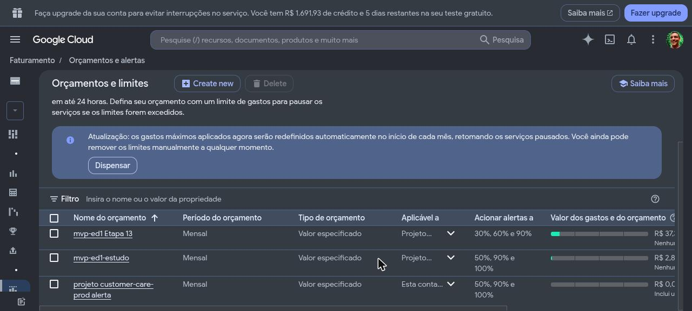
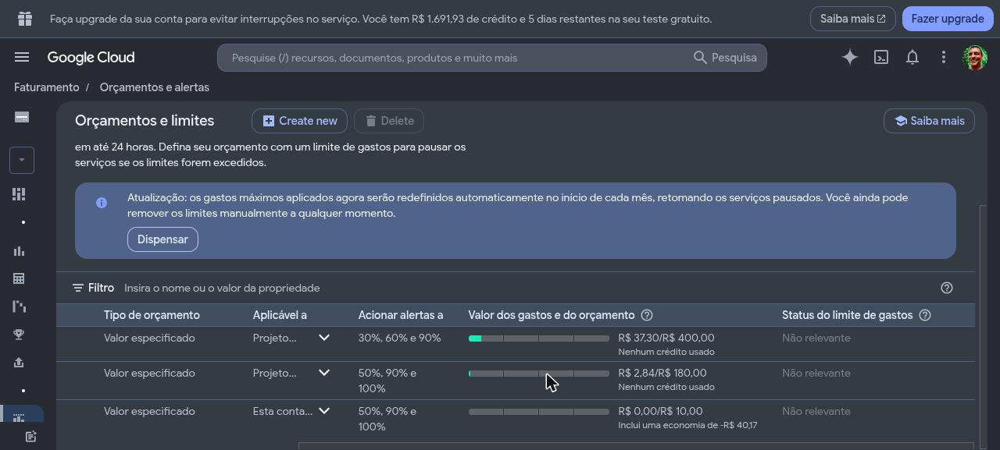
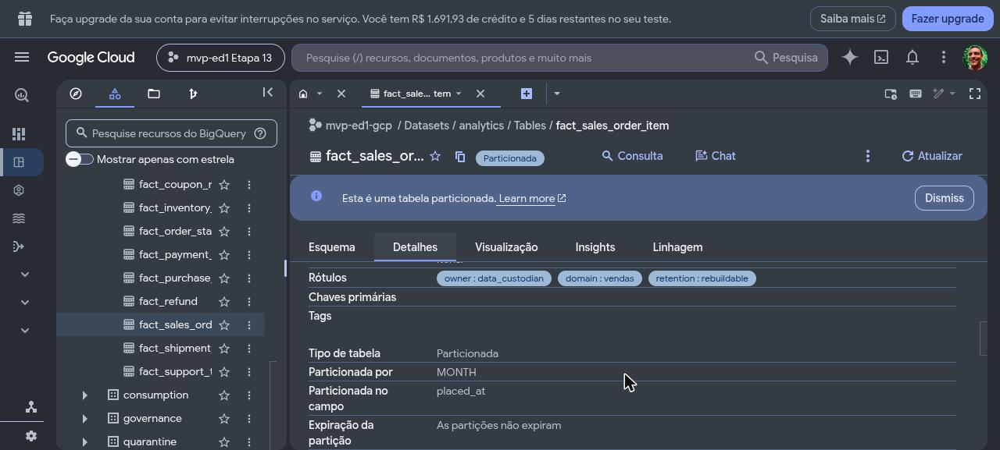
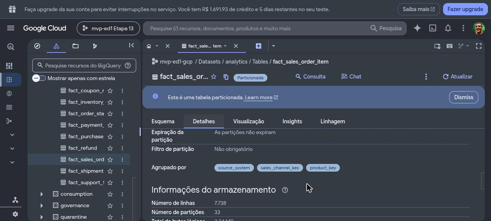
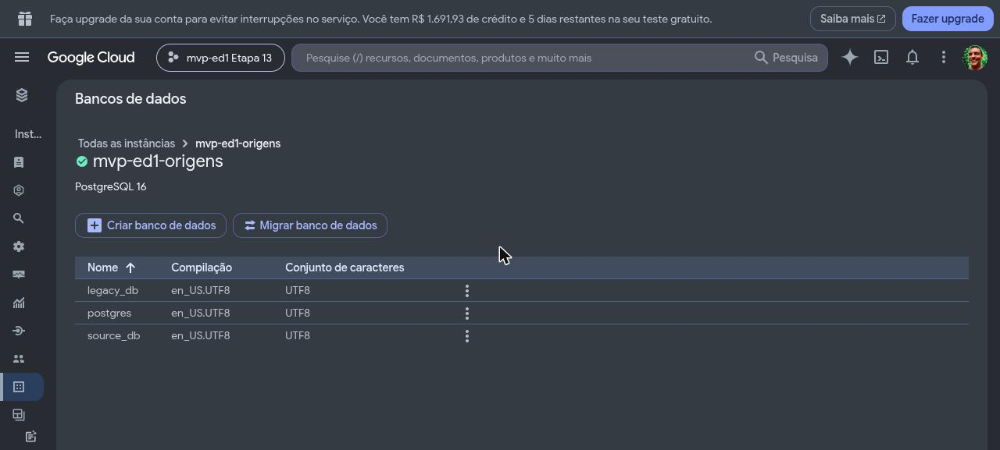
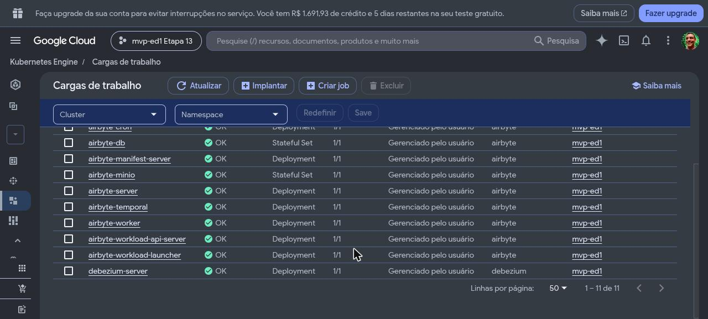

# Registro da fase GCP — o processo de construção da Etapa 13

> **O que vive aqui:** o diário de construção da fase GCP, em ordem cronológica — o que foi feito,
> com que comando, o que saiu, o que se decidiu, o que deu errado e como se resolveu, e quanto
> custou. A infraestrutura da Etapa 13 é **destruída** em 12/11/2026; o que sobrevive é o
> repositório, e este registro é a parte dele que conta como foi.
>
> **O que não vive aqui:** o plano e as suas regras (ver o plano transitório `PLANO_etapa_13.md`
> enquanto existir, e o [Plano de Desenvolvimento](plano_de_desenvolvimento.md#etapa-13--replicação-no-gcp-com-terraform--m6));
> as decisões (ver os [ADRs](adr/README.md) e as [Pendências §2](pendencias.md)); os números de
> custo e capacidade como referência (ver [Capacidade §2.6](capacidade_e_recuperacao.md#26-custo-da-janela-na-nuvem));
> o mapa de paridade (ver [Arquitetura §5](arquitetura.md#5-mapa-de-paridade-local--gcp)). Este
> registro conta a história e aponta para eles; não repete as regras.
>
> Rótulos: **[medido]** tem saída de comando ou página oficial por trás; **[estimado]** não.
> Horários em America/Sao_Paulo. O identificador da conta de faturamento aparece mascarado
> (`0199D3-…`); o projeto é `mvp-ed1-gcp`.

| Campo | Informação |
|---|---|
| Versão | 1.0 |
| Abertura | 06/11/2026 |
| Última revisão | 10/11/2026 — o Bloco A da revisão da governança, com a janela parada (§54) |

---

## 1. Como a etapa foi aberta (06/11/2026)

**A pergunta do Owner:** "Vamos iniciar a etapa 13? Me fale mais dos planos, e avalie se há algo a
mudar, revisar, enviar ao Codex ou enviar ao Gemini."

**O que existia:** a Etapa 13 era uma linha de tabela no plano de desenvolvimento, o mapa de
paridade, o ADR-0024 (Airbyte e Composer em janela curta), o ADR-0025 (*policy tags* por fluxo com
federação de identidade), um guia de estudo (`NAVEGANDO_GCP/`) e uma conversa de custos
(`CONVERSAS_COM_CHAT/ARQUITETURA_E_CUSTOS_GCP.md`). Nenhum Terraform da nuvem.

**A primeira leitura achou um furo no mapa:** a Arquitetura §5 dizia Datastream → Pub/Sub →
`ReadFromPubSub`; a página oficial de destinos do Datastream lista **só** BigQuery, Cloud Storage e
Iceberg. O capítulo 07 do guia de estudo já avisava; o mapa não tinha sido corrigido. Virou o
[ADR-0051](adr/0051-cdc-da-fase-gcp-pelo-debezium-server.md) (§3).

**O Gemini como parecerista:** havia um parecer dele, de 03/11, no `NAVEGANDO_GCP/` e um
`GEMINI.md`. Lidos, eram genéricos — nenhuma recomendação que mudasse o plano, sem o furo do
Datastream, e contando 48 ADRs quando havia 50. O `GEMINI.md` foi reduzido ao papel de
**verificador de fatos com URL oficial**, e o parecer foi arquivado em `CONVERSAS_COM_CHAT/gemini/`.

**Decisões do Owner na abertura:**

- autorizou a Etapa 13 (Termo v1.3 §11);
- a conta é a da **avaliação gratuita**, não convertida — "temos 7 dias para ter tudo ativado e
  desativado, e falhar nisso é falhar no projeto";
- **D68**: sem volume alto — a fase GCP roda no fator `dev` (a premissa estava no Termo §7 e nas
  consequências do ADR-0014 e do ADR-0016, emendados por nota);
- **escopo inteiro**, recusando o corte preventivo; revisões em rodadas com prazo.

**A conta, lida pelo `gcloud` e pela consola** [medido]: uma conta de faturamento compartilhada por
nove projetos; **R$ 1.740,37 de crédito e 9 dias restantes** em 06/11 (fim real ~15/11; o Owner
fixou 13/11 por prudência). Cota de 32 vCPUs em todas as regiões, sem aumento possível na avaliação.

## 2. O Gemini e a cota (06–07/11/2026)

O plano era usar o Gemini CLI para conferir fatos do GCP. O que aconteceu, na ordem:

1. `gemini -p` com as 15 perguntas de uma vez → **429 `RESOURCE_EXHAUSTED`** em todas as buscas:
   ele disparou as buscas em paralelo e estourou o limite.
2. Uma pergunta por chamada, em série, com pausa → 429 do mesmo jeito.
3. Troca de modelo (`gemini-3-pro-preview`, `gemini-3.1-pro-preview`, `gemini-flash-latest`) → 429.
   O "Login with Google" é recusado pela ferramenta nesta conta; só a chave de API funciona, no
   nível gratuito.
4. O Owner sugeriu `gemini-2.5-flash`. Testado direto na API REST: **"This model
   models/gemini-2.5-flash is no longer available to new users"** (404).
5. Teste isolado: chamada **sem** ferramenta funciona; o esgotado é a cota de **busca na web**
   (*grounding*), comum a todos os modelos.
6. **A saída:** a ferramenta `url_context` — o Gemini lê uma URL que se passa a ele — tem outra cota
   e funciona. Conferida com a página do Datastream: confirmou o furo do §1.

Daí o uso que ficou: o Claude Code indica a página oficial, o Gemini lê e cita o trecho. Foi assim
que os preços do §6 foram lidos.

## 3. A revisão do plano pelo Codex (06–07/11/2026)

O plano transitório `PLANO_etapa_13.md` foi revisado **antes de qualquer código**, como o da
Etapa 12. Três rodadas, cada uma com escopo fixo em *commits*:

| Rodada | Conta e esforço | Achados | O que pegou de mais importante |
|---|---|---|---|
| 1 | conta 1, `xhigh` | 11 (9 bloqueantes, 2 ajustes) | o desmonte dependia de passos que podem falhar; a conversão do dbt **não** era "a maior parte `::`" — só 4 a 8 de 106 modelos são *cast* puro, e 81 nascem dos geradores do legado; o catálogo analisa o SQL como PostgreSQL; o caminho quente depende de `on conflict … returning` e do *Producer* do Kafka; a DAG tem `/opt/mvp_ed1` fixo; *authorized views* e Secret Manager sem bloco |
| 2 | conta 2, `xhigh` | 5 (1 bloqueante, 3 ajustes, 1 observação) | transações do BigQuery que só acrescentam **rodam em paralelo** — a idempotência proposta não impedia dois lotes simultâneos de inserir o mesmo movimento; um *pool* regional do GKE teria 6 nós, não 2 |
| 3 | conta 1, `high`, só regressão | 0 | revisão encerrada; o G0 pode começar |

Depois da rodada 1, o Claude Code avaliou que fazer tudo bem feito até segunda era improvável e
ofereceu ao Owner uma janela parcial com segunda janela paga depois. **O Owner manteve o escopo
inteiro.** A consequência ficou escrita no plano: critério que não for provado deixa o M6
**incompleto, sem aceite e sem *tag***, e o desmonte acontece do mesmo jeito.

As decisões tomadas pelo Owner sobre a rodada 1 (07/11) estão nas
[Pendências §2](pendencias.md#d69-a-d74--decididas-em-07112026-na-revisão-do-plano-da-etapa-13):
D69 (Debezium Server → Pub/Sub, ADR-0051), D70 (retenção sem trava — travar põe *lien* no projeto),
D71 (o dbt aplica as *policy tags*, porque substituir tabela no BigQuery as apaga), D72 (Airbyte →
BigQuery sem chave), D73 (`us-central1`, Composer 3 com Airflow 3.2.2), D74 (projeto dedicado e
relógio de emergência).

**Perguntas do Owner no caminho, e as respostas:** qual é a referência GCP — é a de **paridade**
(o mapa), derivada da local; a referência nativa do GCP (Datastream, Workflows, Cloud Run) seria
uma terceira entrega, depois do M6, porque trocá-la agora seria reprojetar o protocolo do legado.
Em custo [estimado, conversa de 15/09], a nativa sairia ~10× mais barata ligada o mês inteiro
(~US$ 30–80 contra ~600–900) e mais leve de operar; a paridade é a que prova portabilidade.

## 4. Ferramentas e contas usadas

- **Codex CLI** `0.166.0`, modelo `gpt-6.1-sol`, duas contas ChatGPT (sem custo de API), sandbox
  com escrita só no `REVISAO.md` e rede para documentação oficial.
- **Gemini** pela API REST com `url_context` (o CLI sem busca não serve para fatos).
- **Terraform** `1.16.1` (`.tools/terraform`), *provider* `hashicorp/google` `~> 8.10`.
- **gcloud** com a conta do Owner; **ADC** de usuário (`authorized_user`), sem chave de conta de
  serviço.

## 5. G0 — fundação (07/11/2026)

**Projeto** [medido]:

```
$ gcloud projects create mvp-ed1-gcp --labels=projeto=mvp-ed1,etapa=13,desmontar-ate=2026-11-12
$ gcloud billing projects link mvp-ed1-gcp --billing-account=0199D3-…
billingEnabled: true
```

**As conferências do relógio de emergência, antes de qualquer recurso** [medido]: o Owner tem
`roles/billing.admin` na conta (pode desligar o faturamento do projeto); a lista de *liens* do
projeto veio vazia (`GET cloudresourcemanager v3 liens` → `{}`; o `gcloud alpha` não estava
instalado, e a API REST respondeu no lugar dele depois de ativada a `cloudresourcemanager`); cota
do projeto novo igual à da conta — `CPUS_ALL_REGIONS` 32, `E2_CPUS` 24 em `us-central1`,
`IN_USE_ADDRESSES` 8.

**ADC** — passo do Owner. Rodado como `! gcloud …` dentro da sessão, não criou o arquivo (o *login*
é interativo); num terminal à parte funcionou, seguido de
`gcloud auth application-default set-quota-project mvp-ed1-gcp`.

**A raiz do Terraform** (`terraform/`): uma raiz só, com um interruptor por degrau de preço
(`enable_cheap`, `enable_cloud_sql`, `enable_gke`, `enable_composer`) — desmontar um degrau é o
mesmo `apply` com o interruptor desligado, então a ordem do desmonte fica declarada. Estado local
(D74), `terraform.tfvars` e planos salvos fora do Git.

**Primeiro `plan` e primeiro `apply`** [medido], pelo rito do plano (§6.3: `plan -out`, leitura,
aprovação do Owner, `apply` do arquivo salvo):

```
Plan: 23 to add, 0 to change, 0 to destroy.     # 22 APIs + 1 orçamento
Apply complete! Resources: 23 added, 0 changed, 0 destroyed.
```

Dois cuidados que só apareceram escrevendo:

- **Os créditos escondem o gasto.** Com o padrão do orçamento, os créditos da avaliação entram no
  cálculo, o gasto líquido fica em zero e nenhum alerta dispara. O orçamento usa
  `credit_types_treatment = "EXCLUDE_ALL_CREDITS"`: teto de R$ 400 na moeda da conta, alertas em
  30, 60 e 90%.
- **O orçamento é da conta, não do projeto** — apagar o projeto não o remove. O `deletion_policy`
  do *provider* tem padrão `DELETE`, mas `ABANDON` ou `PREVENT` o deixariam para trás; ficou
  explícito.

## 6. Preços lidos para a estimativa (07/11/2026)

Lidos pelo Gemini nas páginas oficiais, com o trecho citado; os arquivos de resposta ficam fora do
Git, e os números entram na [Capacidade](capacidade_e_recuperacao.md#26-custo-da-janela-na-nuvem)
como estimativa antes do primeiro `apply` cobrável.

| Serviço | Preço lido | Página |
|---|---|---|
| Composer 3 | US$ 0,06 por DCU-hora; armazenamento do banco US$ 0,000232877/GiB-h; a taxa de ambiente está dentro do DCU | composer pricing |
| Composer 3, preset *small* | *scheduler* 0,5 vCPU/2,5 GB, *triggerer* 0,5/0,5, *DAG processor* 1/2, *web server* 1/2,5, *workers* 1/2 (2 a 4) | environment-scaling |
| GKE | US$ 0,10 por *cluster*-hora; crédito de US$ 74,40/mês por conta, que cobre um *cluster* zonal | kubernetes-engine/pricing |
| Cloud SQL Enterprise | US$ 0,0413 por vCPU-h; US$ 0,007 por GiB-h; SSD US$ 0,17/GiB-mês | sql/pricing |
| Dataflow *streaming* | US$ 0,069 por vCPU-h; US$ 0,003557 por GB-h; Streaming Engine US$ 0,018/GB; máquina padrão `n1-standard-2` | dataflow/pricing |
| Pub/Sub | 10 GiB/mês grátis, depois US$ 40/TiB | pubsub/pricing |
| BigQuery | 1 TiB de consulta e 10 GiB de armazenamento grátis por mês; US$ 6,25/TiB | bigquery/pricing |
| Rede | *forwarding rule* de LB interno US$ 0,025/h; Cloud NAT US$ 0,0014/h por VM | vpc/nat pricing |

**Dois buracos e como foram tapados.** A página de preço de VM carrega a tabela dinamicamente, e
nem o Gemini nem a leitura direta a viram; o preço da `e2-standard-4` saiu da **Cloud Billing
Catalog API**, a fonte oficial por SKU [medido]: E2 US$ 0,021812 por vCPU-h e US$ 0,002924 por
GiB-h; N1 US$ 0,031611 e US$ 0,004237; `pd-balanced` US$ 0,10/GiB-mês. E a conversão do Composer 3
em DCU não está escrita; o que a página traz é um **exemplo oficial** — 12 DCUs para um ambiente
em uso normal, 15 com mais *workers*, a US$ 0,06 —, lido do HTML baixado depois que o Gemini
esgotou também a cota de `url_context` (429, 07/11). A estimativa por serviço está na
[Capacidade §2.14](capacidade_e_recuperacao.md#214-a-estimativa-da-janela-da-etapa-13--07112026).

## 7. As evidências para o portfólio (07/11/2026)

O Owner, no meio do G0: "o produto que terei ao término deste projeto é o processo de construção,
visto que o produto em si construído será destruído" — e o objetivo é **comprovar que consegue
replicar uma estrutura local adequada na nuvem**, mostrando isso no portfólio por código, capturas,
documentos e páginas, em conteúdo humanamente interessante.

Daí três coisas: este registro passou a ser escrito **no momento**, não no fim; o plano ganhou um
roteiro de capturas com a frase que cada uma prova (19 capturas e 2 GIFs, a maioria na quarta, antes
do `destroy`); e o caso de portfólio será redigido aqui e publicado pelo Owner no portfólio depois
do M6. As capturas saem do Chrome do Owner, logado na consola, e ficam em
[`registro_fase_gcp/capturas/`](registro_fase_gcp/capturas/).

**A primeira captura** — o painel do projeto recém-criado; a faixa no alto é a própria consola
contando o crédito e os dias restantes da avaliação:


## 8. G1 — o dbt nos dois alvos, primeira metade (07/11/2026)

**O degrau barato** [medido], com a aprovação do Owner em cada `apply`: os nove *datasets* (plano
02) e uma conta de serviço por papel do ADR-0011, sem chave (plano 03).

**A carga de desenvolvimento** — o bruto local copiado para o BigQuery para o dbt ter o que
transformar antes do Airbyte do GKE: 79 tabelas, 712.861 linhas, `governance` como *fixture*. A
primeira versão usava `COPY … TO STDOUT` e quebrou numa tabela: o formato texto do `COPY` escapa
as barras invertidas, e o JSON chegava estragado ("Parser terminated before end of string"). Leitura
por cursor resolveu.

**O termômetro e o caminho** — `dbt run --target gcp --select staging`, rodada a rodada:

| Rodada | Resultado | O que destravou a seguinte |
|---|---|---|
| 1 | 1 de 78 | as fontes declaravam `database: warehouse_db`, que no BigQuery é o projeto → `target.database` |
| 2 | 1 de 78 | `distinct on` não existe no BigQuery → macro que vira `qualify row_number() … = 1` |
| 3 | 37 de 78 | o `+grants` traz papéis do PostgreSQL → macro que traduz `select` em `roles/bigquery.dataViewer` na conta do papel |
| 4–7 | 38 → 78 de 78 | o legado: o gerador continua escrevendo PostgreSQL, e o mesmo SQL é traduzido pelo `sqlglot`; o que ele não traduz (*substring* por padrão, `convert_from`, `split_part`, `at time zone`, `jsonb_*`) é traduzido na árvore sintática, com o motivo de cada regra |

**O oráculo que mantém o local intacto:** compilar o alvo local antes e depois de cada mudança e
comparar — **0 de 903 arquivos diferem**. O `make check` do lote: `dbt build` com PASS=907, 1079
testes Python. Dois tropeços do caminho, contados como foram: um *script* que inseriu uma linha de
`import` **dentro de uma string SQL** (procurava a última linha começando com `from` — e achou o
`from` de um SQL); corrigido pela árvore sintática do Python, e o `make check` pegou antes do
*commit*. E dois testes de frescor que comparavam o arquivo gerado com o SQL puro, ensinados a
esperar os dois corpos.

**Próximo:** a classificação do legado, escrita à mão para o BigQuery (recursão, JSON dinâmico,
`lateral`), e o oráculo **semântico** — o mesmo bruto nos dois alvos, a classificação comparada
linha a linha.

## 9. G1 — o dbt nos dois alvos, segunda metade (07/11/2026, madrugada)

**A classificação do legado, à mão.** O `sqlglot` traduz os 40 modelos de limpeza, mas não a
classificação: `jsonb_each_text`, `lateral`, `pg_input_is_valid` e o recursivo com `union` não têm
tradução mecânica. O corpo BigQuery foi escrito à mão (`legacy/classification_bigquery.sql`), a
mesma regra noutro dialeto, e o gerador o põe no lugar da tradução. O que o BigQuery recusou no
caminho, rodada a rodada: `NULLS LAST` em agregado ascendente (a ordem virou `x is null, x`), um
`not exists` sobre `union distinct` que ele não descorrelaciona (virou anti-junção). O recursivo:
o PostgreSQL termina em ciclo porque o `union` deduplica; o BigQuery só aceita `union all`, então a
profundidade é limitada em 64 e o modelo **recusa** se alguma ocorrência só aparece no limite — em
ciclo ela já apareceu antes, e a guarda não dispara.

**O oráculo semântico** [medido]: o mesmo bruto nos dois alvos, a classificação comparada linha a
linha por `(source_system, snapshot_id, source_table, legacy_row_id)` — **12.741 × 12.741 linhas,
0 divergências**, nos campos `classification`, `rejection_origin`, versão, impressão digital e na
lista ordenada de achados (código e coluna). Ferramenta: `python -m mvp_ed1.gcp.oraculo`.

**Os modelos escritos à mão.** O plano contava "~25"; eram 70 modelos, 4 *snapshots*, 34 testes
singulares e 15 macros. A técnica foi uma só: **macro com duas metades** (`macros/portavel.sql`) —
a `default__` emite o texto que o modelo já tinha, a `bigquery__` o equivalente. Uma passada
mecânica (`count(*) filter (where …)`, `extract(epoch …)`, `at time zone`, `timestamptz '…'`,
`x::tipo`) e o resto à mão. O que o BigQuery cobrou, e que nenhuma leitura da documentação teria
listado de antemão:

| Recusa do BigQuery | Saída |
|---|---|
| tipo parametrizado no `cast` (`numeric(12, 4)`) | `decimal_fixo`: `round(cast(x as numeric), 4)` — o mesmo arredondamento |
| `percentile_cont` só como janela | `mediana`: lista ordenada, interpolação em FLOAT64 como o `double` do PostgreSQL |
| `count(distinct (a, b))` sobre STRUCT | `contar_distintos`: o texto JSON da combinação |
| `except all` não existe | `diferenca_multiconjunto`: a linha como JSON e a ocorrência numerada |
| `varchar(n)` nos *seeds*, `timestamp with time zone` no contrato | o tipo escolhido por alvo no `.yml` |
| `100.0` é FLOAT64 e o contrato diz `numeric` | `cast(100.0 as numeric)`; `sum` de bigint é numeric lá e INT64 aqui |
| descrição de coluna com mais de 1.024 caracteres | cortada **só no BigQuery**, com a indicação do catálogo |
| `where` sem `from` | uma linha de `from` |
| `lateral` e `exists` com chave canônica correlacionada | junções sobre as chaves calculadas antes |

**O oráculo de compilação ficou mais fino.** Igualdade de texto não basta mais: `x::int` e
`cast(x as int)` são o mesmo SQL. O comparador (`python -m mvp_ed1.gcp.compilacao`) classifica
cada arquivo compilado do alvo local em **igual** (texto), **equivalente** (a mesma árvore no
`sqlglot`, sem comentários) ou **diferente** — e com `--rodar` executa os diferentes, antes e
depois, no armazém local, comparando linhas e tipos. Resultado [medido]: **858 iguais, 30
equivalentes, 11 diferentes na árvore e com o mesmo resultado no armazém** (`cast(100.0 as
numeric)` no lugar de `100.0`, por exemplo). O caminho local não mudou.

**Achado latente** (não corrigido, registrado): o membro desconhecido de `dim_support_agent` tem
`hired_at = date 'period_start'` numa coluna `timestamptz` — o PostgreSQL converte na meia-noite do
**fuso da sessão**. Local é UTC e o resultado é estável; noutro fuso mudaria. É a mesma classe do
RVL3-6-04. O `cast` explícito agora diz isso em voz alta; a decisão ficou para o Owner
([D76](pendencias.md#d76--o-membro-desconhecido-do-agente-é-contratado-à-meia-noite-de-são-paulo-decidida-em-07112026)) — decidida (a) na manhã seguinte (§11).

**A canonização no BigQuery** [medido]: a `bigquery__chave_canonica` rodou no BigQuery sobre as
mesmas formas que provam a do PostgreSQL (`tests/test_legado_remocao.py`: hexadecimal, octal,
binário, `_`, as fronteiras de cada domínio, cadeias de 131 mil caracteres) e devolveu o que o
`cast` do PostgreSQL devolve em **todas** — `GCP_TESTES=1 pytest tests/test_gcp_dialetos.py`,
12 testes, 16 s. Fica fora do `make check`: o projeto é destruído no fim da etapa.

**O build inteiro no BigQuery** [medido, 07/11/2026 ~04h20]: `dbt build --target gcp` —
**PASS=907, 0 erros**, o mesmo número do `make check` local: *seeds*, *snapshots*, os 9 schemas,
testes de dados, *unit tests* e contratos. Foram cinco *builds* até lá (`g1_build_01` a `05`):
2 erros, 3, 1, 3, 0 — cada um destravando os nós que o anterior pulava.

**A paridade das camadas** [medido]: `python -m mvp_ed1.gcp.oraculo contagens` — **277 de 278**
tabelas e views com a mesma contagem de linhas nos dois alvos. A única diferença é a quarentena
(84.843 × 2.855), e é de propósito: ela é destino permanente (ADR-0037) e guarda localmente 27
auditorias; recortada na captura e no tratamento correntes, dá **2.855** dos dois lados.

**Partição, *clustering* e *authorized views*** [medido]: as dez fatos reconstruídas com
`--full-refresh` (PASS=269), particionadas por mês e clusterizadas (por exemplo,
`fact_sales_order_item`: `placed_at`, `MONTH`, `[source_system, sales_channel_key,
product_key]`), e **16 views de `consumption` autorizadas** no *dataset* `analytics`.

## 10. Decisões da sessão autônoma (07/11/2026, madrugada) — para o Owner ler

O Owner autorizou seguir sozinho com as decisões que eu marcaria como recomendadas, desde que
anotadas. Nenhuma delas pede ADR; as que mexem em infraestrutura esperam a aprovação dele.

| # | Decisão | Por quê | Como desfazer |
|---|---|---|---|
| A1 | A classificação do legado tem corpo BigQuery **escrito à mão**, não traduzido | a tradução mecânica não existe para `lateral`, `jsonb_each_text` e recursivo com `union`; o oráculo semântico é a prova | apagar `classification_bigquery.sql`; o alvo `gcp` deixa de rodar `trusted` |
| A2 | A impressão digital do tratamento (D34) continua sendo a do **texto PostgreSQL**; o corpo BigQuery não entra nela | incluir mudaria a impressão local e criaria auditorias novas na quarentena sem o tratamento ter mudado; a equivalência é provada pelo oráculo | incluir o corpo BigQuery em `impressao_digital` |
| A3 | Oráculo de compilação em três níveis (igual, equivalente pela árvore, mesmo resultado no armazém) | `x::int` × `cast(x as int)` não muda nada e quebrava a igualdade de texto | — |
| A4 | Descrição de coluna acima de 1.024 caracteres é **cortada só no BigQuery**, com aviso | o limite é do BigQuery e derrubava quatro views; o texto inteiro fica no `.yml` e no catálogo | encurtar as quatro descrições na declaração |
| A5 | Fatos particionadas **por mês** pelo instante do evento; *clustering* pela origem e duas chaves de dimensão | ~24 meses e até 81 mil linhas: diária seriam centenas de partições minúsculas | trocar `granularity` no `dbt_project.yml` |
| A6 | Views de `consumption` autorizadas em `analytics`, `trusted` e `raw` (*authorized views*) | são os três que elas leem; sem isso o `analyst` precisaria ler `analytics` | tirar a entrada do `grant_access_to` |
| A7 | Os *unit tests* da remoção perdem o `payloads` do *fixture* | nenhum caso confere o payload, e o BigQuery não converte texto em JSON no *fixture* | — |
| A8 | Mediana no BigQuery pela lista ordenada, interpolada em FLOAT64 | é a conta do `percentile_cont` do PostgreSQL, que devolve `double`; o BigQuery só o tem como janela | — |
| A9 | **Plano 04 salvo, não aplicado**: o Owner pode personificar `mvp-analyst` e `mvp-auditor` (Token Creator) | é o que falta para provar "o analista lê `consumption` e é negado em `analytics`" sem chave | não aprovar; o vínculo some com o projeto |

**Para aprovar de manhã:** `data/medicoes/etapa_13/planos/04_personificacao.txt` (2 a adicionar, 0
a mudar, 0 a destruir). Depois do `apply`, a prova é uma consulta em cada *dataset* como
`mvp-analyst`. *(Aprovado pelo Owner às ~06h20 e aplicado — §11.)*

## 11. G1 fechado e o primeiro `apply` da manhã (07/11/2026, ~06h–07h)

A sessão anterior parou no limite de uso, no meio do `make check`; o vigia desligou o computador,
como combinado. Retomada por uma conta nova do Claude Code, lendo o `RETORNO.md` do vigia e a memória.
Antes de se ausentar, o Owner respondeu a quatro perguntas: **aplicar o plano 04**; **D76 = (a)**;
*commits* **sem *push***; depois do G1, **o G3 só em planos**, sem `apply`.

**O vigia rearmado.** O timer transitório some no *reboot*; recriado
(`systemd-run --user --unit=mvp-vigia`), agora olhando a transcrição da conta nova — o caminho da
transcrição virou variável do `vigia.sh`.

**O socket do Docker, de novo** (o R11 registrado na memória): o primeiro `docker ps` depois do
*boot* subiu Airbyte e Airflow juntos. `make airbyte-pause` antes do `make check`.

**Os patches deixados prontos**, aplicados em ordem: os testes que renderizam macros com Jinja puro
(a metade `default__` chamada pelo nome), o dialeto da derivação lido do *manifest* (G2.2), o
recorte da quarentena no oráculo de contagens, os alvos `gcp-*` no `Makefile`.

**O `make check` cobrou mais sete** [medido]: todas em `tests/test_vigencia_em_utc.py`, guardas que
leem o texto SQL procurando `at time zone 'UTC'`, `interval 'N days'` e literais `timestamptz` com
fuso — e o texto agora diz `{{ meia_noite(var("as_of_date")) }}`. A saída foi a mesma da guarda de
identidade: **renderizar** cada chamada pela metade local antes de ler. A chamada dentro de outra
expressão Jinja (``) vira a concatenação que o modelo tinha antes; o
corpo de `default__meia_noite` sai da leitura, e uma contraprova nova confere que o padrão dele é
`-03`. A contraprova das aspas voltou a achar os **14** literais e a acusar cada um sem o *offset*.
Segundo `make check`: **dbt PASS=907; pytest 1.088 passaram, 7 pulados; código de saída 0**.

***Commits*** (sem *push*): `1edb117` (classificação à mão), `ee8e31b` (modelos nos dois dialetos),
`921c52a` (oráculos), `f69c065` (catálogo no dialeto do alvo), `7b092c7` (alvos `gcp-*`), `a7d2e73`
(personificação).

**Plano 04 aplicado** [medido, 06:22]: `make gcp-apply NOME=04_personificacao` — 2 adicionados, 0
alterados, 0 destruídos, 9 s. A primeira tentativa de personificar, logo depois, recusou
(`iam.serviceAccounts.getAccessToken` negado): o IAM leva minutos para propagar. Cinco minutos depois:

| Leitura como… | `consumption` (view) | `analytics` | `trusted` | `quarantine` | `governance` | consulta (*job*) |
|---|---|---|---|---|---|---|
| `mvp-analyst` | **metadado lido** | negado | negado | negado | negado | negado |
| `mvp-auditor` | negado | negado | negado | **metadado e linhas lidos** | **negado** | negado |

Duas descobertas, as duas boas de achar agora e não na quarta:

1. **Nenhuma conta de papel roda consulta.** No BigQuery toda consulta é um *job* do projeto, e
   `bigquery.jobs.create` vem de `roles/bigquery.jobUser`, que ninguém tinha. No PostgreSQL não
   existe equivalente: a consulta é da sessão. A prova de que "o analista **lê** `consumption`"
   precisa do vínculo — entra no plano 05.
2. **O auditor é negado em `governance`**, que a declaração do dbt concede a ele (`grants` da fonte
   `governance`). No PostgreSQL quem concede o que fica acima do objeto — o `select` nas fontes, o
   `create` no schema — é o `on-run-end` (`aplicar_acesso_por_camada`), e ele só roda no alvo
   local. No BigQuery isso é IAM de *dataset*: Terraform. A lista sai **derivada** do mesmo
   *manifest*, não escrita de novo (§12).

Evidência: `data/medicoes/etapa_13/acesso/prova_02_sem_jobuser.txt`.

## 12. G3 em planos: o degrau barato e o Cloud SQL (07/11/2026, manhã)

O Owner autorizou o G3 **só em planos**: Terraform escrito, `plan -out` salvo, nenhum `apply`.

**O acesso por *dataset*, derivado.** `python -m mvp_ed1.gcp.acesso` lê o *manifest* do dbt —
`meta.writers` de cada camada e `grants` de cada fonte — e grava `terraform/acesso.auto.tfvars.json`,
que o Terraform carrega sozinho. Resultado [medido]: **13 concessões** — `dataEditor` a quem escreve
(o `transformer` nas seis camadas do pipeline, o `ingestor` em `raw`, `raw_legacy` e `governance`) e
`dataViewer` a quem lê as fontes (o `transformer` em `raw`, `raw_legacy` e `governance`; o `auditor`
em `governance` — a negação da §11). Uma concessão por tabela fica **pendente** e listada no próprio
arquivo: `raw.inventory_movements_stream` (`insert` e `select` do `streamer`), porque a tabela nasce
com o caminho quente e o IAM dela vai junto, no G2.3. O teste `tests/test_gcp_acesso.py` recusa o
arquivo que não for o que a declaração dá.

**Um recurso do provider que apagaria o trabalho do G1.** `google_bigquery_dataset_iam_member`
reescreve a lista de acesso do *dataset* e **remove as *authorized views*** que o dbt grava nela
(`grant_access_to`) — o aviso está na página do recurso. O `papeis.tf` usa
`google_bigquery_dataset_access`, que acrescenta uma entrada e não toca nas outras.

**Os planos** [medidos, 07/11/2026]:

| Plano | O quê | Criar / alterar / destruir | Custo |
|---|---|---|---|
| `05_barato` | 13 acessos por *dataset*; `jobUser` dos 5 papéis; *buckets* `livro` e `beam` com o IAM; 2 tópicos e 2 assinaturas com o IAM; VPC, sub-rede, faixa e conexão de serviços privados | **36 / 0 / 0** | centavos (Capacidade §2.14, linha do degrau barato) |
| `06_cloud_sql_revisao` | o 05 **mais** a instância, os 2 bancos, os 2 usuários, as 2 senhas e os 2 segredos | **47 / 0 / 0** | ~US$ 10 na janela (Capacidade §2.14) |

O 06 é **para revisão**: o `.tfplan` foi apagado, ficou só o texto. Aplicado por engano antes do 05,
ele ligaria o Cloud SQL dois dias cedo; depois do 05, fica obsoleto e é refeito na segunda
(`make gcp-plan NOME=06_cloud_sql VARS="enable_cloud_sql=true"`). `VARS` é novo no alvo: liga um
degrau só naquele plano, sem tocar no `terraform.tfvars`, e o plano salvo leva os valores dentro.

**Decisões da sessão** (continuação da tabela da §10):

| # | Decisão | Por quê | Como desfazer |
|---|---|---|---|
| A10 | As guardas de texto leem a metade local **renderizada** das macros de instante | é o SQL que o alvo local compila, o que elas sempre leram; regex por macro envelheceria a cada macro nova | — |
| A11 | Acesso por *dataset* **derivado** do *manifest*, não escrito no Terraform | uma declaração só (CLAUDE.md §5); a negação do auditor na §11 era exatamente essa lacuna | escrever a lista em `papeis.tf` |
| A12 | `bigquery.jobUser` para os **cinco** papéis | todos consultam, carregam ou fazem DML; sem ele ninguém roda nada | tirar do `for_each` quem não precisar, quando a prova da terça mostrar |
| A13 | Livro: `ingestor` com `objectCreator` + `objectViewer`; `auditor` com `objectViewer`; retenção **7 dias, sem trava** | `objectCreator` não substitui nem apaga: o "nunca substituído" do ADR-0050 também no IAM; 7 dias cobrem a janela; sem trava pela D70 | outro papel; `ledger_retention_seconds` |
| A14 | Tópicos com os **nomes do Kafka** local; o `streamer` publica e lê; assinaturas sem expiração | o Debezium Server publica em `<prefixo>.<schema>.<tabela>`, o nome que o conector já tem | — |
| A15 | Rede no **degrau barato**, faixas 10.10/20 (nós), 10.20/16 (*pods*), 10.30/20 (*services*), 10.40/20 (serviços privados) | não cobra por existir; o Cloud SQL de segunda e o GKE de terça a acham pronta | mudar as faixas antes do `apply` |
| A16 | Cloud SQL: **uma** instância PostgreSQL 16 com os dois bancos, `db-custom-2-7680`, zonal, sem *backup* e sem PITR, só IP privado, SSL obrigatório; usuários com `deletion_policy = ABANDON` | a versão da fase local; o tamanho da Capacidade §2.14; nada que sobreviva ao desmonte; usuário dono de objeto não sai por `DROP ROLE`, e quem o leva é a instância | outra versão ou *tier* no `cloud_sql.tf` |
| A17 | O 06 guardado **sem** `.tfplan` | evita ligar o degrau cobrável fora de hora | — |

**O que ficou para os blocos seguintes**, anotado onde vai ser feito: a concessão por tabela do
*stream* e o privilégio `REPLICATION` do usuário do Debezium no Cloud SQL (G2.3); quem lê os segredos
— o Composer e o Airbyte (G2.4, GKE); a retenção e a expiração dos *datasets* que o plano do G3 cita
(não declaradas ainda); SSL obrigatório pede `sslmode=require` nos conectores (G2.1, G2.3).

**Para aprovar:** `data/medicoes/etapa_13/planos/05_barato.txt` (36 / 0 / 0). Depois do `apply`, a
prova de acesso da §11 roda de novo (`data/medicoes/etapa_13/acesso/prova.py`), agora esperando o
analista **consultar** `consumption` e o auditor ler `governance`.

**Um *commit* que o portão não viu.** O `make check-offline` passou com o `cloud_sql.tf` ainda fora
do Git, e a revisão de segredos lê **só arquivos rastreados**: depois do *commit* `4a0b221`, ela
acusou o campo `secret_id` do segredo, escrito com o nome entre aspas — atribuição literal a uma
chave com `secret`. Não é
credencial (é o nome do segredo, e o valor nasce no `apply`), mas a regra é a certa e a correção foi
na declaração: o nome sai de um `local` montado por expressão. Lição para o resto da etapa: **`git
add` antes do portão**, não depois.

## 13. A D43 medida (07/11/2026, manhã)

O plano manda medir a guarda de identidade nas **três** noções de "mesma chave" antes de declarar
paridade (§2.3). `python -m mvp_ed1.gcp.identidades` renderiza as macros reais na metade de cada alvo
e roda, uma forma por consulta, as 115 formas que provam a canonização — um erro numa forma vira o
resultado dela, não derruba as outras. Duas rodadas (~5 min cada, ~460 consultas no BigQuery):

- **a primeira** contou como divergente a forma que os dois armazéns recusam (131.073 noves: o
  `numeric` do PostgreSQL e o `BIGNUMERIC` do BigQuery estouram, com mensagens diferentes). Recusa dos
  dois lados é o mesmo resultado; o comparador passou a dizer isso, com teste;
- **a segunda** [medido]: `chave_canonica` **115 de 115**; `identidade_canonica` **114 de 115**, e a
  que sobra é real — `' 8 '` **aborta a consulta no PostgreSQL** (o `\s` dele aceita espaço
  Unicode, o `numeric` não) e passa intacta no BigQuery. Defeito latente do caminho **local**, que o
  dado de hoje não exercita: virou a
  [D77](pendencias.md#d77--a-identidade_canonica-local-só-aceita-os-brancos-que-o-numeric-aceita-decidida-em-07112026),
  para o Owner.

Entre as noções: a identidade nunca junta o que a chave separa, e separa 241 dos 264 pares que a chave
junta. Os números e a tabela ficaram na própria D43
([Pendências](pendencias.md#d43--a-guarda-de-identidade-como-função-no-armazém-adiada-em-16092026)),
que continua do Owner. Evidência: `data/medicoes/etapa_13/d43/medicao_02.{txt,json}`.

## 14. G2.1, primeira peça: o livro retido no Cloud Storage (07/11/2026, manhã)

O livro (ADR-0050) era um diretório, e o "nunca substituído" era o `os.link`. Na nuvem,
`LEGACY_LEDGER_DIR=gs://<bucket>/<prefixo>`: `ledger.root()` devolve um `Lugar` do Cloud Storage
(`mvp_ed1.recovery.livro_gcs`), que imita do `pathlib` só o que os chamadores usam (`/`, `.name`,
`.parent`, `str()`), e as seis funções que tocam o meio despacham pelo tipo da raiz. Nenhum chamador
mudou — CLI, DAG, recuperação e oráculo da memória continuam passando a época adiante.

Três diferenças do meio, cada uma com o motivo no módulo: sem temporário nem `fsync` (o objeto aparece
inteiro ou não aparece); a época nasce com a linha de base, não vazia (o prefixo só existe com
objeto — e a época sem linha de base continua não contando); e **a prova de escrita não escreve**:
o `ingestor` tem `objectCreator`, que não apaga, e a retenção (D70) também não deixaria — um objeto
de prova ficaria para sempre. A prova é `testIamPermissions(storage.objects.create)`.

**Prova** [medido]: `tests/test_livro_gcs.py`, com um *bucket* em memória que responde `412` à
escrita condicionada repetida e `404` à leitura do que não existe — 6 testes, entre eles o mesmo
roteiro (abrir, publicar fora de ordem, recusar a repetição e os nomes inválidos, ler) rodado no
disco e no *bucket*, com o mesmo resultado. Os 174 testes do livro e dos chamadores, verdes. A prova
contra o Cloud Storage real está escrita (`GCP_TESTES=1`) e **espera o *bucket***: ele nasce no plano
05, que aguarda o Owner.

**O que falta do G2.1** (PLANO_etapa_13 G2.1): a leitura do bruto e do certificado no BigQuery
(`captura.py`, `capture_recovery.py`, as medidas do `ledger`); a escrita do certificado em *staging*
+ `MERGE`; os *locks* no Cloud SQL, separados do *insert*; o DDL da governança; a guarda de
identidade do `airbyte.py`; a época inicial no projeto novo.

## 15. G2.1, segunda peça: o DDL do `governance` no BigQuery (07/11/2026, manhã)

`governance.garantir_bigquery()` aplica no BigQuery as **mesmas** duas migrações, com os mesmos
nomes, e as registra no mesmo `_versions`: a lista diz, nos dois armazéns, quais valem. Sem
transação que envolva DDL no BigQuery, cada migração é idempotente por si e só entra em `_versions`
depois de todos os comandos dela.

O que o BigQuery não impõe, e para onde foi: o `check (status in …)` e a chave primária (lá,
`not enforced`) viraram **testes da fonte** — `accepted_values` no `status` e combinação única de
`(capture_attempt_id, source_table)` —, gerados pelo `make legacy-models` a partir das constantes
da `captura`, e por isso rodando **nos dois alvos**: a regra continua uma só. O índice virou
*clustering* pelas mesmas colunas.

**Prova** [medido]: `tests/test_governanca_bigquery.py` — as duas listas com os mesmos nomes na mesma
ordem; o `create table` dos dois dialetos lido pelo `sqlglot` com as mesmas colunas, tipos
equivalentes e nulidade; os testes da fonte com os mesmos vereditos do `check`. Com `GCP_TESTES=1`,
num *dataset* temporário apagado no fim: as migrações aplicam do zero, a segunda chamada não aplica
nada, *clustering* e ordem das colunas conferidos (4 testes, 16 s). Os testes novos da fonte passaram
no armazém local e no BigQuery (`dbt test --select source:governance.legacy_captures`).

O BigQuery cobrou, de novo, uma ordem que a documentação não grita: `default` vem **antes** de
`not null` na definição da coluna.

## 16. As decisões do Owner e o degrau barato inteiro (07/11/2026, ~11h30)

De volta, o Owner respondeu às quatro pendências da manhã: **aplicar o plano 05**; **contrato do
G2.1 aprovado como está**; **D77 = (a)**; ***push*** dos *commits* (`0246e88..2217ed5`, publicados).

**O `apply` do 05** [medido]: 36 / 0 / 0, como o plano; a conexão de serviços privados levou 1 min 4 s,
o resto segundos. Estado anterior guardado em `data/medicoes/etapa_13/planos/tfstate_05_barato.bak`.

**A prova de acesso, agora com consulta** [medido] (`data/medicoes/etapa_13/acesso/prova_*_pos05.txt`):

| Papel | Permitido | Negado |
|---|---|---|
| `mvp-analyst` | metadado da view de `consumption`; **consulta** nela (`count(*)` = 1.494) | metadado, linhas e consulta em `analytics`, `trusted`, `quarantine`, `governance` |
| `mvp-auditor` | metadado e linhas de `quarantine` e de `governance` | `consumption`, `analytics`, `trusted`; nenhuma consulta |

A consulta do analista passa pela *authorized view* (A6) sem que ele leia `analytics`: é a
separação do ADR de acesso, agora provada com *job*, não só com metadado.

**O livro no Cloud Storage real** [medido]: `GCP_TESTES=1 pytest tests/test_livro_gcs.py
tests/test_governanca_bigquery.py` — 11 passaram, no *bucket* `mvp-ed1-gcp-livro` (prefixo
`testes/<uuid>`). Os objetos de teste ficam sob a retenção sem trava da D70 e saem no desmonte.

**A D77 (a), implementada** [medido]: a classe `[ \t\n\v\f\r]` na metade PostgreSQL da
`identidade_canonica`; a paridade da identidade foi a **115 de 115** (`python -m
mvp_ed1.gcp.identidades`), e o caso do espaço Unicode entrou no teste do vínculo
([Pendências §2](pendencias.md#d77--a-identidade_canonica-local-só-aceita-os-brancos-que-o-numeric-aceita-decidida-em-07112026)).

## 17. G2.1, terceira peça: a captura com o certificado no BigQuery (07/11/2026, tarde)

O contrato do G2.1 aprovado pelo Owner virou código. O certificado e o bruto passam a poder morar
no BigQuery, e os *locks*, no PostgreSQL ao lado — no GCP, o Cloud SQL das origens. Na fase local nada
muda: quem chama continua passando um `Engine`, e os 177 testes da captura, da recuperação e do livro
passaram sem alteração.

**A forma** (`src/mvp_ed1/legacy/armazem.py`): `BigQuery(cliente, projeto, coordenador, local)` é o
armazém; o coordenador é o `Engine` do banco legado. `do_ambiente()` escolhe pelo `.env`
(`LEGACY_WAREHOUSE`, vazio ou `postgres` / `bigquery`), e os dois chamadores — `make sync-legacy` e as
cinco tarefas da DAG `fluxo_batch` que tocam o certificado — passam por ele, e a CLI do livro
(linha de base, registro do operador, tratamento) também. As leituras da
recuperação, do portão e da linha de base (`leitura`, `ledger`, `capture_recovery`) perguntam ao
módulo como se escreve o nome da tabela e o `sync_id`; o resto da consulta é o mesmo.

**O que cada DML garante no BigQuery:** o número de linhas que vale é o do *job*, não o da resposta.
Cada DML nasce com um id sorteado e com o reenvio automático do cliente desligado (`job_retry=None`);
se a resposta se perde, o *job* é procurado pelo id e esperado — **nunca reenviado**. Erro do *job*
(conflito de DML concorrente incluído) é "não gravou", e quem chama relê o certificado.

| Decisão | O que é | Por quê | Como reverter |
|---|---|---|---|
| A18 | A abertura grava as 40 linhas num **`MERGE` só, a partir de um parâmetro** `ARRAY<STRUCT>` (`on false … where not exists` da tentativa), e não numa tabela de passagem | uma instrução, tudo ou nada, sem tabela a criar e limpar; id repetido grava zero e falha, como o `insert` do PostgreSQL | trocar o `using` por uma tabela de passagem em `_iniciar_bigquery` |
| A19 | A publicação da fase 2 é **um `update … from unnest(...)`**, não uma transação multi-instrução | atômica por ser uma instrução; a guarda `pending` no `where`, como no PostgreSQL | — |
| A20 | Leituras "de um estado só" no BigQuery por **viagem no tempo** (`for system_time as of` o `current_timestamp()` do servidor) | é o `REPEATABLE READ` que o livro e a barreira pedem; o relógio é o do servidor, que não lê o futuro | — |
| A21 | O coordenador no GCP é o **próprio banco legado** no Cloud SQL | o contrato diz "o Cloud SQL das origens"; nenhuma conexão a mais | apontar `coordenador` para o banco de origem principal |

**Prova** [medido] (`data/medicoes/etapa_13/g21_armazem_real.txt`, 11 testes, 3 min 18 s): unidade com cliente simulado —
resposta perdida lê o *job* e não reenvia, conflito de id lê o existente, erro do *job* é "não
gravou", *job* que não termina para com erro em vez de fingir resultado. Com `GCP_TESTES=1`, contra o
BigQuery de verdade, certificado num *dataset* temporário e o lock no PostgreSQL local fazendo o papel
do Cloud SQL: o ciclo inteiro (abrir, id repetido recusado, registrar o *job* duas vezes, outro *job*
recusado, concluir, reenvio da fase 2 sem remedir); **duas aberturas concorrentes, uma abre e a outra
é recusada pela barreira**; a resposta da abertura perdida no meio — 40 linhas, nenhuma a mais; o
abandono só fora da carência.

**O que a prova cobrou:** sem a região, `get_job` responde "não encontrado" para um *job* em
`us-central1`, e a resposta perdida esperaria até o limite — o primeiro teste real ficou parado dez
minutos dentro do lock de abertura. A região agora vai em toda consulta e em toda busca de *job*.

**Fica para depois:** `medir_recebido` faz três leituras por tabela (120 *jobs*, ~2 min por
conclusão); juntar numa leitura por tabela é otimização, não correção. A época inicial no projeto
novo (`make ledger-baseline` com `LEGACY_WAREHOUSE=bigquery`) e a prova contra o Cloud SQL real ficam
para segunda, com o degrau 06.

## 18. G2.3 aberto: o tempo de evento no Pub/Sub (07/11/2026, tarde)

O leitor do Kafka local controla o *watermark* pelo `occurred_at` de cada evento
(`transport.py`, com a folga declarada). No Pub/Sub, quem dá o tempo de evento ao Dataflow é um
**atributo** da mensagem (`timestamp_attribute`); sem ele o tempo é o da publicação, e um evento do
*snapshot* de 2024, ou um movimento de ontem que chegou hoje, ficaria atrás do *watermark* e seria
descartado como atraso — o contrário do "evento atrasado corrige a janela" do Streaming §3.

**O que se conferiu** [medido, fontes oficiais]:

- A página do Debezium Server lista 21 propriedades `debezium.sink.pubsub.*`, nenhuma sobre
  atributos ([debezium-server](https://debezium.io/documentation/reference/stable/operations/debezium-server.html)).
  O Gemini, lendo a mesma página por `url_context`, citou **3** delas — e por isso a página foi lida
  direto também (`data/medicoes/etapa_13/revisao/gemini_debezium_pubsub_headers.txt`).
- O código do *sink* copia os **cabeçalhos** do registro para atributos
  (`pubsubMessage.putAllAttributes(resolveHeaders(…))`, desde a DBZ-6017, 2023); o ajuste que usa o
  cabeçalho cru quando os *schemas* de cabeçalho estão desligados (dbz#2783, 20/10/2026) entrou no
  **3.7.1.Final, publicado em 06/11/2026**.
- O `HeaderFrom` do Kafka Connect **não** aceita campo aninhado: o KIP-821 chegou ao `ExtractField` e
  a outros, não a ele (fonte do `HeaderFrom.java` em `trunk`, `4.1` e `3.9`). Com o envelope intacto,
  `after.occurred_at` não vira cabeçalho.

**A decisão do Owner** (D78, [Pendências §2](pendencias.md#d78--o-tempo-de-evento-do-caminho-quente-chega-ao-pubsub-como-atributo-decidida-em-07112026)):
achatar o envelope (`ExtractNewRecordState`, `add.fields=op,lsn`, *deletes* reescritos para que o
`envelope.py` continue recusando `u/d` pelo `__op`) e copiar `occurred_at` para cabeçalho pelo
`HeaderFrom`; Debezium Server **`3.7.1.Final`** por *digest*. Fica no mapa de paridade: local
`connect:3.6.2` com o envelope inteiro, GCP `server:3.7.1` achatado — o mesmo contrato do evento.

## 19. G2.3, o lado do Beam: Pub/Sub, a escrita da D75 e o Debezium Server gerado (07/11/2026, tarde)

O grafo da fase local é o mesmo; `pipeline.construir(..., nuvem=True)` troca três peças e só elas
(`src/mvp_ed1/streaming/nuvem.py`): a **leitura** pela assinatura `beam`, com o tempo de evento no
atributo `occurred_at` (D78); a **escrita** dos deltas no BigQuery; e o **alerta** no tópico do
Pub/Sub. A semente do saldo lê o BigQuery. O `envelope.py` aceita o envelope achatado e continua
recusando `u`/`d` — agora pelo `__op`, e um DELETE reescrito pelo `__deleted`.

**A D75, o mecanismo escolhido** (registrado aqui e no código; a garantia estava fixada, o meio não):

| Cláusula do contrato | Como se cumpre |
|---|---|
| (i) duas decisões de inserir a mesma chave não vencem as duas | cada evento vai a um fragmento fixo pelo `crc32` do `movement_id` (o `hash` do Python muda por interpretador); `GroupIntoBatches` é passo com estado por chave, e o Beam processa uma chave de cada vez — um escritor por fragmento |
| saber o que entrou sem `returning` | o lote é um `MERGE` só (inserir onde não casa), com o mesmo `_stream_extracted_at` em todas as linhas; o que entrou são as chaves do lote com esse instante, e tem de bater com as linhas afetadas pelo *job* — senão a escrita para |
| (ii) reexecução não alerta duas vezes | o lote reexecutado acha as linhas da primeira vez e não as devolve; erro do *job* (nada gravado) repete o mesmo `MERGE` até 3 vezes |
| (iii) resposta perdida | a DML passa pelo `armazem.BigQuery.dml` do G2.1: o *job* é achado pelo id, não reenviado |

| Decisão | O que é | Por quê | Como reverter |
|---|---|---|---|
| A22 | `_stream_partition` e `_stream_offset` **nulos** na nuvem | o Pub/Sub não tem partição nem posição; inventar um número seria procedência falsa | gravar o `message_id` numa coluna nova (catálogo e dicionário na mesma entrega) |
| A23 | `fragmentos_de_escrita: 4`, lote de 500, espera de 5 s | HIPÓTESE (P5): o volume `dev` cabe; calibrar na janela | `streaming/fluxo.yml`, seção `nuvem` |
| A24 | O Debezium Server **gerado** da declaração do conector local (`mvp_ed1.streaming.debezium_server` → `streaming/debezium_server/application.properties`, conferido por teste) | duas declarações do mesmo conector divergiriam | — |
| A25 | Tópico `mvp-heartbeat.mvp`, sem assinatura | o padrão `__debezium-heartbeat.mvp` começa com `_`, que o Pub/Sub recusa; sem *heartbeat* o slot segura WAL | — |

**Prova** [medido]: `tests/test_caminho_quente_nuvem.py` — unidade (envelope achatado, fragmento
estável, regra do lote com BigQuery simulado, grafo da nuvem montado, `application.properties` em
dia, tópico de *heartbeat* no Terraform) e, com `GCP_TESTES=1`, no BigQuery de verdade: lote com
duplicata grava uma vez e devolve só o que entrou; o mesmo lote de novo não devolve nada; `NUMERIC`
e microssegundos exatos do envelope ao destino; a mesma chave nova em dois lotes seguidos fica uma
vez; dois fragmentos em paralelo devolvem cada um o seu; a semente vê só o que veio antes (11
testes, 43 s).

**De ponta a ponta, antes do GKE** [medido] (`python -m mvp_ed1.gcp.prova_quente`,
`data/medicoes/etapa_13/g23/prova_quente.json`): o grafo da nuvem no executor local, contra o
Pub/Sub e o BigQuery de verdade, em tópicos, assinaturas e *dataset* **temporários** (a assinatura
`beam` do Terraform não foi tocada), apagados no fim. Um saldo de partida de 30 gravado antes de o
*pipeline* subir; publicados, no formato da D78, três movimentos ao vivo, uma duplicata no transporte
e um movimento oito minutos atrasado. Resultado: **cinco linhas no destino, a duplicata barrada, saldo
durável 23 e exatamente um alerta, abertura de 29 para 23** — o atrasado entrou primeiro no saldo e a
janela dos três ao vivo cruzou o limiar.

**O que a prova cobrou: a D62.** A primeira rodada gravou certo e **não alertou**. Com escutas em cada
estágio, a semente veio com 23 — os três movimentos que a própria execução já tinha gravado: o
`setup` do acumulador só roda quando chega o primeiro painel, e o corte da semente era o instante
dele. É a D62, pendente desde 04/10/2026 e aceita só na fase local; aqui ela derrubava o critério
"alerta observado". O Owner a decidiu na hora — opção (a), o corte no instante em que o *pipeline* é
construído ([Pendências §2](pendencias.md#d62--a-semente-do-saldo-do-alerta-corta-no-instante-em-que-o-pipeline-é-construído-decidida-em-07112026)) —,
e a segunda rodada alertou. A correção vale nas duas fases; **a prova local da D62** (o caminho quente
local, `make stream-*`) **fica pendente** até rodar na máquina.

**O executor local não é o Dataflow** em uma coisa que importa aqui: ele segura o *watermark* do
Pub/Sub no relógio de parede (`transform_evaluator.py`, "TODO: correct value for watermark hold"), e
por isso os painéis da rodada com escutas saíram como atrasados. Com 20 minutos de atraso tolerado, isso não perde evento; a
semântica do *watermark* pelo atributo é do Dataflow e se confere na janela.

## 20. O tópico de *heartbeat* aplicado e o acesso ao Cloud SQL (07/11/2026, tarde)

**Plano 07** [medido]: `07_heartbeat`, 2 / 0 / 0 — o tópico `mvp-heartbeat.mvp` (A25) e a permissão
do `streamer` de publicar nele —, aprovado pelo Owner e aplicado.

**A lacuna:** o Cloud SQL do degrau 06 nascia só com IP privado (A16), e desta máquina não se
chegava a ele — nem o gerador que povoa as origens, nem as provas do G2.1 contra o Cloud SQL real.
Opções postas ao Owner: IPv4 público só pelo Auth Proxy; uma VM bastião com túnel IAP (componente
novo, ADR e mais um passo no desmonte); ou rodar tudo de dentro do GKE (o G2.1 real e a carga das
origens escorregariam para terça).

| Decisão | O que é | Por quê | Como reverter |
|---|---|---|---|
| A16, revista pelo Owner | Cloud SQL com IP privado **e** IPv4 público **sem nenhuma rede autorizada**: só o Cloud SQL Auth Proxy entra, por TLS e IAM | GKE e Composer seguem pelo IP privado; esta máquina entra pelo proxy, sem VM nova; o IPv4 custa ~US$ 0,005/h | `ipv4_enabled = false` no `cloud_sql.tf` |
| A26 | Proxy `v2.26.3` (22/10/2026) em `.tools/`, baixado por `make tools` e conferido pela soma SHA-256 das notas da versão; `make gcp-sql-proxy` o abre em `127.0.0.1:15432` | o mesmo regime do Terraform e do `abctl`; a `v2.27.0` tem nove dias | trocar a versão e a soma no `Makefile` |

O plano do degrau 06 foi refeito com a mudança (`06_cloud_sql_revisao.txt`, só texto, como pede a
A17): **11 / 0 / 0** — a instância, os dois bancos, as duas senhas, os dois usuários e os dois
segredos com suas versões; os 36 que o somavam aos 47 da §12 já são do degrau barato aplicado.
Para segunda, antes do primeiro *snapshot*: o atributo `REPLICATION` do usuário da origem que o
Debezium Server usa.

## 21. G3 em planos: o GKE, os *releases* do Helm e o destino BigQuery do Airbyte (07/11/2026, tarde)

O degrau médio escrito e planejado, **sem `apply`** (terça, no rito). Três peças:

- **`terraform/gke.tf`** — *cluster* Standard zonal, *pool* de 2 × `e2-standard-4` (D73), nós
  privados com saída pelo Cloud NAT (as imagens vêm do quay.io e do Docker Hub), Workload Identity
  ligando `airbyte/airbyte-admin` a `mvp-ingestor` e `debezium/debezium-server` a `mvp-streamer`,
  e uma conta própria dos nós só com log e métrica (a padrão do Compute Engine é Editor).
- **`terraform/aplicacoes_gke.tf`** — o Airbyte pelo chart `2.3.0` (o mesmo do
  `AIRBYTE_CHART_VERSION`) e o Debezium Server por um chart local (`terraform/charts/debezium-server`),
  que monta o `application.properties` **gerado** (§19) num ConfigMap, os *offsets* num PVC e a
  senha da origem num Secret.
- **`airbyte/`** — a mesma declaração da ingestão, com `armazem = "bigquery"`: destino BigQuery por
  *Batched Standard Inserts*, sem `credentials_json` (D72), e as origens com SSL exigido.

**Fatos conferidos antes de escrever** [medido, fontes oficiais, 07/11/2026]:

| Fato | Fonte | Efeito |
|---|---|---|
| O chart `airbyte` `2.3.0` está em `https://airbytehq.github.io/charts` (o repositório do `abctl` v0.30.4) | `index.yaml` do repositório; *digest* `24be848e…` | `helm_release` com a versão fixada |
| Os *pods* de *job* rodam com `JOB_KUBE_SERVICEACCOUNT` = `global.serviceAccountName` (`airbyte-admin`), e a conta aceita anotações | `templates/config/_jobs.tpl`, `values.yaml` do chart | uma anotação `iam.gke.io/gcp-service-account` dá aos conectores a identidade do `mvp-ingestor` |
| O destino BigQuery usa as credenciais padrão quando `credentials_json` fica vazio; o método por GCS exige HMAC | `oss_registry.json`, `destination-bigquery` 3.1.0 | a D72 cabe sem chave; a prova é da terça (P3) |
| Com `global.auth.enabled`, o *bootloader* gera as credenciais no Secret `airbyte-auth-secrets` — é o que o `abctl` liga | `internal/helm/airbyte_values.go` do `abctl` v0.30.4; `_auth.tpl` do chart | sem segredo a criar à mão; o `mvp_ed1.airbyte` autentica como no local |
| O Debezium Server roda como `jboss` (uid 185), com `/debezium/config` e `/debezium/data` e saúde em `:8080/q/health` | `server/3.7/Dockerfile` das imagens oficiais; página do Debezium Server | `fsGroup: 185`; sondas em `/q/health/ready` e `/live` (subcaminhos do SmallRye, **a conferir de pé**) |
| Imagem `quay.io/debezium/server:3.7.1.Final` | API do quay.io: `sha256:8e103635…` | fixada por *digest* no chart |

| Decisão | O que é | Por quê | Como reverter |
|---|---|---|---|
| A27 | Os *releases* atrás de um interruptor próprio, `enable_gke_apps`, num `apply` depois do do *cluster* | o provider do Helm se conecta ao *cluster* para planejar; nascendo no mesmo `apply`, o endereço não existe na hora do plano | — |
| A28 | Debezium Server por **chart local**, e não por *manifests* soltos nem pelo Operator | o plano diz "por `helm_release`"; o Operator seria componente novo | — |
| A29 | Armazenamento do Airbyte no GKE pelo **MinIO** do chart, não o `local` do `abctl` | o `local` monta um disco compartilhado por *pods* de nós diferentes, que dois nós não dão | `global.storage.type` em `terraform/helm/airbyte_gke.yaml` |
| A30 | Plano de controle com *endpoint* público, autenticado pelo IAM | é por ele que o Helm e o `kubectl` desta máquina chegam; restringir a um IP dinâmico quebraria no meio da janela | `master_authorized_networks_config` |
| A31 | Estado da configuração do Airbyte na nuvem num *workspace* `gcp` da raiz `airbyte/` | a mesma declaração, estados separados: nada do local é tocado | — |

**Planos** [medido]: `08_gke` (só o *cluster*, `enable_gke=true`) — **11 / 0 / 0**, guardado só como
texto (A17). O dos *releases* só se faz com o *cluster* de pé.

**A conferir** (não medido): o plano da raiz `airbyte/` contra o Airbyte local mostrando nada a
mudar — os endereços do estado são os mesmos, mas a prova pede a API local de pé, e ela está pausada;
o alvo do Makefile que aplica a raiz `airbyte/` no *workspace* `gcp` por `kubectl port-forward`, que
nasce com o *cluster*.

**Renderizado** [medido]: o Helm `v3.22.1` (a linha do provider do Terraform) entrou no `make tools`,
fixado pela soma SHA-256 — o desmonte da §6.5 usa `helm uninstall`. O chart local passa no
`helm lint` e renderiza conta, ConfigMap com o `application.properties` gerado, Secret, PVC e
Deployment. O do Airbyte, com os valores do projeto: `AIRBYTE_URL`, `STORAGE_TYPE=minio`,
`JOB_KUBE_SERVICEACCOUNT=airbyte-admin` e a anotação `iam.gke.io/gcp-service-account` na conta. Um
cuidado que o *template* mostrou: a `airbyte-admin` nasce como *hook* `pre-install`, e uma anotação
mudada depois **não** chega a ela por `upgrade` — tem de estar certa no primeiro `apply`.

## 22. G4: as *policy tags* (07/11/2026, noite)

**Decidido pelo Owner** (D79, [Pendências §2](pendencias.md#d79--as-policy-tags-quais-níveis-quem-cria-quem-lê-quando-o-fluxo-roda-decidida-em-07112026)):
só `confidential` e `personal` com controle ligado; o Terraform cria taxonomia, *tags* e leitura;
os cinco papéis e o Owner leem, `mvp-prova-sem-leitura` prova a negação; o fluxo só roda na janela.

**Fatos conferidos** [medido, fontes oficiais, 07/11/2026]:

| Fato | Fonte | Efeito |
|---|---|---|
| As *tags* do dbt só valem com `persist_docs` de coluna ligado | [dbt — BigQuery configs](https://docs.getdbt.com/reference/resource-configs/bigquery-configs) | já ligado no projeto (G1.4) |
| O `update_columns` do dbt-bigquery grava `policyTags` de **toda** coluna documentada — vazio sem `policy_tags` | `dbt/adapters/bigquery/impl.py`, `_update_column_dict` | a *tag* é derivada na macro que o projeto já sobrepõe (`descricao_no_bigquery.sql`), sem escrever `policy_tags` em 4.161 colunas |
| A *view* — autorizada ou não — carrega o controle das colunas que lê | [column-level-security-intro](https://docs.cloud.google.com/bigquery/docs/column-level-security-intro), "Query views" | o `analyst` precisa da leitura fina para as views de `consumption`; *view* não leva *tag* |
| Vincular *tag* pede `datacatalog.taxonomies.get` e `bigquery.tables.setCategory`; o segundo está no Data Owner, **não** no Data Editor | [column-level-security](https://docs.cloud.google.com/bigquery/docs/column-level-security), "Set policy tags on columns" | papel próprio `mvpVincularPolicyTags` nos *datasets* do `transformer` e do fluxo; `mvpLerTaxonomia` no projeto |
| As sete permissões dos dois papéis existem e aceitam papel próprio | `permissions:queryTestablePermissions` no projeto | o `apply` não para em permissão inexistente |

**O que foi escrito:**

- `terraform/politicas.tf` — taxonomia (`FINE_GRAINED_ACCESS_CONTROL`), as duas *tags*, a leitura
  fina de cada uma para os cinco papéis e o Owner, a conta da prova, a federação de identidade do
  GitHub (condição: este repositório e a `main`) e a conta do fluxo, que vincula *tag* e não lê dado.
- `dbt/macros/descricao_no_bigquery.sql` — a *tag* de cada coluna de **tabela** derivada de
  `meta.sensitivity` pelo mapa `MVP_POLICY_TAGS` (a saída `policy_tags`, que o `make gcp-dbt-build`
  passa); sem o mapa, nada é marcado.
- `src/mvp_ed1/gcp/politicas.py` — `convergir` (só as fontes: `raw`, `raw_legacy`, `governance`) e
  `inventario` (tudo, sem escrever; falha com qualquer divergência ou coluna sem classificação).
  Na classificação de hoje: 226 tabelas (147 do dbt, 79 fontes) e 355 colunas a marcar.
- `.github/workflows/policy-tags.yml` — o fluxo do ADR-0025, com as *actions* fixadas por *commit*.
- `src/mvp_ed1/gcp/prova_tags.py` — a negação: `count(*)` e a soma de `net_revenue_amount`
  (`confidential`) numa view de `consumption`, pelas duas contas, e os registros de auditoria.

**Plano** [medido]: `09_politicas` — **36 / 0 / 0**, sem custo (taxonomia, IAM e federação não
cobram), aprovado pelo Owner e aplicado.

**A prova** [medido, 07/11/2026, `data/medicoes/etapa_13/g4/`]:

| Passo | Resultado |
|---|---|
| O fluxo do ADR-0025 no GitHub Actions, disparado pelo *push* com as variáveis do repositório ligadas (aprovado pelo Owner) | autenticou pela federação, **sem chave**; convergiu as **79 tabelas de fonte** — 1.178 colunas, 88 marcadas, nenhuma ausente, nenhuma sem classificação — em 1 min 5 s ([execução 42398859752](https://github.com/alencardoug/mvp_eng_dados_1/actions/runs/42398859752)) |
| `make gcp-dbt-build` com o mapa das *tags* | **PASS=909, 0 erros** — o mesmo número do local; vale também como a repetição do P2 |
| Inventário depois da carga | **226 tabelas, 3.516 colunas, 355 marcadas; 0 divergentes, 0 sem classificação, 0 ausentes** |
| *Rebuild*: `--full-refresh` de `fact_sales_order_item` e `fact_inventory_movement` (PASS=39) e o inventário de novo | **0 divergentes**: o `create or replace` apaga as *tags*, e o dbt as devolve no mesmo *build* (D71) |
| Negação (`prova_tags`), na view `monthly_revenue_by_channel_and_category` | `analyst`: contagem e `sum(net_revenue_amount)` **permitidas**; `mvp-prova-sem-leitura`: contagem permitida, coluna marcada **negada** — *"User has neither fine-grained reader nor masked get permission to get data protected by policy tag"* |
| Auditoria das duas | 34 registros do BigQuery; os dois da conta de prova na consulta negada com o código 7 (`PERMISSION_DENIED`) e a mesma mensagem |
| Chaves de conta de serviço | **0 `USER_MANAGED`** em 8 contas; uma `SYSTEM_MANAGED` em cada, por desenho |

**Falta repetir o inventário** depois de **uma nova sincronização** (o Airbyte no GKE, terça — a
DAG converge as fontes logo depois dela) e de **uma reclassificação** (mudar o nível de uma coluna no
YAML, deixar o fluxo e o dbt agirem e inventariar). O desmonte ganhou o passo de desligar o fluxo
(`MVP_GCP_ATIVO=false`, PLANO §6.5 passo 1).

## 23. G5: catálogo e linhagem (07/11/2026, noite)

**Decidido pelo Owner** (D80, [Pendências §2](pendencias.md#d80--a-linhagem-por-coluna-é-a-nativa-do-bigquery-o-metadado-vai-em-labels-decidida-em-07112026)),
sobre o que a documentação e a API mostraram antes de qualquer código:

| Fato | Fonte | Efeito |
|---|---|---|
| Evento OpenLineage customizado **não** leva linhagem por coluna | [about-data-lineage](https://docs.cloud.google.com/dataplex/docs/about-data-lineage), "Column-level lineage limitations"; [openlineage-mapping](https://docs.cloud.google.com/knowledge-catalog/docs/openlineage-mapping) | publicar as arestas do módulo daria só linhagem por tabela |
| O BigQuery já registrou a linhagem **por coluna** dos *jobs* do dbt de hoje — `CREATE TABLE AS SELECT`, `CREATE VIEW` — com o tipo de cada dependência | `searchLinks` com `field`, em 07/11/2026 | por coluna, a nativa; o módulo vira a régua |
| Não se coleta linhagem por coluna de *job* com mais de 1.500 ligações de coluna; ela aparece em até 24 h e fica 30 dias | mesma página | as ausências se explicam por isso (abaixo) |
| O `searchLinks` aceita até 20 colunas da mesma tabela por consulta (`targets.entities`); uma por coluna estoura a cota (429) | documento de descoberta da API; medido | a paridade consulta por relação, com espera no 429 |
| O *endpoint* OpenLineage recusa o espaço de nomes do Cloud SQL ("Unrecognized input"); o evento nativo aceita o FQN `cloudsql_postgresql:` | medido | as travessias vão pela API nativa (processo, execução, evento) |

**A paridade** [medido, `data/medicoes/etapa_13/g5/paridade.json` e `paridade_por_relacao.json`]:
das **4.982** arestas de valor que o módulo deriva do SQL (2.772 colunas), **4.399 estão na captura
nativa (88,3 %)**; as **583** que faltam vêm de **duas** relações só, e nelas a nativa não tem
**nenhuma** aresta por coluna, embora tenha a por tabela: `trusted.legacy_presence_by_capture` (536
arestas no módulo; a união das 40 tabelas do legado; 42 arestas por tabela na nativa) e
`analytics.fact_shipment_item` (47; 10 por tabela) — o limite de 1.500 ligações por *job*. Em todas
as outras relações, **100 %** das arestas do módulo estão na nativa. A nativa é mais larga, como
esperado: 14.637 arestas a mais, quase todas `OTHER` (*join* e filtro), que o módulo não conta como
origem do valor. Nessas duas, a linhagem por coluna fica no Dicionário §3, não na nuvem.

**As travessias** [medido, `travessias.json`]: **79 de 79** publicadas — uma por tabela extraída pelo
Airbyte (36 + 40), o certificado de captura, o Debezium Server (`oltp.inventory_movements` → tópico
do Pub/Sub) e o Beam (tópico → `raw.inventory_movements_stream`).

**Uma coluna de `consumption` até a origem** [medido, `caminho_ate_a_origem.txt`]: o valor de
`monthly_revenue_by_channel_and_category.net_revenue_amount` ← `fact_sales_order_item` ←
`trusted.order_items` ← `stg_retail__order_items` ← `raw.order_items`, cada salto uma aresta do módulo
**presente na nativa**; e `raw.order_items` ← `cloudsql_postgresql:…mvp-ed1-origens.<banco>.oltp.order_items`,
a travessia publicada. A captura de tela da mesma cadeia na consola fica para a janela, com o Cloud
SQL de pé.

**O metadado** [medido]: `domain`, `owner` e `retention` como *labels*, por um *post-hook* do dbt
(`rotulos_no_bigquery.sql`) que os lê do `meta` — `analytics.dim_brand`: `domain=catalogo`,
`owner=data_custodian`, `retention=rebuildable`; a view `monthly_revenue_by_channel_and_category`:
`domain=vendas`. As descrições já iam pelo `persist_docs` (G1.4). Os *labels* das demais relações
entram no próximo `gcp-dbt-build`.


## 24. G2.4: a DAG no layout do Composer (07/11/2026, noite)

**O que a imagem traz** [medido, lista de pacotes de `composer-3-airflow-3.2.2-build.9` em
[versions-packages](https://docs.cloud.google.com/composer/docs/versions-packages), lida em 07/11]:
Python 3.11.8; **`dbt-core 1.13.0b1`** — um *beta* — e `dbt-bigquery 1.12.1`; `google-api-core
2.42.0`, **dentro** da faixa do problema conhecido das [*release notes*](https://docs.cloud.google.com/composer/docs/release-notes)
de 30/10/2026 (2.28.0 a 2.43.0 com Python 3.11; a correção indicada é `>=2.43.1`); SQLAlchemy
2.0.54, psycopg 3.3.6, PyYAML 6.0.3, `google-cloud-storage` 3.1.1, `google-cloud-bigquery` 3.46.1 —
estes dentro das faixas do `pyproject`. Os pacotes do ambiente são, por isso, só três, em
`airflow/requirements-composer.txt`: `dbt-core==1.12.3`, `dbt-bigquery==1.12.2` (as do P2) e
`google-api-core==2.44.0` (a do `uv.lock`). Antes de qualquer imagem, `uv pip compile` das três **com
os outros 445 pacotes da imagem fixos** (o Airflow pela versão do PyPI, sem o `+composer`) resolveu
sem trocar nenhum: nada da imagem exige o `dbt-core` 1.13 [medido, `g2_4/pacotes_da_imagem_build9.txt`
e `g2_4/resolucao_com_a_imagem.txt`].

| # | Escolha de implementação | Por quê | Onde |
|---|---|---|---|
| A32 | `MVP_PROJECT_DIR` lido pelo `bash` na hora da tarefa, sem valor padrão | sem a variável a tarefa diz qual falta, e a DAG continua importável; um padrão esconderia o erro de configuração no Composer | `fluxo_batch.py` (`DBT`); `docker-compose.airflow.yml` |
| A33 | *Target* e *logs* do dbt num `mktemp -d` **por tarefa**, apagado no fim; `dbt/` montado somente leitura também no local | a pasta `data/` do Composer é um sistema de arquivos sobre o GCS; o log da tarefa guarda a saída do dbt. Custo aceito: *parse* inteiro a cada tarefa, e o `catalog.json` da tarefa `dbt_docs` some com ela (o `make docs-serve` gera o seu) | idem |
| A34 | O layout é uma declaração (`mvp_ed1.gcp.composer.LAYOUT`): a DAG e o pacote em `dags/`, com um `.airflowignore` que tira o pacote da varredura; o dbt com os pacotes instalados e o glossário em `data/` | é o mesmo que a prova monta e que a janela copia para o *bucket*; o glossário fica ao lado do dbt porque os `docs-paths` o leem por `../docs/` | `src/mvp_ed1/gcp/composer.py` |
| A35 | A prova roda na **imagem do Composer**, pelo *digest*, como o usuário `airflow` dela, e não numa `apache/airflow` com as mesmas versões | a lista de pacotes que importa é a da imagem; a ferramenta `composer-dev` subiria o ambiente inteiro (R11) para provar o mesmo | `make gcp-composer-prova` |

**A prova** [medido, `data/medicoes/etapa_13/g2_4/prova_composer.json`; `make gcp-composer-prova`]:
na imagem `…airflow-worker-scheduler-3-2-2@sha256:96e0cc94…` (11 GB; a primeira descarga caiu por
*connection reset* e a segunda completou), com o layout montado somente leitura em
`/home/airflow/gcs` e os três pacotes instalados por cima: `pip check` sem conflito; o pacote
importado de `dags/mvp_ed1`; o `DagBag` do Airflow 3.2.2+composer leu **só** `dags/fluxo_batch.py`, sem
erro, com as **15** tarefas, em 2,0 s; e o comando **da própria tarefa** `dbt_staging`, renderizado
com o `legacy_snapshot_id` 67 (a captura certificada mais recente no BigQuery), rodou contra o
BigQuery: **PASS=455, ERROR=0**, 292 s, nenhum temporário deixado e nada escrito em `data/`. (Duas
rodadas, iguais; a segunda depois de a ADC passar a entrar pelo caminho padrão do gcloud no
contêiner, em vez de uma variável que a revisão de segredos acusava.)
**No Airflow local**, recriado pelo `make airflow-up`: `MVP_PROJECT_DIR` presente, `dbt/` recusando
escrita, nenhum erro de importação, e o prefixo `DBT` da DAG rodando `dbt parse` com código 0.

**Fica para o Composer de verdade:** *Connections* e *Variables* pelo *backend* do Secret Manager e
a rede até o Cloud SQL e a API do Airbyte — os dois nascem com o Terraform do Composer, que ainda
não existe —, e o *smoke test* da janela (§G2.4 do plano).

## 25. G5: os *labels* de todas as relações e a reclassificação de ida e volta (07/11/2026, noite)

**Os *labels*** [medido, `data/medicoes/etapa_13/g5/labels_todas_as_relacoes.json`]: depois de um
`make gcp-dbt-build` inteiro (**PASS=909**, 10 min 47 s), as **199** relações que o dbt materializa
no BigQuery — 140 tabelas e 52 views de modelos, 4 *snapshots*, 3 *seeds* — têm `domain`, `owner` e
`retention` iguais aos do `meta` do manifest, normalizados como a macro normaliza: 199 de 199,
nenhuma sem *label* esperado.

**A reclassificação** [medido, `g5/reclassificacao_*.json` e `reclassificacao_build*.log`]: a
declaração de `carriers.tracking_url_template` (`models/logistics.py`) trocada de `public` para
`confidential`, sem *commit*, e o caminho que uma reclassificação de verdade faz:

| Passo | O que fez | Resultado |
|---|---|---|
| `make legacy-models` e `make catalog` (com o `make dbt-build` local que o `catalog` pediu, por o manifest ter ficado atrás da declaração do legado) | a derivação reescreveu **7** `.yml` — as duas fontes, o *staging* dos dois lados, `trusted.carriers`, a ponte `legado__carriers` e `dim_carrier` | `sensitivity --check` sem diferença |
| `dbt parse --target gcp` e `politicas convergir` | o comando do *workflow* `policy-tags`, aqui com a ADC do Owner em vez da conta do fluxo (o *push* que o dispararia não houve) | **2** colunas trocadas: `raw.carriers` e `raw_legacy.carriers` ganharam a *tag* |
| `gcp-dbt-build --select` dos 5 modelos | o dbt marcou as colunas das tabelas que materializa | PASS=29 |
| `politicas inventario` | tudo, sem escrever | **0 divergências**, 361 colunas marcadas (355 antes): as 6 tabelas com a coluna levam a *tag* `confidential`; a view `stg_retail__carriers` não, porque *view* não leva *tag* |
| reversão pelo Git e os mesmos passos de volta | — | convergência tirou a *tag* das 2 fontes; PASS=29; inventário com **0 divergências** e **355** marcadas, o estado de antes |

O manifest e os comentários do armazém local voltaram com um `make dbt-build` local depois da
reversão.

**O G5 fica, assim, com uma pendência só:** a captura de tela da cadeia de linhagem na consola, que
espera o Cloud SQL de pé na janela (§23).

## 26. A D62 provada no caminho quente local (07/11/2026, noite)

A pendência do §19: a correção da D62 — a semente do saldo do alerta corta no instante em que o
*pipeline* é construído — rodando no caminho quente **local** (Debezium → Redpanda → Beam no
executor local), pelos alvos guardados: `stream-up` (que pausou o Airflow pela troca),
`stream-run`, `stream-produce LIMITE=2200`, `stream-wait ATE_SEQ=18125`; depois, `stream-pause`.

**O caso foi exercitado** [medido, `data/medicoes/etapa_13/d62_local/`]: o *pipeline* foi construído
às 20:58:16 UTC e retomou do *offset* 5560; os **2.200** eventos ao vivo foram gravados no destino entre
20:59:15,65 e 20:59:19,50, e a semente rodou às **20:59:19,905** ("saldo semeado a partir de 2923 pares
já duráveis") — todos depois de gravados, que é a condição em que o corte antigo, no instante da
semente, os contaria duas vezes.

**O oráculo** (`oraculo_d62.py`, guardado com a evidência): para cada alerta emitido depois da
construção, o saldo antes da janela contra a soma de `quantity_delta` da origem com `occurred_at`
anterior ao início da janela, e o saldo depois contra a soma anterior ao fim dela. Três leituras do
tópico de alerta, para o ramo de alerta drenar (a D63): 10 alertas às 20:59:39, **181** às 21:02:53 e
**181** às 21:06:18 — estável. **181 de 181 certos** (59 aberturas, 122 normalizações, 10 correções de
evento atrasado). Os 181 caem em pares com evento gravado antes da semente, e em **179** deles o
corte antigo teria deslocado o saldo (a soma desses eventos no par não é zero).

A D62 fica provada nas duas fases: na nuvem pelo alerta da prova quente (§19), aqui pelo saldo de
cada alerta contra o livro.

## 27. A raiz `airbyte/` sem mudança no local (07/11/2026, noite)

A pendência do §21: o `plan` local da raiz `airbyte/` depois da variável `armazem` e do destino
BigQuery condicional. Pelo alvo novo `make airbyte-plan` (planeja com as mesmas variáveis do
`airbyte-config`, sem aplicar), no *workspace* `default`: **"No changes. Your infrastructure matches
the configuration."** [medido, `data/medicoes/etapa_13/g3/airbyte_plan_local.txt`].

Duas coisas do caminho até aí:

- **o alvo nasceu com um defeito meu:** a ajuda dizia "sai 2 se há mudança", mas o `make` devolve 2
  para **qualquer** falha de receita, e a primeira rodada deu 2 por **erro** (API fora). A receita
  agora traduz o `-detailed-exitcode` na última linha — nada a mudar, mudança ou falha;
- **o Airbyte demorou a voltar:** o preflight recusou primeiro por memória (sobravam 0,3 GB; o Owner
  liberou a máquina), e depois da retomada o `airbyte-server` reiniciou pela sonda de vida antes de
  terminar de subir (código 143, a 77ª reinicialização em 43 dias) até a API responder, 80 s depois
  de o `airbyte-resume` desistir de esperar. O `workload-launcher` seguia reiniciando; o `plan` não
  dispara *job* e não depende dele.

A máquina voltou ao estado de antes: Airflow de pé; Airbyte e *streaming* pausados.

## 28. G2.4 e G3: o Composer em Terraform (07/11/2026, noite)

**A pergunta que o desenho fez antes do código:** o ambiente tem **uma** conta de serviço, e a DAG
faz duas coisas que o ADR-0011 separa — a captura do legado (papel `ingestor`: escreve `governance`
e o livro) e o dbt (papel `transformer`). Até aqui, no GCP, tudo rodou com a ADC do Owner.

| Decisão | O que é | Por quê | Como reverter |
|---|---|---|---|
| D81 (Owner, 07/11) | Conta própria do ambiente, `mvp-composer`, só com `composer.worker` e a leitura dos segredos de que a DAG precisa; ela **personifica**, por token de curta duração, o `ingestor` nas tarefas Python e o `transformer` no dbt | os cinco papéis do ADR-0011 ficam como estão, e nenhuma conta de papel ganha o que a outra tem; as alternativas eram um sexto papel com a união das concessões (ADR novo, e o dbt passaria a escrever `raw`) ou rodar como `transformer` com as do `ingestor` somadas | conta do ambiente = uma conta de papel, e as concessões somadas a ela |

**O que nasceu**, só em código e em plano, nenhum `apply`:

- **`terraform/composer.tf`** (`enable_composer`): o ambiente Composer 3 na imagem do G2.4,
  *preset* *small*, ligado à VPC por um *network attachment* que ele mesmo cria na sub-rede; os três
  pacotes de `airflow/requirements-composer.txt`, lidos do mesmo arquivo da prova local; a conta
  `mvp-composer` com `composer.worker`, `serviceAccountTokenCreator` só no `ingestor` e no
  `transformer`, e a leitura **segredo a segredo** dos quatro de que a DAG precisa; o *bucket* do
  ambiente declarado, com `force_destroy`.
- **Segredos pelo *backend* do Secret Manager** (RV13-1-09): prefixo `mvp-ed1`, então a *Variable*
  `legacy-db-password` é o segredo que o `cloud_sql.tf` já cria. As variáveis de ambiente do Composer
  levam só o que não é segredo — o teste confere. A DAG lia tudo do ambiente; a ponte
  (`mvp_ed1.orquestracao.segredos`) preenche no ambiente da tarefa **só o que falta**, a partir das
  *Variables*, e no local nada muda. A URL do Airbyte passou a ser lida na hora da chamada (era lida
  na importação do módulo).
- **A personificação** (`mvp_ed1.gcp.credenciais`, `MVP_IMPERSONATE_SA`) nos dois clientes que as
  tarefas usam — o BigQuery do certificado e o Cloud Storage do livro — e no dbt pelo
  `impersonate_service_account` do *profile* (`MVP_DBT_IMPERSONATE_SA`). Vazias, como nesta
  máquina, é a ADC de antes.
- **O Airbyte para o Composer:** o Service do `airbyte-server` (chart 2.3.0: `airbyte-airbyte-server-svc`,
  porta 8001, que na edição *community* serve `/api/public` direto — lido no chart em cache do `abctl`)
  vira *load balancer* **interno** do GKE. Muda o `helm_release` do degrau de terça.
- **A DAG de diagnóstico** `diagnostico_composer`, só no layout do Composer: seis tarefas que não
  escrevem nada e perguntam, antes da `fluxo_batch`, o que ela pressupõe — segredos, rede, as duas
  identidades, a origem com TLS, a época gravável do livro, o Airbyte. O que as duas DAGs partilham
  (o prefixo do dbt e a ponte) foi para `mvp_ed1.orquestracao`.
- **Três alvos da janela**, nesta ordem: `gcp-composer-segredos` (credenciais do Airbyte e o IP do
  *load balancer* do GKE para o Secret Manager, pelo `kubectl`, sem mostrá-los), `gcp-composer-publicar`
  (o layout no *bucket*) e `gcp-composer-smoke` (importação e a `diagnostico_composer` inteira). O
  `kubectl` v1.35.10 entrou no `make tools`, fixado pela soma de `dl.k8s.io`.

| Decisão | O que é | Por quê | Como reverter |
|---|---|---|---|
| A36 | Ambiente de **IP público**, ligado à VPC pelo *attachment* | os pacotes do PyPI se instalam sem Cloud NAT; o tráfego para endereços privados da VPC vai pelo *attachment* | `enable_private_environment = true` e NAT na VPC |
| A37 | O endereço e as credenciais do Airbyte entram no Secret Manager por um alvo do `make`, não pelo Terraform | nenhum dos dois existe no plano (o bootloader gera as credenciais; o IP nasce com o Service); um *provider* do Kubernetes só para lê-los seria ferramenta nova | `kubernetes_secret_v1` e `kubernetes_service_v1` como *data sources* |
| A38 | *Smoke test* por uma DAG própria que não escreve, e não por `tasks test` de tarefas da `fluxo_batch` | nenhuma tarefa Python da `fluxo_batch` é livre de efeito: todas tocam a captura | — |

**Medido nesta noite:**

- a personificação, pelos dois caminhos, com a conta `analyst` (a única de papel que a ADC do Owner
  já pode personificar): o BigQuery respondeu `session_user() = mvp-analyst@…` ao cliente Python e ao
  `dbt show` do alvo `gcp`; sem a variável, a ADC [medido, `data/medicoes/etapa_13/g2_4/personificacao_d81.txt`];
- o comando do `dbt_identidade` da DAG de diagnóstico, como o `bash` o recebe: passa com a conta
  esperada e falha com outra;
- a **prova do G2.4 refeita** na imagem do Composer com o layout novo (`make gcp-composer-prova
  TAREFA=dbt_seed`): `pip check` limpo; as duas DAGs importam em 2,2 s, sem erro, a varredura fica
  nelas (`dags/diagnostico_composer.py`, `dags/fluxo_batch.py`), 15 e 6 tarefas; `dbt_seed` contra o
  BigQuery **PASS=4** em 37 s, nenhum temporário sobrando [medido,
  `data/medicoes/etapa_13/g2_4/prova_composer_dbt_seed_20261108T003051Z.json`];
- **`plan` `10_composer`** com Cloud SQL, GKE e Composer ligados: **36 / 0 / 0** — os 22 dos degraus
  06 e 08, já revistos, e 14 do Composer; guardado só como texto (A17).

**Não provado, e onde se prova:** que o tráfego que entra pelo *attachment* chega ao **Cloud SQL**,
do outro lado do *peering* dos serviços privados — a página do Composer 3 fala de "endpoints na sua
VPC" e não de *peering*. É a tarefa `rede` da `diagnostico_composer`, a primeira depois dos segredos,
na quarta. Se falhar, o caminho conhecido é o Cloud SQL por Private Service Connect, que o desenho do
degrau 06 não tem — decisão do Owner na hora. A versão do plano de controle do GKE, para a folga do
`kubectl`, se lê na terça.

**Um defeito do alvo da prova, e o que se perdeu:** o `gcp-composer-prova` gravava o relatório
sempre como `prova_composer.json`, e a rodada desta noite sobrescreveu o da prova do §24. O
conteúdo foi **restaurado** do log daquela rodada, que tinha o JSON inteiro (`dbt_staging`,
PASS=455, falhas vazias); o alvo agora grava `prova_composer_<tarefa>_<instante UTC>.json` e não
sobrescreve mais nada.

## 29. G2.3 e G6: o lançamento no Dataflow (08/11/2026, madrugada)

**O que a leitura do código achou antes de qualquer *job*:** no Dataflow, três peças leem o projeto
e a região do **ambiente do *worker*** — a gravação no BigQuery, a semente e a publicação do alerta
(`nuvem.armazem()` e `PublicarAlerta.setup`). O *worker* não tem o `.env`, e o *pipeline* cairia no
primeiro evento. A prova do §19 não podia mostrar isso: o executor local roda no processo que tem o
ambiente. E o pacote: o `--extra_package` do Beam 2.76 instala o pacote duas vezes, a segunda
**resolvendo as dependências** (`piputil.go`, `pipInstallPackage` com `force`) — o `pyproject.toml`
do projeto levaria dbt, Faker, Kafka e psycopg ao *worker*.

| Decisão | O que é | Por quê | Como reverter |
|---|---|---|---|
| D82 (Owner, 08/11) | Os *workers* do Dataflow rodam como **`mvp-streamer`**, que ganha `roles/dataflow.worker` só enquanto o degrau do Dataflow está ligado | uma identidade para o caminho quente, como no local, e o que o `iam.tf` já anunciava ("pela conta do ambiente"); uma conta própria precisaria receber as concessões do `streamer`, porque o Beam não personifica dentro do *worker* | conta `mvp-dataflow` com as concessões do `streamer` somadas |
| D83 (Owner, 08/11) | **Ensaio curto** do Dataflow na terça, ~1 h, depois da prova do caminho quente com o Debezium no GKE | o que só o Dataflow mostra — instalação no *worker*, rede sem IP público, *watermark* pelo atributo — aparece na véspera, e não na manhã da parte cara; resolve a divergência entre o plano ("só na janela") e a Capacidade §2.14 ("~6 h de ensaio na terça") | só na quarta |

**O que nasceu**, sem *job* enviado:

- **As peças da nuvem levam o projeto e a região dentro delas** (`nuvem.Projeto`, lido no lançador
  por `pipeline.construir`): a gravação, a semente e o alerta não leem mais o ambiente do *worker*.
- **O pacote do *worker*** (`streaming/dataflow/pyproject.toml`): o mesmo `mvp_ed1`, como *wheel*
  **sem dependência declarada**; o teste confere que o caminho quente só importa, no nível de módulo,
  o que a imagem `beam_python3.11_sdk:2.76.0` traz (Beam, SQLAlchemy, PyYAML).
- **A tabela do destino com IAM de tabela:** fecha a pendência que o `acesso.py` deixava para o G2.3
  (`pendentes_por_tabela`). O `terraform/dataflow.tf` lê a declaração do dbt e concede no
  `raw.inventory_movements_stream` — `insert` → `dataEditor` ao `streamer`, `select` → `dataViewer`
  ao `streamer` e ao `transformer`. O `streamer` não ganha nada no *dataset*; por isso a tabela é
  criada antes, pela ADC do Owner (`make gcp-dataflow-tabela`), e o *worker* só a cria se ela não
  existir (`garantir_tabela` pergunta primeiro).
- **`enable_dataflow`**: `dataflow.worker` para o `streamer` (D82) e o IAM da tabela. O *job* não é
  recurso do Terraform — sobe pelo `make gcp-dataflow-lancar` e sai pelo `make gcp-dataflow-parar`,
  que drena, cancela se a drenagem passar de 15 min, e só termina com nenhum *job* ativo (§6.5 passo
  1). Nenhuma regra de *firewall*: com o Streaming Engine, os *workers* só precisam das APIs do
  Google, que a sub-rede alcança pelo Private Google Access (página `routes-firewall` do Dataflow).
- **`make gcp-dataflow-validar`**: monta o *job* inteiro com o `--dry_run` do Beam — o grafo
  traduzido e cada peça serializada — e o ambiente dos *workers* pelo mesmo `apiclient.Environment`
  do Beam, sem enviar nada nem copiar para o *bucket*; falha se conta, máquina, número de *workers*,
  sub-rede ou IP diferem do pedido.
- **Uma dica de tipo** na chave do passo com estado do saldo (`AnotarJanela`): o `validar` mostrou
  o aviso do Beam de chave "talvez não determinística" — o mesmo que a deduplicação já evitava com a
  dica; chave instável em passo com estado é estado procurado no lugar errado.

**Medido:**

- o **`validar`** contra o estado real: 24 transformações; `mvp-streamer`, `n1-standard-2`, 1
  *worker*, a sub-rede do projeto, `WORKER_IP_PRIVATE`, Streaming Engine e Runner v2, imagem
  `gcr.io/cloud-dataflow/v1beta3/beam_python3.11_sdk:2.76.0`; nenhuma divergência; o aviso da chave
  sumiu com a dica;
- a **prova de ponta a ponta do §19 refeita** com as peças novas (`python -m mvp_ed1.gcp.prova_quente`,
  executor local contra Pub/Sub e BigQuery reais, recursos temporários): o mesmo resultado — 5 linhas
  no destino, a duplicata barrada, saldo 23, **exatamente um alerta, abertura de 29 para 23**, nada
  sobrando [medido, `data/medicoes/etapa_13/g23/prova_quente_projeto_nas_pecas.json`];
- **`plan` `11_dataflow`** (`enable_dataflow=true`): **4 / 0 / 0** — o `dataflow.worker` e as três
  concessões da tabela —, e a saída `dataflow` que o lançador lê; guardado só como texto (A17). A
  saída só existe no estado depois do próximo `apply`; a prova de hoje montou o mesmo JSON pelo
  `terraform console`, que só lê o estado.

**A ordem na terça (D83):** `gcp-dataflow-tabela` → `apply` com `enable_dataflow` → `gcp-dataflow-validar`
→ `gcp-dataflow-lancar` → o caminho quente com o Debezium → `gcp-dataflow-parar`. O que o ensaio
confere e nada antes dele pode: a instalação do *wheel* no *worker* sem IP público, a semente pelo
`streamer` com IAM só da tabela, e o *watermark* pelo atributo.

**Um aviso que fica:** o lançador roda `pip freeze` para registrar o ambiente de submissão, e o venv
do `uv` não tem `pip` — o Beam avisa e segue; é registro, não instalação.

## 30. G7: o desmonte em alvos do `make` (08/11/2026, madrugada)

A §6.5 do plano dizia o quê e a prova de cada passo, mas só como texto. Escrever cada passo como
alvo do `make` expôs quatro defeitos, nenhum visível na leitura da ordem.

**Os quatro defeitos:**

1. **O `VARS` da janela é cumulativo, e nada o conferia.** O `terraform.tfvars` liga só o degrau
   barato, e cada plano liga o resto pelo `VARS`. Na terça, um plano com `enable_gke=true` e sem
   `enable_cloud_sql=true` **destruiria o Cloud SQL**. Do mesmo modo, um plano de desmonte
   esquecido de um interruptor leva o degrau errado. O Owner leria isso no plano, mas o rito não o
   recusava.
2. **Os discos do Airbyte não saem com o `helm uninstall`.** O banco interno e o MinIO do chart
   2.3.0 são StatefulSets com `volumeClaimTemplates`, sem política de retenção (lido no `.tgz` do
   chart). O Kubernetes não apaga esses PVCs com o *release*, e o GKE retém o disco ao apagar o
   *cluster*. Três comentários (`gke.tf`, `aplicacoes_gke.tf` e `helm/airbyte_gke.yaml`) diziam
   o contrário e foram corrigidos. O PVC do Debezium Server é do *release* e sai com ele.
3. **O *peering* dos serviços privados trava o `destroy` da rede.** A API recusa apagar a conexão
   enquanto acha que o Cloud SQL a usa, o que dura além da exclusão da instância, e o *peering*
   que sobra impede apagar a VPC. O provider 8.10 tem `deletion_policy = "REMOVE_PEERING"` para isso
   (descrição do esquema do provider): recusada a exclusão, o *peering* sai da rede no lugar dela.
4. **O `gcloud` desta máquina aponta para outro projeto.** O `core/project` é o `analisador-de-risco`.
   O primeiro `gcloud asset search-all-resources` faturou a cota nele e falhou com
   `SERVICE_DISABLED`. Os alvos existentes passavam `--project`, mas os comandos de cota por
   projeto (`asset`, `billing budgets`) seguem o `core/project`. Todo alvo `gcp-*` agora carrega o
   `.env` pelo `GCP_ENV`, que exporta `CLOUDSDK_CORE_PROJECT`, e um teste guarda isso.

**O que nasceu:**

- **`mvp_ed1.gcp.desmonte`** (`src/mvp_ed1/gcp/desmonte.py`):
  - os planos por passo, um degrau a mais desligado sobre a janela inteira ligada:
    `make gcp-plan PASSO=n` e `make gcp-apply PASSO=n`;
  - a **guarda** que todo `gcp-plan` passa a fazer, sobre o `terraform show -json`. Recusa plano de
    construção que destrói, salvo `DESTROI=n` com o número lido no plano, e plano de desmonte que
    cria. O plano recusado vira `.tfplan.recusado`, e o `gcp-apply` não o acha;
  - o inventário contra o esperado;
  - a exclusão da linhagem.
- **Os passos sem Terraform** (§6.5): `gcp-desmonte-parar`, `-slot`, `-kubernetes`, `-orfaos`,
  `-sql`, `-linhagem`, `-inventario` e `-orcamento`, além de `gcp-desligar-faturamento` e
  `gcp-apagar-projeto`. Esses dois pedem `CONFIRMA=<id do projeto>` e guardam a prova em
  `data/medicoes/etapa_13/g7/`.
- **`retain_backups_on_delete = false`** explícito no Cloud SQL, como o `deletion_policy` do
  orçamento: o padrão não é o que se prova.

| Decisão | O que é | Por quê | Como reverter |
|---|---|---|---|
| A39 | A retenção do livro sai no `apply` que leva o Cloud SQL (plano 23), e os *buckets* saem no plano 24, com o resto do degrau barato. A §6.5 pedia os *buckets* antes do Cloud SQL | o interruptor dos *buckets* é o `enable_cheap`: separá-los pediria uma variável nova só para a ordem, e nada depende de os *buckets* saírem antes | `enable_buckets` próprio |
| A40 | O desmonte **apaga os processos da Data Lineage API**, os das travessias (G5) e os que o BigQuery registra sozinho, e recusa sem a captura de tela da linhagem em `capturas/` | eles não têm `destroy` (ninguém os declarou), e a §6.5 pede ação e prova para todo item fora do esperado, não só registro. A captura é a evidência que fica | deixar à exclusão do projeto, com registro |
| A41 | O inventário aceita a VPC `default` com as 42 sub-redes, as rotas e as 4 regras de *firewall* dela, e a conta padrão do Compute Engine | é o que o projeto cria ao ligar o Compute Engine, e nenhum recurso o usa | apagar a VPC `default` no G0 de um projeto novo |
| A42 | O produtor de movimentos para no terminal do Owner, e não por alvo | daqui não se vê processo de outro terminal sem o risco do `pgrep -f` casar com o próprio comando | — |

**Medido:**

- **o que o projeto cria por padrão.** O `gcloud asset search-all-resources` de hoje listou 870
  recursos de 21 tipos. Os de 9 tipos não vêm do Terraform e são o `residuos_esperados.yml`:
  - o projeto e o vínculo de faturamento;
  - as 51 APIs;
  - a VPC `default`, com 42 sub-redes, 4 regras e as 47 rotas;
  - a conta padrão do Compute Engine;
  - 8 grupos de entradas `@…` do catálogo.

  Ficam 368 processos de linhagem (237 `Query` do BigQuery) e 315 tabelas. A VPC `default` tem
  `default-allow-ssh` e `-rdp` abertas a `0.0.0.0/0`, sem nenhuma VM nela.
  [medido, `data/medicoes/etapa_13/g7/inventario_padrao_20261108.json`]
- **a guarda, com planos reais (só leitura):**
  - o plano sem `VARS` passou: **0 / 1 / 0**, o `REMOVE_PEERING`, que entra no `apply` de segunda;
  - `VARS="enable_cheap=false"` foi **recusado**: 90 a destruir, e o `.tfplan` foi renomeado;
  - `PASSO=2` levou a janela menos o Composer e o Dataflow e foi **recusado**: contra o estado de
    hoje, ele criaria 24.

  Os textos estão em `data/medicoes/etapa_13/g7/guarda/`; os `.tfplan` saíram da pasta dos planos.
- **os alvos de prova, contra o projeto de hoje:**
  - `-orfaos` e `-sql` passaram;
  - `-orcamento` falhou apontando o orçamento;
  - `-inventario` falhou com 713 resíduos de 870.

  É o esperado com o degrau barato de pé. Os alvos que agem (`-parar`, `-slot`, `-kubernetes`,
  `-linhagem`) e os das camadas 2 e 3 **não rodaram**: só existem na janela, e são do Owner.

**Não medido:** o que o Composer, o GKE, o Cloud SQL e o Dataflow criam por padrão, só conhecido na
janela; se a exclusão branda dos papéis customizados e do *pool* de identidade aparece no
inventário; e se o `REMOVE_PEERING` é mesmo acionado. O inventário de quinta responde às três.

## 31. O roteiro de segunda e as origens no Cloud SQL (08/11/2026, madrugada)

O roteiro da segunda foi escrito comando por comando ([PLANO §6.6](../PLANO_etapa_13.md#66-roteiro-de-segunda-0911-o-cloud-sql-de-pé-povoado-e-provado)).
Escrevê-lo assim expôs três lacunas: dois passos não tinham comando, e um teria corrompido evidência
da fase local.

**As três lacunas:**

1. **Não havia como apontar os comandos locais para o Cloud SQL.** O `make migrate` e o
   `make seed-data` recarregam o `.env` antes de rodar (`ALEMBIC`, `GERADOR`), e o `.env` aponta
   para os bancos locais. Uma variável passada na linha de comando é desfeita por eles. O
   `make gcp-sql-proxy` abria o caminho, mas nenhum alvo o usava.
2. **A carga do legado no Cloud SQL encerraria o diário local.** O `seed` do legado grava
   `data/legacy/manifesto-<hash>.json` relativo à pasta de onde roda, e uma carga do mesmo lote
   **encerra o diário de mutações aberto** dele (`writer.gravar_manifesto`, `carga=True`). Esse
   manifesto descreve o `legacy_db` local. O `seed` do gerador regrava `data/source/geracao.json`,
   que o pacote de recuperação leva como oráculo da geração local.
3. **A época inicial do livro não pode ser na segunda.** O `ledger baseline` lista os *jobs* da
   conexão legada pela API do Airbyte (`mvp_ed1.recovery.ledger.main`). Na segunda o Airbyte do
   projeto não existe. Rodada da raiz, a época leria o Airbyte **local** e gravaria no livro da
   nuvem os *jobs* dele. O §17 a deixava para segunda; o cronograma (§6.1) passa a pô-la na terça,
   depois do `apply` do Airbyte no GKE.

**O que nasceu:**

- **`GCP_ORIGENS`** (`Makefile`):
  - abre o proxy em segundo plano e o fecha no fim da receita;
  - lê as duas senhas do Secret Manager;
  - exporta `SOURCE_DB_*` e `LEGACY_DB_*` para o proxy, por cima do `.env`, que continua o local.
- **Os alvos que usam o `GCP_ORIGENS`:**
  - `gcp-origens-migrar`, `-povoar`, `-oraculo` e `-replicacao`;
  - `gcp-g21-prova`, que roda os testes de `GCP_TESTES=1` com o legado do Cloud SQL como
    coordenador dos *locks* (A21);
  - o `gcp-desmonte-slot` passou a usá-lo.
- **`MVP_REGISTROS_DIR`** (`mvp_ed1.registros`): a raiz em que a carga deixa o `geracao.json` e o
  manifesto do legado, e de onde o oráculo das origens o lê. Sem a variável, nada muda. Os alvos do
  Cloud SQL a apontam para `data/medicoes/etapa_13/origens_cloud_sql/`.
- **`mvp_ed1.gcp.origens replicacao`**: o `REPLICATION` do usuário da origem, só se faltar,
  conferido em `pg_roles`. Pendente desde o §20.

| Decisão | O que é | Por quê | Como reverter |
|---|---|---|---|
| A43 | A época inicial do livro na terça, depois do `apply` do Airbyte no GKE | a linha de base lista os *jobs* da conexão legada do Airbyte do projeto, que só existe na terça | — |
| A44 | Os registros da carga do Cloud SQL numa raiz própria (`MVP_REGISTROS_DIR`), e não um `.env` da nuvem | as senhas continuam só no Secret Manager e no `.env` local; um segundo arquivo de ambiente com elas contrariaria a regra 1 do `CLAUDE.md` | — |

**Medido, sem banco e sem custo:**

- o **`legacy.cli manifesto`** com `MVP_REGISTROS_DIR` no rascunho gravou o lote
  `060c3fc983fb71984764e6d3074e8e6e` fora de `data/legacy/`, o **mesmo lote** do manifesto local.
  O manifesto local ficou com a mesma soma SHA-256 e o mesmo *link*;
- o **`plan` do degrau 06** com o código de hoje (`06_cloud_sql_ensaio`): **11 / 1 / 0**, aceito pela
  guarda. A alteração é o `REMOVE_PEERING`. O texto está em
  `data/medicoes/etapa_13/g7/guarda/`, e o `.tfplan` saiu da pasta dos planos: o de segunda nasce no
  passo 2 do roteiro;
- os alvos novos recusam limpo sem Cloud SQL no estado (`ERRO: sem Cloud SQL no estado (degrau 06).`).

**Não medido:** a carga pelo proxy (tempo e volume), o oráculo contra o Cloud SQL, o `ALTER ROLE …
WITH REPLICATION` aceito pelo Cloud SQL e as provas do G2.1 com o coordenador remoto. São os passos
5 a 11 do roteiro.

## 32. A época inicial: o Airbyte do GKE, o armazém zerado e a governança da nuvem (08/11/2026, madrugada)

O Owner confirmou a A43: a época inicial vai para terça. Escrever o alvo dela mostrou que ela
dependia de mais três coisas, nenhuma escrita:

1. **A conexão legada no Airbyte do GKE.** A linha de base procura a conexão pelo nome
   (`airbyte.conexao`), e quem a cria é o `apply` da raiz `airbyte/` no *workspace* `gcp` (A31).
   Esse alvo estava "a conferir" desde o §21.
2. **O armazém da nuvem não está vazio.** Hoje há 278 tabelas e *views* nos nove *datasets*: a
   cópia do bruto e do certificado **local** (`gcp-carga-dev`) e o que os `dbt build` de ensaio
   materializaram. O `governance.legacy_captures` tem as **760 linhas do certificado local**, e o
   `_versions`, as datas de setembro do PostgreSQL local. A linha de base mede capturas,
   certificado, quarentena e exclusões. Tirada assim, registraria a fase local como a memória da
   nuvem.
3. **Ninguém criava a governança da nuvem.** O `governance.garantir_bigquery` só era chamado pelos
   testes, e o `captura.py` diz que ele roda "na preparação do ambiente (época inicial)".

**O que nasceu:**

- **`GKE_AIRBYTE`** (`Makefile`): um `port-forward` até o Service do `airbyte-server`, porque o
  *load balancer* é interno, e as credenciais do Secret `airbyte-auth-secrets` no ambiente, sem
  passar pela tela.
- **`GCP_LIMPEZA`**: uma pasta temporária e um `trap` por receita, somando os processos de segundo
  plano. Um `trap` por macro substituiria o do anterior: a receita da época abre o proxy e o
  `port-forward`, e um dos dois ficaria aberto.
- **`gcp-airbyte-config`**: a raiz `airbyte/` com `armazem=bigquery`, as origens no IP privado do
  Cloud SQL e as senhas do Secret Manager. Vai por `TF_WORKSPACE=gcp`, que não troca o *workspace*
  selecionado, e o `airbyte-config` local continua no `default`.
- **`gcp-armazem-zerar`** (`CONFIRMA=<id>`), **`gcp-armazem-governanca`** e **`gcp-livro-epoca`**
  (`mvp_ed1.gcp.armazem_janela`). A época roda o `ledger baseline` com o BigQuery, o livro em
  `livro_raiz`, o legado no Cloud SQL e o Airbyte do GKE, por cima do `.env`. Ela **recusa** se o
  livro já tem época, ou se o armazém tem *view* ou linha fora do `governance._versions`.
- **Três saídas do Terraform** que entram no `apply` de segunda, sem mudar a contagem de recursos:
  - `livro_raiz`: a raiz do livro, agora uma só, também a do Composer;
  - `cloud_sql_ip_privado`;
  - `datasets`.

| Decisão | O que é | Por quê | Como reverter |
|---|---|---|---|
| A45 | O `gcp-airbyte-config` aplica pelo `apply` **interativo** (plano na tela, `yes` do Owner), e não por plano salvo como pede a §6.3 | as senhas do Cloud SQL e o segredo do Airbyte entram como variáveis, e um plano salvo os levaria para um arquivo | plano salvo numa pasta temporária, aplicado na mesma receita |
| A46 | O armazém é **zerado inteiro** antes da época (toda tabela e *view* dos nove *datasets*), e não só a cópia do `gcp-carga-dev --apagar` | o `--apagar` leva só o que copiou (`raw`, `raw_legacy`, `governance`); as saídas dos `dbt build` de ensaio em `staging`, `trusted`, `quarantine`, `snapshots`, `analytics` e `consumption` ficariam, e a quarentena entra na linha de base | `make gcp-carga-dev APAGAR=1` e conferir o resto à mão |

**Medido (só leitura):** o `pronto` contra o BigQuery e o livro reais **recusou**, com 276 resíduos
(as 278 menos o `_versions` e uma tabela vazia) e nenhum sobre o livro, que está sem época. É o
esperado antes do passo 7 da §6.7. Sem as saídas novas no estado, o `gcp-armazem-zerar` recusa limpo.

**Não medido:** se o *bootloader* do chart cria o *workspace* padrão sem a configuração inicial pela
interface (o `airbyte workspace` o lista); o plano da raiz `airbyte/` contra o Airbyte do GKE; a
época contra o livro real.

## 33. O roteiro de terça, parte 2 (08/11/2026, madrugada)

A parte 2 da terça foi escrita comando por comando (PLANO §6.8). Ela cobre a porta P3:
as capturas pelo Airbyte do GKE, o `dbt build` sobre o dado real, as *tags* e o caminho quente com
o ensaio do Dataflow (D83). Os alvos locais equivalentes (`sync-airbyte`, `sync-legacy`,
`stream-produce`) usam o Airbyte do `abctl` e o `.env`. Nasceram os da nuvem, todos com os macros
do §31 e do §32:

- **`gcp-sync-retail`** e **`gcp-sync-legacy`**: o mesmo `mvp_ed1.airbyte sync` da fase local,
  contra o Airbyte do GKE. A captura do legado leva o armazém BigQuery, o livro no Cloud Storage e
  os *locks* no Cloud SQL (`GCP_LIVRO`, agora também o da época). Ela passa pela recuperação, pelas
  duas fases do certificado e pelo registro no livro, como a da fase local.
- **`gcp-tags-convergir`** e **`gcp-tags-inventario`**: o `mvp_ed1.gcp.politicas` com o mapa da
  saída `policy_tags` e o *manifest* do alvo `gcp`. O padrão do módulo é o do alvo local.
- **`gcp-gke-versao`**: a folga de uma versão menor entre o `kubectl` fixado e o plano de controle,
  pendente desde o §28.
- **`gcp-debezium-status`**: o *pod*, o fim do log e o *slot* no Cloud SQL (ativo, WAL retido).
- **`gcp-quente-produzir`** e **`gcp-quente-conferir`** (`mvp_ed1.gcp.quente`). O conferir compara
  o livro da origem no Cloud SQL com o destino no BigQuery. Com o *snapshot* inicial do conector,
  são todos os movimentos, uma linha por `movement_id`. Ele também lê os alertas da assinatura de
  observação, e falha enquanto o destino não alcança a origem.

**Medido (só leitura):** o `gcp-tags-inventario` contra o BigQuery de hoje deu **0 divergências**,
sobre o estado de desenvolvimento. Sem Cloud SQL no estado, os alvos do caminho quente recusam limpo.

**O que a P3 pede e o roteiro ainda não prova:**

- **"memória anterior intacta"**: o `memory_oracle` abre o `WAREHOUSE_DB` e lê o certificado, a
  captura selecionada e a quarentena por SQL do PostgreSQL. Não foi portado para o BigQuery como o
  `ledger` e a `captura` foram no G2.1;
- **"nenhum POST indevido"** como contagem: os *jobs* da conexão legada contra as tentativas
  registradas no livro. Hoje só se lê pelos registros de tentativa, um a um.

Os dois ficam como pendência do G2.1. Sem eles, a linha "G2.1 real" da P3 passa só com as capturas,
a recuperação e o certificado.

## 34. O G2.1 inteiro na P3: o oráculo da memória no BigQuery e a auditoria dos *jobs* (08/11/2026, manhã)

As duas lacunas do §33 foram fechadas, e o roteiro de terça ganhou os passos 10 e 11 (PLANO §6.8).

**O oráculo da memória (T3) nos dois armazéns.** Quase tudo que ele lê já tinha sido portado no
G2.1: o certificado, as capturas, a quarentena, a classificação, as versões, as exclusões e o
recebido. Faltavam:

- o `main`, que abria o `WAREHOUSE_DB` direto. Agora usa `do_ambiente`, como a captura e o livro;
- quatro nomes sem dialeto: o certificado, a quarentena, a captura selecionada e a existência de
  *view*. O `tabelas_do_schema` do BigQuery só lista tabela;
- as duas consultas do `expected_deletion_rows`, a memória de exclusões recalculada do bruto. Elas
  agora existem nos dois dialetos (`_presenca`, `_payload`): no BigQuery, `json_value` no
  `_airbyte_meta`, `in unnest(@ids)` e `to_json(struct(…))` no lugar do `jsonb_build_object`.

**A auditoria dos *jobs*** (`mvp_ed1.recovery.job_audit`, `make gcp-jobs-auditoria`) cruza os *jobs*
da conexão legada com os registros da época. Três coisas falham:

- um *job* que nem a linha de base nem um registro de tentativa citam: é um **POST indevido**;
- um *job* citado por duas tentativas;
- um *job* citado no livro que o Airbyte não lista.

Somente leitura, e vale também para a fase local.

**Medido:**

- **o caminho do PostgreSQL, sem mudança:** os testes de integração do oráculo da memória, da
  remoção e da recuperação adversária, em bancos efêmeros: **70 passaram**;
- **o caminho do BigQuery, de verdade** (`GCP_TESTES=1`, *dataset* temporário apagado no fim):
  - a presença por captura;
  - o *payload* só da captura e das chaves pedidas, com todas as colunas declaradas e nenhuma do
    Airbyte;
  - pela viagem no tempo do instante da leitura. **Passou.**

**Não medido:** o T3 inteiro sobre capturas reais no BigQuery, que é o passo 10 da §6.8. Lá ele mede
o recebido de cada captura certificada, ~2 min por captura pelo §17.

## 35. O roteiro de quarta e a matriz das duas capturas (08/11/2026, manhã)

O dia caro foi escrito comando por comando (PLANO §6.9): o Composer, a mudança controlada na origem
legada, a `fluxo_batch` com o *streaming* junto, as provas da §7.2, a exportação e a saída até as
22:00. Escrevê-lo assim mostrou três lacunas:

1. **A matriz das duas capturas só existia como teste.** A §7.2 pede três coisas: a primeira
   captura preservada, a transição exercitada e a exclusão física detectada. O esperado delas, o
   efeito líquido do diário contra o intervalo e a memória, morava em *helpers* de
   `tests/test_legado_remocao.py`, só no PostgreSQL. Agora é `mvp_ed1.legacy.diario`, nos dois
   dialetos, e os testes o usam daqui: uma regra, um lugar.
2. **As mutações gravariam o diário no manifesto local.** O `legacy.cli remover|inserir|alterar` não
   passava manifesto, e o padrão do `mutacoes` é `data/legacy/manifesto.json`. Mutar o Cloud SQL
   escreveria no manifesto do `legacy_db` local. Agora vai para o manifesto do lote do legado do
   ambiente (`MVP_REGISTROS_DIR`, §31).
3. **Nada disparava a `fluxo_batch` nem guardava os tempos dela.** O *smoke* só sabia a
   `diagnostico_composer`. O laço de disparar e esperar virou o macro `COMPOSER_RODAR`, com o
   `tasks states-for-dag-run` no fim. É de lá que saem os tempos de sincronização e de `dbt build`.
   Os logs do Airflow somem com o *bucket* do Composer no desmonte; o `gcp-composer-exportar` os
   copia antes.

**O que nasceu:**

- **`mutacoes_da_janela.yml`**, declarado e revisável, com o `mvp_ed1.gcp.mutacoes_janela`:
  - duas marcas e três clientes removidos, escolhidos pelo oráculo entre as ocorrências aptas;
  - uma marca inserida;
  - o nome dela alterado.

  Recusa aplicar com o diário já preenchido.
- **Os alvos:** `gcp-composer-fluxo`, `gcp-composer-exportar`, `gcp-legado-mutar` e
  `gcp-legado-matriz`.

**Medido:**

- **o `diario` no PostgreSQL:** os testes da remoção, com os de integração em bancos efêmeros
  (55 passaram), agora pelo módulo;
- **o `diario` no BigQuery:** o veredito por um BigQuery simulado, todo nome qualificado pelo
  projeto;
- **as mutações declaradas:** só tabelas e colunas do legado, e cada uma no manifesto dado;
- **sem Composer nem manifesto da nuvem:** os alvos novos recusam limpo.

**Não medido:**

- a matriz sobre a captura real, que é o passo 11 da §6.9;
- a latência do caminho quente e o tamanho por *dataset* da §7.2. Nenhum alvo os mede, e o roteiro
  os declara não medidos, salvo leitura na consola.

## 36. As duas medidas da §7.2 que faltavam: a latência e o tamanho (08/11/2026, manhã)

O §35 deixou duas linhas da §7.2 sem alvo. Agora têm.

**A latência de ponta a ponta, por observação** (`make gcp-quente-latencia`,
`mvp_ed1.gcp.quente latencia`). O destino não tem coluna de gravação: as colunas são as do evento,
`occurred_at`, `recorded_at` e `_stream_extracted_at`. Então a latência se mede de fora:

1. o corte da origem;
2. o produtor solto em segundo plano;
3. o destino consultado a cada 5 s.

Cada evento vivo conta do `recorded_at`, que o produtor grava com o relógio desta máquina, até a
primeira consulta que o vê, com o relógio do BigQuery. O alvo falha se não vir todos em 15 min.

| Decisão | O que é | Por quê | Como reverter |
|---|---|---|---|
| A47 | Latência **observada**, com resolução de 5 s, e não uma coluna de gravação no destino | uma coluna nova mudaria o contrato do destino (`sink.tabela`, a D75) às vésperas da janela, pedindo dbt e testes de novo; a observação mede o que um leitor do destino vê | `_written_at` no `GravarEventos` e no DDL |
| A48 | Tamanho pelos **bytes lógicos** da `__TABLES__` de cada *dataset* | a `INFORMATION_SCHEMA.TABLE_STORAGE` da região, que daria também os físicos, recusou a ADC (403) | a permissão no projeto e a `TABLE_STORAGE` |

**O tamanho por *dataset*** (`make gcp-armazem-tamanho`): tabelas, linhas e bytes lógicos.

**Medido** (o estado de desenvolvimento de hoje, que o zerar da terça apaga):

| *Dataset* | Tabelas | Linhas | MiB lógicos |
|---|---:|---:|---:|
| `analytics` | 25 | 144.709 | 45,5 |
| `consumption` | 16 | 0 (*views*) | 0,0 |
| `governance` | 2 | 762 | 0,2 |
| `quarantine` | 2 | 2.855 | 1,7 |
| `raw` | 37 | 266.036 | 40,5 |
| `raw_legacy` | 40 | 446.063 | 82,3 |
| `snapshots` | 4 | 2.222 | 0,6 |
| `staging` | 77 | 12.742 | 3,4 |
| `trusted` | 75 | 505.717 | 110,0 |

[medido, `data/medicoes/etapa_13/g6/tamanho_desenvolvimento_20261108.json`]. É a cópia local e os
`dbt build` de ensaio, e não a medida da janela: essa sai do passo 14 da §6.9.

**Nos roteiros:**

- o passo 18 da terça (§6.8) passou a ser o `gcp-quente-latencia`;
- o segundo terminal da `fluxo_batch` na quarta (§6.9, passo 9) mede a latência com o *batch* junto;
- o passo 14 da quarta mede o tamanho.

**Não medido:** a latência real, que só existe com o Debezium e o Dataflow de pé.

## 37. A rodada 1 da revisão dos roteiros da janela (08/11/2026, tarde)

O Owner mandou o lote "janela" (`4e0dea2..b9e9c04`: o desmonte, as origens, os roteiros de segunda
a quarta, a latência e o tamanho) à revisão do Codex na conta 2, com esforço `xhigh`. Voltaram 12
bloqueantes e 2 ajustes (`REVISAO.md`, RV13J-1-01…14). O que eles têm em comum: **verificação que
anuncia sucesso sem ter provado** e **ordem que não se cumpre executada à letra**. Nenhum se achava
lendo o diff de um alvo só; todos apareceram percorrendo os roteiros como o Owner vai percorrê-los.

**O que mudou no código** (cada um com teste que falha no código anterior):

- **o T3 na janela** (RV13J-1-03): a época inicial, tirada com o armazém zerado, grava a memória de
  exclusões como `None`; o primeiro `build` a materializa vazia, e o T3 acusava mudança. Agora a
  linha de base **sem captura nenhuma** vale como memória vazia — só ela, porque sem captura a
  memória é provadamente vazia. As remoções aceitas da quarta saem do **diário** de mutações
  (`--diary`, o efeito líquido que a matriz também usa), e o tratamento de cada dia vai ao livro
  (`make gcp-livro-tratamento`);
- **as mutações retomáveis** (RV13J-1-04): o diário é lido como prefixo da declaração; falha no
  meio retoma da que falta, sem repetir remoção. Antes de cada mutação, o *hash* da tabela no banco
  tem de ser o do diário (ou o do lote) — mutação confirmada sem registro recusa;
- **a latência só com produção válida** (RV13J-1-05): o produtor tem de sair com 0, e a origem ter
  ao menos os `--limite` eventos; antes, produtor que falhava antes de gravar dava
  `"completo": true` com zero eventos;
- **o conferir do caminho quente por chave e conteúdo** (RV13J-1-10): as 16 colunas de negócio de
  cada `movement_id`, e não só contagem e máximo;
- **tabela ausente reprova** o inventário e a convergência das *tags* (RV13J-1-06);
- **listagem que falha não é "nada em curso"** no `gcp-dataflow-parar` e no `gcp-desmonte-parar`
  (RV13J-1-07), e os tempos das tarefas do Composer são conferidos antes de virar evidência
  (RV13J-1-12) — as duas leituras passaram a um leitor estrito, `mvp_ed1.gcp.composer_cli`;
- **cada oráculo com o seu veredito** no `gcp-oraculos` (RV13J-1-08), e um quarto, o **conteúdo**
  das *views* de `consumption` (RV13J-1-09, em parte);
- **os processos de segundo plano** (RV13J-1-13): o *port-forward* lançado direto (o `$!` de uma
  função é o do *shell* dela), a porta conferida livre antes, o `wait` na limpeza; e o *token* da
  ADC num `kubeconfig` da pasta temporária, fora da linha de comando;
- **o plano salvo** (RV13J-1-01, RV13J-1-11): nasce com `umask 077` e o binário sai depois do
  `apply`; o da raiz `airbyte/` volta ao rito da §6.3 — plano salvo, lido e aplicado do arquivo —,
  mas na pasta temporária, e a A45 deixa de valer.

**Nos roteiros:** a terça foi reordenada (RV13J-1-02) — o caminho quente nasce e alcança o
*snapshot* antes das capturas e do `build`, porque o zerar leva o `raw.inventory_movements_stream`,
que só ele recria; os movimentos novos só depois da paridade. Entraram as provas do G2.3 que
faltavam: `make gcp-quente-prova` (os testes reais da escrita e o grafo no Pub/Sub) e os reinícios
do *worker* e do *pod* (`make gcp-debezium-reiniciar`). A §6.6 ganhou a regra de falha comum
(RV13J-1-14), e cada passo citado ganhou esperado e conduta.

**Achado ao corrigir, fora da rodada: a declaração das mutações removeria duas marcas, e a geração
declarada tem uma.** O legado do fator 0,05 tem `brands` com 1 linha apta (medido no manifesto do
lote local, que o hash do banco confirma igual: `brands`, `carriers` e `customers` batem). O
`remover brands quantidade 2` cairia com `ValueError` na quarta. Agora é 1, e um teste confere
cada quantidade contra as aptas do manifesto.

**Medido** (só leitura, o BigQuery de desenvolvimento contra o armazém local,
`python -m mvp_ed1.gcp.oraculo consumo`): **13 das 16 *views* de `consumption` iguais em
conteúdo.** Diferem `inventory_turnover_by_sku_and_warehouse` e `skus_below_reorder_point`, que leem
os movimentos ao vivo de cada ambiente, e `gross_margin_by_category`, cujas 16 linhas do mês
corrente (`2026-11`) mudam com a data. É o ponto de partida da paridade da janela, não ela.

**Levado ao Owner:**

| # | A pergunta | Recomendação |
|---|---|---|
| RV13J-1-01 | O plano salvo leva o estado, com as senhas do Cloud SQL e o *token* da ADC: basta o binário com permissão só do dono e apagado depois do `apply`, ou a raiz troca a autenticação do Kubernetes/Helm por `exec` e as senhas por atributos só de escrita? | a primeira: o mesmo segredo já está no estado remoto, e o *token* vence em uma hora; a segunda muda *providers* às vésperas |
| RV13J-1-09 | A classificação do legado e as contagens casam por `snapshot_id`, que é o *job* de cada Airbyte: como parear o local com a nuvem? | comparar na janela só o que é estado corrente (o conteúdo das *views*, as contagens das camadas de estado) e declarar a classificação por captura como não comparável entre ambientes; a alternativa é regerar o local com a mesma sequência de capturas, horas de máquina |
| RV13J-1-11 | O plano da raiz `airbyte/` na pasta temporária, e não em `data/medicoes/etapa_13/planos/`, cumpre o rito? | sim: o texto fica, o binário com as senhas não |

Os sete `.tfplan` já aplicados de `data/medicoes/etapa_13/planos/` continuam lá; o `09_politicas`
tem o *token* de então, vencido. Apagá-los é do Owner.

## 38. A rodada 2 da revisão dos roteiros da janela (08/11/2026, tarde)

A rodada 2 (`xhigh`) deu os 14 da rodada 1 como resolvidos ou parcialmente resolvidos, e achou 1
bloqueante, 2 ajustes e 1 observação (RV13J-2-01…04).

**O bloqueante é o mesmo defeito que a rodada 1 achou no código, agora no texto:** a tabela do G2.3
que escrevi no §37 dava como provados itens que nenhum comando exercita — a mesma chave em lotes
**concorrentes** (o teste é de chaves diferentes), o reenvio **fora** da janela de deduplicação, a
resposta perdida **na escrita quente** (a contraprova que existe é a da abertura da captura, G2.1) e
a recuperação de um *worker* **dentro do mesmo** *job* (parar e lançar outro é retomada da
assinatura). A tabela agora diz, item por item, *provado por comando*, *garantido pelo desenho* ou
*não atendido* (PLANO §6.8). O que nasceu para provar mais:

- **a resposta perdida na escrita quente**, no BigQuery real
  (`test_no_bigquery_de_verdade_a_resposta_perdida_do_lote_nao_duplica_nem_cala`). **Nunca rodou**:
  roda pela primeira vez no passo 3 da terça, dentro do `make gcp-quente-prova`;
- **o reinício do *pod* do Debezium conferido pelo log**: o `gcp-debezium-reiniciar` guarda o log
  do *pod* novo e falha se ele refez o *snapshot* (`Snapshot step 1`); sem `previous offset` nem
  snapshot, diz `NÃO CONCLUSIVO`. As frases são as do Debezium 3.x, **não conferidas** na 3.7.1 da
  imagem fixada.

**Levado ao Owner:**

| # | A pergunta | Recomendação |
|---|---|---|
| RV13J-2-01 | O G2.3 fica com dois itens não atendidos como prova (lotes concorrentes com a mesma chave nova; recuperação do *worker* no mesmo *job*) e um só na escrita (reenvio fora da janela). A §G2.3 diz que sem a prova o caminho quente não entra na janela. Entra assim, declarado incompleto, ou sai? | entrar declarado incompleto: os dois não atendidos são impedidos pelo desenho (o fragmento fixo; a fronteira da escrita), e cortar o caminho quente tira da quarta a reconciliação com *streaming* simultâneo da §7.2, que é medida. A alternativa que prova a recuperação no mesmo *job* é apagar a VM do *worker* na janela (`gcloud compute instances delete`), uma ação destrutiva que só o Owner autoriza |

**Os números de passo deste registro que a §6.8 e a §6.9 mudaram** (RV13J-2-03). Os parágrafos
acima ficam como foram escritos; os números valiam então. Os de hoje:

| Onde aqui | Escrito | Hoje |
|---|---|---|
| §34, o T3 da terça | §6.8 passo 10 | §6.8 passo 19 |
| §35, a matriz das duas capturas | §6.9 passo 11 | §6.9 passo 12 |
| §36, o tamanho por *dataset* (duas vezes) | §6.9 passo 14 | §6.9 passo 15 |
| §36, a latência da terça | §6.8 passo 18 | §6.8 passo 27 |

**Os ajustes:** a §6.6 passo 5 dizia que um `gcp-sql-proxy` de outro terminal servia; desde a
rodada 1 o alvo recusa porta ocupada, e o passo manda fechar o próprio proxy e identificar o alheio
antes de encerrar (RV13J-2-02). O esperado do T3 da quarta dizia três chaves removidas; são a marca
e os três clientes da declaração. E `--limite 0` deixava de ser medida vazia aprovada: a amostra
mínima é um evento (RV13J-2-04).

## 39. A rodada 3 da revisão dos roteiros da janela (08/11/2026, tarde)

A rodada 3 (`high`, só regressão) deu os quatro da rodada 2 como resolvidos, menos o RV13J-2-01, e
achou 1 bloqueante e 2 ajustes — os três nas provas que a rodada 2 fez nascer:

- **o reinício do Debezium aprovava texto ambíguo** (RV13J-3-01): `previous offset` casa também com
  `No previous offset found`, e a coleta parava antes de o *pod* decidir se fotografava. As frases
  agora vêm do código: copiei os *jars* do conector da imagem `quay.io/debezium/connect:3.6.2.Final`
  desta máquina (sem iniciar o contêiner) e li as mensagens deles — `A previous offset indicating a
  completed snapshot has been found.`, `Snapshot step 1 - Preparing`, `Starting streaming`,
  `No previous offset found`. A decisão foi para `mvp_ed1.gcp.debezium_log`: só a passagem ao
  *streaming* encerra a observação, e só a retomada dita antes dela aprova. A imagem da janela é a
  3.7.1, **não conferida**; frase mudada dá inconclusivo. O log lido é o do *pod* mais novo;
- **o teste da resposta perdida passava com reenvio e com conteúdo errado** (RV13J-3-02): agora
  exige uma submissão só, a busca pelo mesmo id e os eventos devolvidos iguais aos do lote;
- **a prova do grafo cobrava só que houvesse uma abertura** (RV13J-3-03): `prova_quente.conferir`
  cobra o par, o limiar e uma travessia possível (de 25–30 para 23 ou 24). A "abertura de 29 para
  23" deste registro (§19, §26) foi o que **aquela** execução mostrou, e não o que a prova garante.

Sondas da receita do reinício com um `kubectl` dublê, nenhum comando de nuvem: retomada → 0 em 2
leituras; *offset* e depois *snapshot* → 1; só *offset* → inconclusivo depois de 36 leituras;
`No previous offset found` com *streaming* → inconclusivo; leitura que falha → 1.

## 40. A rodada 4 da revisão dos roteiros da janela (08/11/2026, tarde)

A rodada 4 (`high`) deu o RV13J-3-02 como resolvido e achou dois restos das correções da rodada 3:

- **a listagem dos *pods* do Debezium que falhava com saída parcial escolhia o *pod* antigo**
  (RV13J-4-01): o `| tail -1` engolia o erro, e o log antigo, com retomada, aprovava. A listagem
  agora é conferida antes de escolher o nome; sonda com o `kubectl` dublê (listagem rc 7 com
  `pod/antigo` na saída): a receita sai com 1;
- **a conferência do alerta aceitava travessias impossíveis** (RV13J-4-02): o produto
  `{25…30} × {23, 24}` incluía 25→24, que os movimentos publicados não produzem. A revisão
  enumerou 3.600 ordens e partições de painel pelo acumulador real e achou seis travessias; elas
  são as de mesma paridade (o -1 é o único delta ímpar), e a §39, que dizia "de 25–30 para 23 ou
  24", fica corrigida por esta. `prova_quente.TRAVESSIAS` é exatamente essas seis, com teste.

A rodada 5 (`high`) não achou nada e deu o lote como fechável, pendente das decisões do Owner. As
quatro perguntas dos §37 e §38 viraram as [D84 a D87](pendencias.md#d84-a-d87--da-revisão-dos-roteiros-da-janela-da-etapa-13-decididas-em-08112026), para antes da P3.

## 41. As decisões D84 a D87 (08/11/2026, tarde)

A P1 já tinha passado em 07/11, com a revisão do plano (§3; plano §10). A revisão dos roteiros da
janela, que veio depois, fechou de madrugada sem achado (§40) e deixou quatro perguntas, não
bloqueantes. Das revisões do Codex que o plano prevê, falta a do `plan` caro, na terça, que é
pré-requisito da P4 (plano §6.2).

O Owner decidiu as quatro (D84 a D87) pela opção recomendada, em uma rodada de perguntas com as
alternativas explicadas. O que cada uma decide está nas [Pendências §2](pendencias.md#d84-a-d87--da-revisão-dos-roteiros-da-janela-da-etapa-13-decididas-em-08112026);
aqui, o que mudou por causa delas:

- **D84 e D86 não mudam código**: os roteiros já faziam a opção *(a)* (o `gcp-apply` apaga o
  binário depois do `apply` que deu certo, e o plano da raiz `airbyte/` nasce na pasta temporária).
  Saíram os sete `.tfplan` já aplicados de `data/medicoes/etapa_13/planos/` (`01_fundacao`,
  `02_datasets`, `03_contas`, `04_personificacao`, `05_barato`, `07_heartbeat`, `09_politicas`),
  cada um conferido pelo `_apply.txt` ao lado antes do `rm`. Os `tfstate_*.bak` ficam: são a volta
  da regra de falha 3 (§6.6 do plano), e levam o mesmo segredo que o estado.
- **D85 muda o `gcp-oraculos`**: a classificação do legado por captura não é mais comparada — o alvo
  diz que ela não é comparável entre ambientes —, e as contagens de `raw_legacy`, `governance` e
  `snapshots` saem no relatório marcadas "história do ambiente, não comparável" sem reprovar. A
  escolha das três camadas sai do que cada uma guarda: o `raw_legacy` é `full_refresh_append`, uma
  cópia por captura (`airbyte/streams.yml`, ADR-0037); a `governance` registra cada captura e
  certificado; os `snapshots`, uma versão por execução do dbt. O *staging* e o *trusted* do legado
  leem só a captura selecionada (`legacy_selected_capture`), e a quarentena já tinha o recorte da
  captura corrente: ficam como estado. `oraculo.comparar_contagens` saiu de `contagens` para ser
  testável, e ganhou teste (`tests/test_oraculo_consumo.py`); o teste do alvo conta três vereditos
  e confere a declaração (`tests/test_composer_cli.py`). A lista das três camadas estava errada, e a
  revisão a corrigiu (§43).
- **D87 muda só o texto**: a §6.8 do plano diz que o caminho quente entra na quarta declarado
  incompleto nos três itens da tabela do G2.3; a regra dos passos 3 e 8 vermelhos continua.

**A estimativa da janela foi aprovada pelo Owner no mesmo dia** (Capacidade §2.14, US$ 40–70): a
aprovação que o G0 e a P4 pedem antes do `apply` cobrável não estava registrada, e o `apply` do
Cloud SQL, na segunda, é o primeiro de valor.

Não medido: a D85 ainda não rodou contra o armazém, porque o local e a nuvem estão no estado de
desenvolvimento, em que as capturas são as mesmas (a `carga_dev` copia uma na outra). A primeira
execução que a exercita é o passo 18 da terça.

## 42. O projeto de estudo `mvp-ed1-estudo` (08/11/2026, tarde)

O Owner quis explorar o BigQuery, o Vertex AI e serviços próximos antes de o crédito acabar, fora
do M6. A exploração ganhou **projeto próprio**, e não um *dataset* no `mvp-ed1-gcp`, por duas
regras do desmonte: o inventário de quinta reprova todo recurso fora de `residuos_esperados.yml`
(§30), e o `armazem_janela pronto` de terça exige os nove *datasets* sem dado.

- **A cota de projetos da conta de faturamento.** O `gcloud billing projects link` recusou:
  `Cloud billing quota exceeded` — a conta tinha cinco projetos ligados, o limite dela. O Owner
  escolheu tirar o faturamento de um projeto parado, o "My First Project" que a conta criou em
  17/08/2026; antes do `unlink`, conferido vazio (sem *dataset*, sem *bucket*, só as APIs padrão).
- **Proteções**: orçamento de R$ 180 (~US$ 30) só deste projeto, alertas em 50, 90 e 100%, com os
  créditos excluídos, como o da janela; cota `QueryUsagePerDay` do BigQuery reduzida de 200 TiB para
  200 GiB por dia (204.800 MiB) pela API da Cloud Quotas. A redução de mais de 10% é recusada sem
  confirmação (`decreases effective quota unsafely`) e passou com
  `ignoreSafetyChecks=QUOTA_DECREASE_PERCENTAGE_TOO_HIGH`; o `gcloud beta quotas` pedia instalar o
  componente `beta`, e a API REST evitou mexer no SDK.
- **APIs** ligadas: BigQuery (conexões, políticas de dados, Storage), Vertex AI, Dataproc, Pub/Sub,
  Cloud Run, Scheduler, Artifact Registry, Cloud Build, Dataplex, Data Catalog, Storage, orçamentos,
  cotas, Compute, Notebooks e Dataform.
- **Os *datasets* públicos medidos** [medido, metadado do BigQuery]: `thelook_ecommerce`, 7 tabelas,
  0,5 GiB; `fhir_synthea`, 17 tabelas, 307,4 GiB (a maior, `explanation_of_benefit`, 126,8 GiB);
  `cms_synthetic_patient_data_omop`, 24 tabelas, 142,5 GiB; `cms_medicare`, 12,9 GiB.
- **O relógio**: o projeto sai na mesma hora que o da janela, à mão (plano §6.4).

**O laboratório (08–09/11, madrugada).** Todo SQL da página de estudo do Owner rodou como está no
`mvp-ed1-estudo`; os comandos de Cloud Shell rodaram adaptados, com o `gcloud` da máquina, e o
Python num Python da máquina, e quatro itens de console não rodaram — a página marca cada caso
(corrigido pela revisão, §43). Ao todo: 78 consultas, 3,29 GiB faturados, cerca de US$ 0,02 de
BigQuery [medido, `INFORMATION_SCHEMA.JOBS_BY_PROJECT`]; um lote PySpark no Dataproc Serverless em
2 min 50 s e 0,32 DCU-hora; uma sessão interativa de Spark; um lote do Gemini em 7 min. Três
achados valem também para a fase GCP:

- **Os Gemini atuais só respondem pelo endpoint `global`.** Pelo `us-central1`, todos dão "not
  found"; o `gemini-2.5-flash` já não existe para projeto novo. No BigQuery, o `AI.GENERATE` aceita
  a URL inteira do endpoint global.
- **`AI.GENERATE` dentro de um `UNNEST` no `FROM` roda antes do `LIMIT`**: a consulta chamou o
  modelo para cerca de 13 mil produtos por 10 min, até ser cancelada. O limite vai numa subconsulta.
- **O mascaramento de coluna exige organização** (`needs to belong to an organization to manage
  DataPolicies`); a *policy tag* com controle de acesso, a da D79, funciona sem ela.

O projeto voltou ao estado de partida: o *dataset* vazio, a conexão, o *bucket*, a rede, o
orçamento e a cota. As fontes da página ficam em `data/medicoes/estudo_gcp/`.

## 43. A revisão da sessão de 08/11, rodada 1 (09/11/2026, madrugada)

O Owner pediu a revisão do Codex sobre a sessão inteira: os seis *commits* de `79ab2b1..4888126` e o
laboratório. Dossiê em `1f85574`; conta 2, `xhigh`. Voltaram **3 bloqueantes, 7 ajustes e 1
observação** (RV0811-1-01…11); a *Situação* de cada um está no `REVISAO.md`. Os que mudaram o que
está no Git:

- **A D85 calava mais do que devia** (RV0811-1-01, -02). A isenção por camada aprovava uma migração
  ausente em `governance._versions` e um objeto que só existe num lado, e deixava como estado três
  modelos do legado que leem as capturas anteriores. A história agora é declarada por objeto
  (`oraculo.e_historia`: os schemas `raw_legacy` e `snapshots`, o `governance.legacy_captures`,
  `legacy_presence_by_capture`, `legacy_capture_transitions` e `legacy_removed_records`), e objeto
  de um lado só reprova sempre. A lista do §41 estava errada.

Os do laboratório mudaram só as fontes em `data/medicoes/estudo_gcp/`, e a página foi regerada e
republicada (versão 2):

- **O limite antes do Gemini** (RV0811-1-03): a documentação do `AI.GENERATE` avisa que `ORDER BY …
  LIMIT` na mesma consulta não garante o limite. Os exercícios 7.0 e 7.4 materializam a entrada, e
  o 7.1, o 7.2 e o 7.4b leem dela: a 7.1 leu 940 bytes de uma tabela de 15 linhas [medido].
- **Encerrar de verdade** (RV0811-1-04): desconectar um notebook não desliga o *runtime*. O 11.1
  virou um script que encerra as sessões de Spark ativas pela API e exclui os *runtimes*, e confere.
  As listagens rodaram, sem nada ativo (`{}`, `Listed 0 items`); encerrar e excluir não foram
  exercitados. No caminho apareceu um defeito que a revisão não pegou: o `gcloud dataproc sessions`
  da versão 1 não existe sem o componente `beta` (`Invalid choice: 'sessions'`).
- **A sessão interativa ganhou `try/finally`** e rodou de novo: duas tentativas nasceram `FAILED`
  porque a API Cloud Resource Manager estava desligada (`stateMessage` da sessão), coisa que a
  primeira execução não exigiu. Ligada a API, a sessão subiu em 47 s e terminou `TERMINATING`.
- **As afirmações ficaram do tamanho da prova** (RV0811-1-05 a -11): o 9.5 sem RDD (o Spark Connect
  não tem); selos "rodou adaptado" e "rodou fora do notebook"; as saídas literais do Spark, da
  sessão, do Cloud Run, do Pub/Sub e do Dataplex em `data/medicoes/estudo_gcp/evidencias/`; a 4.9
  provada pela estatística do *job* (`materializedViewStatistics`: `chosen: true`, 44.896 bytes); o
  4.4 sem afirmar armazenamento grátis; os "Confira" do BigQuery ML reescritos pelos números; o
  exercício 4.0 para recomeçar o bloco; 1,24 GiB, não 1,26.

**Rodada 2, de regressão (`high`)**: os onze achados resolvidos, nenhum reaberto, e uma observação
(RV0811-2-01): as medidas refeitas em 09/11 ainda levavam o selo "medido em 08/11". Corrigida no
gerador, a página foi republicada (versão 3), e a revisão foi fechada sem rodada 3, por ser a única
pendência uma observação documental já tratada.

## 44. O roteiro de segunda: o Cloud SQL de pé, povoado e provado (09/11/2026)

O Owner executa o roteiro do `PLANO_etapa_13.md` §6.6, um comando por passo, no prompt do Claude
Code; o Claude Code anota cada saída aqui, no momento em que ela aparece.

**Antes do passo 1 (11:12).** O primeiro `docker ps` depois do *boot* ativou o *socket* e subiu o
Airbyte e o Airflow locais juntos (R11, o mesmo de outros dias); o Airbyte voltou a ser pausado com
`make airbyte-pause`. Memória livre: 9 GB; a porta 15432 do proxy, livre. Os seis *commits* de
08/11 já estavam publicados (`origin/main` = `adcc657`).

**Passo 1 — `make gcp-preflight`** [medido]: `gcp-preflight: projeto mvp-ed1-gcp nos três lugares`.
A ADC da véspera continuava válida.

**Passo 2 — `make gcp-plan NOME=06_cloud_sql VARS="enable_cloud_sql=true"`** (11:21) [medido]:
`Plan: 11 to add, 1 to change, 0 to destroy.` e `conferir-plano: construção: 11 a criar, 1 a
alterar, 0 a destruir` — os números do roteiro. O `.tfplan` nasceu com `-rw-------` (§6.3).

**Passo 3 — a leitura do plano** (`data/medicoes/etapa_13/planos/06_cloud_sql.txt`) [medido]:

- as 11 criações são as do roteiro: `google_sql_database_instance.origens[0]`, dois
  `google_sql_database` (`source_db`, `legacy_db`), dois `google_sql_user` (`mvp_source`,
  `mvp_legacy`), dois `random_password`, dois `google_secret_manager_secret` e duas versões;
- a única alteração é `google_service_networking_connection.this[0]`, `deletion_policy` de
  `"DELETE"` para `"REMOVE_PEERING"`;
- a instância é a da linha da Capacidade §2.14: `POSTGRES_16`, `ENTERPRISE`, `db-custom-2-7680`,
  `ZONAL` em `us-central1-a`, `PD_SSD` de 20 GB, `cloudsql.logical_decoding = on` (para o Debezium
  de terça), *backup* e PITR desligados, `retain_backups_on_delete = false` e
  `deletion_protection = false` (o desmonte de quinta não esbarra em trava). Rede: IP privado na
  `mvp-ed1` e IP público sem rede autorizada, com `ssl_mode = ENCRYPTED_ONLY` — o acesso de fora é
  só pelo proxy, que autentica pelo IAM.

A estimativa contava o taxímetro desde as 08:00 (~73 h, ~US$ 10); o `apply` sai mais de três horas
depois, e a conta encurta na mesma proporção [estimado].

**Passo 4 — `make gcp-apply NOME=06_cloud_sql`** (11:24 → 11:30) [medido]: aprovado pelo Owner
depois da leitura do passo 3. `Apply complete! Resources: 11 added, 1 changed, 0 destroyed.` A
instância `mvp-ed1-origens` levou **5 min 1 s** para nascer; o resto, segundos (a conexão de
serviços privados, 3 s; os segredos `mvp-ed1-source-db-password` e `mvp-ed1-legacy-db-password`,
versão 1). O alvo apagou o `.tfplan` e deixou o texto; o estado anterior ficou em
`tfstate_06_cloud_sql.bak`. **O taxímetro do Cloud SQL corre desde as 11:30.**

O comando passou dos 120 s do prompt do Claude Code e seguiu em segundo plano até o fim, sem
interferência — o `!` não interrompe o processo.

Observação, sem bloqueio: o `terraform.tfstate` agora guarda as senhas do Cloud SQL (o estado é
local, D74) e, como os `tfstate_*.bak`, tem permissão `rw-rw-r--`. Fora do Git (`.gitignore`), numa
máquina de um usuário só; a §6.3 restringia só o binário do plano. O Owner aprovou a proposta, e
ela entrou no código: `umask 077` e `chmod 600` no `gcp-apply` e no `gcp-airbyte-config` (o estado
do workspace `gcp` da raiz `airbyte/` vai guardar as mesmas senhas na terça), com teste em
`tests/test_origens_gcp.py` e a regra na §6.3 do plano. A primeira versão foi recusada pelo Owner
para revisão; a revisão trocou o `chmod` do `gcp-airbyte-config` por `chmod -f`, porque um `apply`
que falha antes de gravar não deixa estado e o padrão sem casamento imprimiria um erro enganoso. Os
arquivos que já existiam foram restringidos à mão uma vez (~11:40), com o mesmo padrão.

**Passo 5 — `make gcp-origens-migrar`** (11:45) [medido]: `origens: Cloud SQL
mvp-ed1-gcp:us-central1:mvp-ed1-origens pelo proxy em 127.0.0.1:15432; registros em
…/data/medicoes/etapa_13/origens_cloud_sql`. As duas cadeias subiram do zero, uma migração cada:
`deae0e5943e0` (o schema `oltp` com as 40 tabelas transacionais) e `f558a05ce90e` (o schema
`legacy` com as 40 tabelas frouxas), e o `alembic current` de cada uma respondeu `(head)`. É a
primeira vez que as migrações da fase local rodam fora da máquina — o "migrações aplicáveis do
zero" da Definição de Pronto, num PostgreSQL gerenciado, sem alteração.

**Passo 6 — `make gcp-origens-povoar`** (11:46 → 11:48) [medido]. As duas cargas da fase local,
sem parâmetro:

- **gerador** (semente 20260904, `as_of` 2026-09-01, fator `dev`): `geradas 252,987 linhas em
  3.8s`, `carregadas 252,987 linhas em 51.3s (4,930 linhas/s)`. O `geracao.json` foi para
  `origens_cloud_sql/source/`, com `forcado: false` e o *commit* `cfd529e`;
- **legado** (catálogo v9, semente 20260906, fator 0.05): 40 tabelas, 12.741 linhas, 108 achados
  em 89 ocorrências (32 `corrected`, 57 `rejected`), cobertura 24/24 códigos injetáveis;
  `carregado: 12.741 linhas em 33.75 s; conteúdo conferido por hash`.

O comando passou dos 120 s do prompt e terminou em segundo plano com código 0.

**Passo 7 — o lote do legado** [medido]: `origens_cloud_sql/legacy/` tem
`manifesto-060c3fc983fb71984764e6d3074e8e6e.json` (e o `manifesto.json` apontando para ele) — o
mesmo *hash* para o qual aponta o `data/legacy/manifesto.json` da fase local. Paridade do lote
conferida, sem achado.

**Passo 8 — `make generation-measure`** (11:54) [medido]: em memória, no *commit* `cfd529e`: `oltp`
semente 20260904, `as_of` 2026-09-01, `dev`, 40 tabelas, 252.987 linhas (o mesmo número da carga do
passo 6); `legacy` semente 20260906, fator 0.05, catálogo v9, lote
`060c3fc983fb71984764e6d3074e8e6e` (o do passo 7). Medida em
`data/medicoes/v1_1_0/20261109T145417Z_geracao_cfd529e.json`.

**Passo 9 — `make gcp-origens-oraculo MEDIDA=…20261109T145417Z_geracao_cfd529e.json`** (11:58)
[medido]: `oltp: 40 equal`, `legacy: 40 equal`, `oráculo: conteúdo igual ao da medida`. As 80
tabelas do Cloud SQL têm, tabela a tabela, o conteúdo que a geração em memória produz — sem achado
de paridade das origens (§7.2). Saída em `data/medicoes/v1_1_0/20261109T145826Z_oraculo_cfd529e.json`.

**Passo 10 — `make gcp-origens-replicacao`** (12:00) [medido]: `replicação: concedida agora;
conferida em pg_roles`. O Cloud SQL aceitou o `ALTER ROLE … REPLICATION` no usuário da origem, e o
atributo apareceu em `pg_roles` na mesma execução: o Debezium de terça pode abrir o *slot* (G2.3).

**Passo 11 — `make gcp-g21-prova`** (12:03 → 12:09) [medido]: `24 passed in 373.12s (0:06:13)`,
nenhum `failed`. As provas do G2.1 rodaram contra o BigQuery real com os *locks* no Cloud SQL (o
banco legado como coordenador, A21). Saída em
`data/medicoes/etapa_13/g2_1/cloud_sql_20261109T150339Z.txt`. Depois, `bq ls` no projeto listou só
os nove *datasets* do degrau 02 (`analytics`, `consumption`, `governance`, `quarantine`, `raw`,
`raw_legacy`, `snapshots`, `staging`, `trusted`): o *dataset* temporário dos testes saiu.

**O fim do roteiro (12:10).** Os onze passos rodaram na ordem, nenhum recusou e nenhum precisou de
repetição; o único desvio foi a permissão do estado (passo 4), corrigida em `cfd529e`. O Cloud SQL
fica de pé até o desmonte de quinta (§6.5, passo 7), e o proxy de cada alvo fechou com ele. O
`ledger baseline` não rodou, de propósito: a época inicial é de terça (§6.7). Taxímetro do Cloud
SQL desde as 11:30 [medido o início; custo a medir na fatura].

## 45. A rodada do Codex no `plan` caro (09/11/2026, tarde)

A rodada estava marcada para terça, com o GKE de pé; o Claude Code recomendou adiantá-la para a
tarde de segunda, para que um bloqueante tenha a terça inteira para ser corrigido antes da P4
(ter 20:00), e o Owner aprovou ("pode publicar e seguir com o Codex no `plan` caro"). Os *commits*
`cfd529e` e `339f09b` foram publicados antes.

**Os planos (12:20)** [medido]: três, regerados do estado vivo **sem `apply`**, com sufixo
`_revisao` para que nenhum `gcp-apply` os aplique — `08_gke_revisao` (11 a criar),
`11_dataflow_revisao` (15) e `10_composer_revisao` (29), todos com 0 a alterar e 0 a destruir. Por
degrau: 11, 4 e 14, os números dos roteiros §6.7–§6.9. Os binários foram apagados (levam o estado,
com as senhas do Cloud SQL); fica o texto. O `09_aplicacoes` (os dois *releases* do Helm) não se
planeja sem o *cluster* (A27) e foi passado como código.

**O que a passagem já mediu** [medido]: as cotas de `us-central1` (0 de 24 CPUs E2; o GKE pede 8);
a imagem `composer-3-airflow-3.2.2-build.9` disponível na região (pela API REST — o
`gcloud composer image-versions` não existe nesta versão: `Invalid choice`); e a versão que o canal
`REGULAR` entregaria hoje, `1.36.4-gke.2377000`, já acima da que o aviso de depreciação do
`remove_default_node_pool` (`gke.tf:56`, nos três planos) nomeia. Ficaram para o Codex: esse aviso,
o caminho de rede do Composer 3 até o IP privado do Cloud SQL pelo *peering*, e os `pypi_packages`
contra a imagem.

**O envio (12:37):** dossiê `REVISAO.md` em `b092841`; Codex conta 1, `gpt-6.1-sol`, `high`;
prompt e log em `data/medicoes/etapa_13/revisao/*plancaro_r1*`.

**A rodada 1 (12:37 → 12:46)** [medido]: "Mudanças necessárias" — 1 bloqueante, 2 ajustes, 1
observação (RVPC-1-01…04); 125 testes autorizados passaram; só o `REVISAO.md` mudou. Sobre as três
dúvidas do autor, o Codex não achou impedimento: o Composer 3 entra na VPC por uma interface Private
Service Connect, que é transitiva até o *peering* do Cloud SQL ("A Private Service Connect interface
connection is transitive", página de interfaces PSC); os pacotes têm prova anterior na imagem
(`g2_4/`, `falhas: []`); e o `remove_default_node_pool` é aviso, não falha.

- **RVPC-1-01, bloqueante:** revisar código não basta para os *releases* do Helm. O roteiro de
  terça ganhou o passo 4a: o `09_aplicacoes` real vai ao Codex antes do `apply`.
- **RVPC-1-02, ajuste:** `force_destroy` esvazia o *bucket*, mas não desliga o *soft delete*, que
  guarda o objeto apagado por 7 dias cobrando armazenamento. Reproduzido no plano barato
  `12_soft_delete` (12:48): `retention_duration_seconds = 604800 -> 0` no `livro` e no `beam`,
  `0 to add, 2 to change, 0 to destroy`. Aprovado e aplicado pelo Owner às 12:50; o
  `gcloud storage buckets describe` deu `0` nos dois. O *bucket* do Composer nasce com 0.
- **RVPC-1-03, ajuste:** `ENVIRONMENT_SIZE_SMALL` não fixa os componentes. As páginas oficiais não
  publicam os valores dos *presets*; a declaração passou a trazer os do exemplo oficial em que a
  estimativa se apoia (§6), e o plano mostra o bloco. Essa ligação com a estimativa estava errada:
  ver §46.
- **RVPC-1-04, observação, mantida:** o nó transitório do *pool* padrão custa minutos; mexer agora
  levaria o `apply` de terça a um caminho não ensaiado.

O `10_composer_revisao` foi regerado depois do `apply` do `12`: `29 a criar, 0 a alterar, 0 a
destruir`.

**A rodada 2, de regressão (12:57 → 13:00)** [medido]: "Mudanças necessárias" — RVPC-1-01 e -02
resolvidos, RVPC-1-04 mantido sem erro de fato, e **um bloqueante novo nascido da correção do
RVPC-1-03** (RVPC-2-01): o exemplo oficial copiado traz um *triggerer* de 0,5 GB, e a tabela de
limites do Composer 3 pede no mínimo `2 in Airflow 3`. O plano aceitava o valor (o *provider* não
confere limites do serviço), e a guarda só olhava os nomes dos componentes. A lição: um exemplo
oficial não é um valor válido para outra versão. O *triggerer* passou a 2 GB; a guarda nova confere
cada componente contra a tabela oficial (falhou só no *triggerer* com o 0,5 GB de volta); o
`10_composer_revisao` regerado às 13:02 deu `29 a criar, 0 a alterar, 0 a destruir`.

**A rodada 3, estreita (13:07 → 13:09)** [medido]: os valores do `workloads_config` e o plano
regerado cabem na tabela oficial, sem bloqueante; um ajuste (RVPC-3-01) na **guarda**, que só
conferia faixas: uma sonda do Codex mostrou seis valores inválidos que passavam (CPU fora do passo,
*scheduler* acima do teto de 8 GB, memória e armazenamento fora do passo, armazenamento negativo —
o extrator descartava o sinal —, quantidade fracionária). A guarda passou a ter a tabela inteira, e
os seis casos, com o *triggerer* da rodada 2, viraram testes negativos: todos recusados.

**A rodada 4, estreita (13:15 → 13:17)** [medido]: RVPC-3-01 resolvido, nenhum achado novo. A sonda
independente do Codex recusou os sete casos pelas razões esperadas e aceitou os valores válidos nas
bordas (45/45 de CPU, 35/35 de memória, armazenamento e quantidades); o *hash* do
`10_composer_revisao.txt` é o da rodada 3 (`eed095db…`).

**A revisão do `plan` caro fechou às 13:20**, quatro rodadas em 43 minutos. Para a P4 (ter 20:00):
GKE, Dataflow e Composer com o `plan` revisado; os *releases* do Helm ficam para o passo 4a da
§6.7, sobre o plano real, antes do `apply` deles. O `REVISAO.md` saiu no *commit* de fechamento.

## 46. A revisão do Owner: os DCUs do Composer eram hipótese (09/11/2026, tarde)

Na preparação da revisão do declarativo do dia (CLAUDE.md §5), o Claude Code conferiu uma frase que
as quatro rodadas não contestaram como achado: o comentário do `workloads_config` dizia que os
valores eram "os mesmos em que a estimativa da Capacidade §2.14 se apoia: 12 DCUs". **Não são**
[medido, nas páginas oficiais]:

- o exemplo de 12 e 15 DCUs está na página de preços (cópia de 07/11 em
  `data/medicoes/etapa_13/precos/raw/composer.html`) e não traz componentes, tamanho do ambiente
  nem a conversão de vCPU, memória e armazenamento em DCU;
- os valores vieram de outra página, a `create-environments`, cujos exemplos divergem entre si: o
  `gcloud` tem `scheduler.cpu` 0,5 e `dag_processor.cpu` 0,5; o Terraform, 2,5 (acima do teto de 2
  da tabela de limites) e 1. O `composer.tf` usa 0,5 e 1, uma mistura dos dois, além do *triggerer*
  de 2 GB do RVPC-2-01.

Os valores continuam válidos, e o `plan` não muda: só comentários e a docstring da guarda foram
corrigidos, e o teste perdeu o "da estimativa" do nome. A linha do Composer na Capacidade §2.14
continua verdadeira como está escrita: cita o exemplo e tem o medido pendente. O que muda é o rótulo
da ligação: **12–15 DCUs é hipótese para estes valores**, e o número real sai da fatura da janela de
quarta [a medir]. Como a mudança não toca recurso, o Owner decidiu não abrir nova rodada do Codex.

O cronograma do PLANO §6.1 também foi acertado: a rodada do `plan` caro já aconteceu na segunda, e
o que resta na terça é o parecer sobre o `09_aplicacoes` real (§6.7, passo 4a).

## 47. O material de estudo alinhado à janela (09/11/2026, tarde)

O Owner perguntou quais exercícios do `NAVEGANDO_GCP` e do laboratório conseguia fazer. A resposta
exigiu confrontar o guia, escrito antes da Etapa 13, com o projeto de pé, e o Owner pediu para levar
as correções aos arquivos, com a sugestão de quando fazer cada parte.

- **O guia** (`NAVEGANDO_GCP/`, 14 arquivos): cada capítulo ganhou um "Quando fazer", e o README, o
  calendário de 09 a 12/11 e três limites para o `mvp-ed1-gcp` — não criar nada à mão, não disparar
  fora do roteiro, não mudar configuração pela consola. O capítulo 07 foi reescrito para o Debezium
  Server (ADR-0051), adiantando o item do G8. Saíram o GKE Autopilot, o *bucket* de estado e o
  Datastream; entraram os nomes reais [medido por leitura do GCP, em 09/11]: as contas `mvp-`, a taxonomia
  `mvp-ed1-classificacao` com duas *tags*, o `mvp-analyst` com leitura em cada view e com leitura
  fina, e a `mvp-prova-sem-leitura` como a identidade negada.
- **O que o guia pedia e deixou de pedir**, porque conflita com o roteiro: Query Insights, *Sync
  now*, *Trigger*, publicação à mão no tópico real, *Pull* na assinatura `beam`, *sink*, *dashboard*
  e alerta no projeto da janela. A "sexta" do guia virou quinta: o projeto é apagado às 15:00.
- **Não exercitado:** a UI do Airbyte por `port-forward` no Cloud Shell e o Cloud SQL Studio, ambos
  marcados nos capítulos.
- **O laboratório** (`data/medicoes/estudo_gcp/`, fora do Git): a página ganhou o calendário e as
  dependências por bloco, extraídas das consultas (quem cria e quem lê cada tabela). O projeto
  `mvp-ed1-estudo` estava pronto [medido]: ativo, com faturamento, conexão, *bucket* e *dataset* vazio.
  O Artifact anterior pertence à outra conta, que esta sessão não enxerga; a versão nova saiu num
  Artifact separado, apagado no mesmo dia a pedido do Owner — vale o da outra conta, e a fonte em
  `data/medicoes/estudo_gcp/laboratorio_gcp.html` republica em link novo se preciso.

## 48. O roteiro de terça parado pela conta de faturamento fechada (10/11/2026)

O roteiro da §6.7 do `PLANO_etapa_13.md` começou às 11:29, com o Claude Code rodando os passos que só
leem e o `apply` reservado ao Owner, depois da leitura do plano.

**Antes do passo 1 (11:27)** [medido]: Docker parado (só o *socket* ativo), 8 GB de memória
disponível, portas 18001 e 15432 livres. O material de estudo de 09/11 (§47) foi publicado antes, em
`2903bef`, com o Owner autorizando.

**Passo 1 — `make gcp-preflight`** (11:29) [medido]: `gcp-preflight: projeto mvp-ed1-gcp nos três
lugares`.

**Passo 2 — `make gcp-plan NOME=08_gke VARS="enable_cloud_sql=true enable_gke=true"`** (11:29 →
11:30) [medido]: a linha `Plan: 11 to add, 0 to change, 0 to destroy.` apareceu, a contagem do
roteiro, mas o alvo terminou em `Erro 1`. O texto do plano mostra dois `Error 403` do Secret Manager
ao ler `mvp-ed1-source-db-password` e `mvp-ed1-legacy-db-password`: `This API method requires
billing to be enabled`, `reason: BILLING_DISABLED`. Pela regra 2 da §6.6, nada foi aplicado e o
passo 3 não roda.

**O diagnóstico** (11:31–11:35) [medido, só leituras]:

- `gcloud billing projects describe mvp-ed1-gcp`: `billingEnabled: true`, conta `0199D3-…`;
- `gcloud billing accounts describe 0199D3-…`: **`open: false`** — a conta de faturamento está
  fechada. O vínculo do projeto continua de pé, mas as APIs pagas já recusam;
- `gcloud secrets describe` repetido: o mesmo `BILLING_DISABLED`;
- projeto `ACTIVE`; Cloud SQL `mvp-ed1-origens` ainda `RUNNABLE`;
- nenhuma entrada de auditoria de faturamento no projeto nos últimos 3 dias. O motivo do fechamento
  não aparece pelo projeto: só a consola da conta de faturamento o mostra [a medir];
- ruído, sem relação: um `429` da `cloudbilling.googleapis.com` com o consumidor `32555940559`,
  que não é projeto da conta — é a cota compartilhada do cliente do `gcloud`. Com
  `--billing-project=mvp-ed1-gcp`, a mesma consulta respondeu.

**O plano que falhou foi isolado.** O `terraform plan` escreveu o `08_gke.tfplan` mesmo terminando em
erro, e o `gcp-plan` só renomeia para `.recusado` quando a guarda recusa, não quando o próprio `plan`
falha. Um `gcp-apply NOME=08_gke` aplicaria o plano de uma leitura incompleta. O binário virou
`08_gke.tfplan.recusado`, e o texto, `08_gke_falhou_faturamento.txt`. **Achado no declarativo,
corrigido com o Owner autorizando:** o `gcp-plan` agora trata a falha do `plan` como trata a recusa
da guarda, e `test_o_plan_que_falha_tambem_vira_recusado` roda a receita com um Terraform falso que
grava o binário e sai com erro (falha na receita antiga, passa na nova).

**Estado às 11:35:** roteiro parado no passo 2; nada criado hoje. O Cloud SQL de segunda continua de
pé. Se a conta continuar fechada, o que o Google faz com os recursos do projeto e em que prazo não foi
verificado [a medir]. Depende do Owner: abrir a conta na consola, ver o motivo e reabrir.

**A causa, por eliminação (antes das 11:58)** [medido, menos o que está marcado]. A conta `0199D3-…` é a única
de faturamento, e os cinco projetos ligados a ela (`analisador-de-risco`, `mvp-ed1-gcp`,
`da-voz-ao-produto`, `customer-care-prod`, `mvp-ed1-estudo`) ficaram sem as APIs pagas. A hipótese
do Owner, o `unlink` do "My First Project" (§42), não fecha conta, e a cronologia também a descarta:
depois do `unlink`, em 08/11, o `link` do `mvp-ed1-estudo` foi aceito, e em 09/11, às 11:30, o
`apply` do Cloud SQL criou os segredos. A conta fechou depois disso. A causa provável é o fim da
avaliação gratuita, não convertida (§1: R$ 1.740,37 e 9 dias restantes em 06/11), por prazo ou por
crédito [a medir na consola: a faixa da página da conta diz qual].

**A conta reaberta (até 11:58)** [medido]. O Owner abriu a página da conta e a conta voltou a
funcionar; os créditos continuam, e ele decidiu seguir com a janela. Conferido: `open: True`, o
Secret Manager volta a responder, e os orçamentos de pé — `mvp-ed1 Etapa 13` (R$ 400) e `mvp-ed1-estudo` (R$ 180),
ambos com `EXCLUDE_ALL_CREDITS`. A conversão vale para a conta inteira: nos outros três projetos, só
serviços do Cloud Run sem instância mínima e *buckets* (`analisador-de-risco`, `da-voz-ao-produto`,
`customer-care-prod`), nada que cobre parado.

**A conta continua na avaliação gratuita** [lido pelo Owner na consola, 12:16]: a faixa mostra o
crédito restante, **6 dias restantes** e o botão "Fazer upgrade", que o Owner **não** clicou e não
pretende clicar. O Claude Code tinha inferido o contrário — que só a conversão reabriria uma conta de
avaliação fechada — e a inferência estava errada: a API do Cloud Billing não expõe o tipo da conta
(só `open`, moeda e conta-mãe; a `v1beta` responde 404), e as cotas (`GPUS_ALL_REGIONS = 0`,
`CPUS_ALL_REGIONS = 32`) são as de 06/11. Consequência: o uso continua pago pelo crédito, sem cobrança
no cartão, e a conta fecha sozinha ao fim da avaliação (~16/11) ou do crédito. A hipótese do fim da avaliação,
acima, está descartada, porque restam dias e crédito.

**A causa, pelo e-mail do Google** [lido pelo Owner, recebido na manhã de 10/11]: a conta foi
**suspensa "por falta de pagamento de valores devidos ou por informações de pagamento inválidas"**
(cartão expirado, cancelado ou recusado). Ou houve uma cobrança fora do crédito, que existe mesmo na
avaliação para o que o crédito não cobre, ou o cartão de verificação deixou de valer. Qual dos dois,
e o que reabriu a conta, ainda não foi medido [a medir: a página "Transações" da conta].

**O uso fora do crédito, pelo que a API mostra** [medido, 30 dias, Cloud Monitoring
`serviceruntime…/api/request_count` e `aiplatform…/publisher/online_serving/*`]. Nenhum dos cinco
projetos tem exportação de faturamento para o BigQuery, e transações e faturas não têm API pública;
por isso a medida é indireta: o que foi chamado, não o que foi cobrado. Nenhum projeto tem ligada API
de mapas, de Gemini direto (`generativelanguage`) ou de Marketplace. O único volume fora do comum é o
Vertex AI do `mvp-ed1-estudo`: 52.624 chamadas, quase todas `internal…GenerateContent` (as funções
de IA do BigQuery) no dia que fecha em 09/11 12:23 de Brasília — o laboratório de 08/11 —, só
modelos do Google: `gemini-3.5-flash-lite` com 10.746 invocações, 853.986 *tokens* de entrada e
201.093 de saída; `text-multilingual-embedding-002` com 61 e 119.035; cinco modelos Flash com uma
chamada de teste cada. Nenhum modelo de parceiro do Model Garden. Nos outros três projetos, só
Secret Manager, Artifact Registry, Cloud Run e o Gemini Cloud Assist, em dezenas de chamadas.
Conclusão, com o limite dito: nada do que a API mostra aponta para uso fora da cobertura, e o volume
é pequeno; a causa 2, o cartão, fica mais provável, sem estar medida.

**A lista de contas da consola** [medido pelo Owner, CSV exportado da página de faturamento]:
`Minha conta de faturamento`, tipo `Direta`, **gastos dos últimos 30 dias R$ 0**, status `Ativa`,
sem organização e sem verificação de integridade pendente. O crédito pagou todo o uso dos 30 dias:
não há valor cobrado no cartão, e a causa 1 (uso fora da cobertura) fica descartada. Resta a causa 2,
a informação de pagamento, que a consola não mostra nessa lista [a medir: "Formas de pagamento"]. Isso volta a ser risco da janela: um novo fechamento no
meio da quarta pararia o Composer e o Dataflow, e o desmonte precisa das APIs de pé.

**Passo 2, de novo** (11:59) [medido]: `Plan: 11 to add, 0 to change, 0 to destroy.` e
`conferir-plano: construção: 11 a criar, 0 a alterar, 0 a destruir`; `.tfplan` com `-rw-------`.

**Leitura do plano** (`08_gke.txt`) [medido]: os mesmos 11 endereços do `08_gke_revisao` de 09/11 —
o roteador e o Cloud NAT (`AUTO_ONLY`), o *cluster* `mvp-ed1` zonal em `us-central1-a` (canal
`REGULAR`, nós privados, `workload_pool = mvp-ed1-gcp.svc.id.goog`, `remove_default_node_pool = true`,
`deletion_protection = false`), o *pool* `mvp-ed1` com 2 nós `e2-standard-4`, disco `pd-balanced` de
50 GB, sem *spot*, a conta dos nós com os quatro papéis de log e métrica, e a personificação das contas
`ingestor` e `streamer` pelo Workload Identity.

**Passo 3 — `make gcp-apply NOME=08_gke`** (12:36:49 → 12:47:43) [medido]: aprovado pelo Owner
depois da leitura do plano. `Apply complete! Resources: 11 added, 0 changed, 0 destroyed.` e a linha
de que o binário do plano saiu. O *cluster* `mvp-ed1` em `us-central1-a`, `RUNNING`, mestre e nós em
`1.36.4-gke.2377000` (o padrão do canal `REGULAR` lido em 09/11); o *pool* `mvp-ed1`, `RUNNING`, 2 nós
`e2-standard-4`. **O taxímetro do GKE corre desde as 12:47.**

**Passo 4 — `make gcp-plan NOME=09_aplicacoes VARS="enable_cloud_sql=true enable_gke=true
enable_gke_apps=true"`** (12:48) [medido]: `Plan: 2 to add, 0 to change, 0 to destroy.` e
`conferir-plano: construção: 2 a criar, 0 a alterar, 0 a destruir`; `.tfplan` com `-rw-------`.
Leitura: `helm_release.airbyte[0]` (*chart* `airbyte` 2.3.0 de `https://airbytehq.github.io/charts`,
*namespace* `airbyte`, `timeout = 1200`, `wait = true`, `atomic = false`) e
`helm_release.debezium[0]` (*chart* local `./charts/debezium-server` 0.1.0, *namespace* `debezium`,
`timeout = 300`); a senha da origem entra por `set_sensitive` (`origem.senha`) e aparece como
`(sensitive value)`; o `application.properties` renderizado leva `${SOURCE_DB_PASSWORD}`, não o valor.

**Passo 4a — o plano real ao Codex** (12:48, sessão `01a1c625-e634-7cc0-9ac8-c9faaa289723`): rodada 5 da revisão do `plan` caro, o complemento do
RVPC-1-01; pedido em `data/medicoes/etapa_13/revisao/prompt_plancaro_r5_4a.txt`, parecer em
`codex_plancaro_r5_4a.md`. O passo 5 espera o parecer.

**O parecer do passo 4a** (12:48 → 12:55) [medido]: **"Nenhum bloqueante no escopo revisado."**
O Codex confirmou `2/0/0` e só os dois `helm_release`; os valores renderizados no plano iguais, em
texto e em YAML, a `airbyte/values.yaml`, `terraform/helm/airbyte_gke.yaml` e ao
`application.properties`; o *chart* `airbyte` 2.3.0 (`appVersion` 2.3.0) e o Debezium com a imagem
fixada por *digest*; as contas `airbyte/airbyte-admin → mvp-ingestor` e
`debezium/debezium-server → mvp-streamer` iguais aos vínculos do Workload Identity já aplicados;
a senha mascarada, lida por `secretKeyRef`; nenhuma credencial em claro nos 31 arquivos de
configuração; o único *LoadBalancer*, o do servidor do Airbyte, interno. Um achado:
**RVPC-5-01 (observação)** — os três PVCs das aplicações (Debezium 1 Gi, PostgreSQL e MinIO do
Airbyte 500 Mi cada) são discos além dos 2 × 50 GB da estimativa §2.14, sem custo medido. Aceito
sem mudança no declarativo: os PVs são lidos depois do passo 5 e anotados aqui; a nota de custo
entra na Capacidade §2.14 no fechamento (G8). Parecer completo, fora do Git:
`data/medicoes/etapa_13/revisao/codex_plancaro_r5_4a.md`. Com ele, o RVPC-1-01 está cumprido.

**Passo 5 — `make gcp-apply NOME=09_aplicacoes`** (13:05:30 → 13:10:46) [medido]: aprovado pelo
Owner depois do parecer do 4a. **Falhou pela metade.** `helm_release.airbyte[0]: Creation complete
after 3m19s`; o `helm_release.debezium[0]` foi criado com status *failed* — `Helm release
"debezium-server" was created but has a failed status` e `Error: Helm release error … context
deadline exceeded`, nos 300 s do `timeout`. Pela regra 3 da §6.6, o `apply` **não** foi repetido.

**O diagnóstico** (13:11–13:13) [medido, só leituras]: `make gcp-debezium-status` mostrou o pod
`debezium-server-54dc86d774-frktv` em `0/1 ImagePullBackOff`, e o *slot* ausente no Cloud SQL (o
Debezium nunca rodou). O evento do pod: `failed to resolve reference
"quay.io/debezium/server@sha256:8e1036358ba5…": not found`. Não é rede — as imagens do Airbyte
desceram pelo mesmo Cloud NAT. A API pública do quay.io mostra que **a *tag* `3.7.1.Final` é
republicada toda noite, por volta das 00:50 UTC**, e que o manifesto substituído deixa de existir:

| *Digest* da `3.7.1.Final` | Vigente de (UTC) | Manifesto hoje |
|---|---|---|
| `8e1036358ba5…` (o do *chart*, lido no §21) | 07/11 00:47 → 08/11 00:54 | HTTP 404 |
| `55ba6ea1221a…` | 08/11 00:54 → 09/11 00:50 | HTTP 404 |
| `0006f77b81f3…` | 09/11 00:50 → 10/11 00:52 | HTTP 404 |
| `8c4e6c7efc39…` | 10/11 00:52 → | HTTP 200 |

O *digest* lido em 07/11 estava certo naquele dia; a premissa errada foi a de que um *digest* do
quay.io continua baixável depois que a *tag* anda. Nem a revisão de código de 09/11 nem o parecer
do 4a podiam vê-lo: só o *pull* mostra. **Achado no declarativo** (`terraform/charts/debezium-server/values.yaml:4`),
levado ao Owner.

**A correção (a), escolhida pelo Owner** (até 13:49) [medido]: `values.yaml:4` com o *digest* de
10/11 00:52 UTC, `8c4e6c7efc39…` (manifesto `HTTP 200` às 13:49), e um comentário com o prazo dele.
O risco aceito: o *digest* deixa de existir na próxima republicação, ~21:50 de hoje em Brasília; o
pod que já estiver de pé segue (a imagem fica no nó), mas um pod recriado em outro nó depois disso
cai no mesmo `ImagePullBackOff`. O reinício do G2.3 é hoje, antes desse horário.

**O plano novo** — `make gcp-plan NOME=09_aplicacoes VARS="…"` (13:49) [medido]:
`Plan: 1 to add, 0 to change, 0 to destroy.`, só `helm_release.debezium[0] will be created`. O
*release* com falha **não ficou no estado do Terraform** (`state list` só tem `helm_release.airbyte[0]`),
mas ficou no *cluster*: `sh.helm.release.v1.debezium-server.v1`, `failed`, com o *deployment*, o
pod, o PVC `debezium-server-offsets` (vazio: o Debezium nunca rodou), o Secret, o ConfigMap e a
conta de serviço. Com `replace = false`, o `apply` recusaria o nome em uso; antes dele, o *release*
com falha tem de sair (`helm uninstall`), o que leva também o PVC e o disco dele.

**O *release* com falha removido** (13:58:36 → 13:59:04) [medido], com o Owner aprovando:
`helm uninstall debezium-server -n debezium --wait` → `release "debezium-server" uninstalled`; no
*namespace* ficou só o `kube-root-ca.crt`; o PV do PVC de *offsets* (`standard-rwo`, 1 Gi, política
`Delete`) passou a `Released` e sumiu em ~25 s, com o disco dele. Nada órfão.

**Passo 5, de novo — `make gcp-apply NOME=09_aplicacoes`** (13:59:13 → 14:01:21) [medido]:
`helm_release.debezium[0]: Creation complete after 2m6s` e `Apply complete! Resources: 1 added, 0
changed, 0 destroyed.` Os dois *releases* de pé.

**O Debezium Server rodando** — `make gcp-debezium-status` (14:01 e 14:01:48) [medido]: pod
`debezium-server-b796d9795-npnl7` `1/1 Running`, sem reinício. O *snapshot* inicial exportou
**8.262 registros** de `oltp.inventory_movements` em 13,99 s; depois, `Starting replication stream
from LSN LSN{0/8E6F070}` e `Processing messages`. O *slot* `mvp_inventory_movements`: inativo
durante o *snapshot* (16 kB de WAL retido, a primeira leitura faz o alvo sair com erro), **ativo**
na segunda, com 24 kB. A imagem nova baixou pelo Cloud NAT (o pod nasceu em menos de 2 min).

**RVPC-5-01, medido** [medido, `gcloud compute disks list` às 13:59]: os dois PVCs do Airbyte pediram
500 Mi cada e viraram discos `pd-balanced` de **1 GB** cada (`airbyte-minio-pv-claim-airbyte-minio-0`,
`airbyte-volume-db-airbyte-db-0`), além dos dois discos de 50 GB dos nós; o do Debezium, 1 Gi pedido,
`standard-rwo`. São ~3 GB de disco além dos 100 GB da §2.14; a nota de custo entra na Capacidade
§2.14 no fechamento (G8).

**Passo 6 — `make gcp-airbyte-config`** (plano às 14:27) [medido]. A confirmação digitada pela receita
(`read`) não passa pelo `!` do prompt; o Owner escolheu que o Claude Code rodasse o alvo com a
entrada num *pipe* nomeado (`mkfifo -m 600`, no *scratchpad*), parado na pergunta, e escrevesse o id
do projeto só depois da aprovação no chat — o binário aplicado é o que foi lido. Saída:
`airbyte: API do GKE em http://127.0.0.1:18001/api/public/v1 (port-forward)` e
`Plan: 6 to add, 0 to change, 0 to destroy.`, texto em
`data/medicoes/etapa_13/planos/airbyte_gcp_20261110T172708Z.txt` (`-rw-------`). Leitura: as fontes
`source_retail` e `source_legacy`, os destinos `bigquery_raw` e `bigquery_raw_legacy` e as duas
conexões `ingestao`, todas com `schedule_type = "manual"`, `namespace_definition = "destination"` e
`non_breaking_schema_updates_behavior = "ignore"`; a `configuration` das fontes e dos destinos
aparece inteira como `(sensitive value)` (4 ocorrências), e não há `credentials_json` nem HMAC no
texto. **Os *streams* conferem com o `airbyte/streams.yml`:** `retail`, 36 (8
`full_refresh_overwrite`, 5 `incremental_append`, 23 `incremental_deduped_history`), contra 36
declarados (8 `full_refresh`, 5 `append`, 23 `dedup_history`); `legacy`, 40 `full_refresh_append`,
contra 40 declarados.

**A aplicação do passo 6** (resposta às 14:29:17, fim às 14:31:12) [medido], com o Owner aprovando
no chat depois da leitura: `Apply complete! Resources: 6 added, 0 changed, 0 destroyed.` As fontes e
os destinos em 0–2 s; as conexões `legacy_para_raw_legacy` (1 min 11 s, `7f5f0f6c-…`) e
`oltp_para_raw` (36 s, `f42f7b5a-…`), o tempo da descoberta dos esquemas no Cloud SQL. Sem `AVISO`:
a raiz `airbyte/` continua no *workspace* `default`, e o estado do `gcp` nasceu `-rw-------`. O
*port-forward* fechou com a receita.

**Passo 7 — `make gcp-armazem-zerar CONFIRMA=mvp-ed1-gcp`** (14:33:04 → 14:34:24) [medido], com o Owner
aprovando: `armazém zerado: 278 tabelas e views apagadas {"analytics": 25, "consumption": 16,
"governance": 2, "quarantine": 2, "raw": 37, "raw_legacy": 40, "snapshots": 4, "staging": 77,
"trusted": 75}` — o mesmo total medido em 08/11.

**Passo 8 — `make gcp-armazem-governanca`** (14:34:29 → 14:34:42) [medido]:
`governance (BigQuery): 0001_legacy_captures, 0002_snapshot_id_e_o_job`.

**Passo 9 — `make gcp-livro-epoca`** (14:34:48 → 14:35:28) [medido]: `pronto para a época inicial:
livro vazio em gs://mvp-ed1-gcp-livro/legado, armazém sem dado`; `época aberta:
gs://mvp-ed1-gcp-livro/legado/epoch_0001_20261110T173526Z`; a linha de base em
`…/epoch_0001_20261110T173526Z/baseline.json`, `sha256 514089867289…`; `0 capturas no bruto, 0 linhas
de certificado, 0 jobs da conexão legada`. O Airbyte lido foi o do GKE, pelo *port-forward*.

**A parte 1 da terça (§6.7) completa às 14:35**, 9 de 9 passos, com dois desvios registrados acima:
a conta de faturamento suspensa (11:30–11:58) e o *digest* do Debezium (13:05–14:01).

## 49. O roteiro de terça, parte 2: o caminho quente, as capturas e as provas (10/11/2026, tarde)

O roteiro da §6.8 do `PLANO_etapa_13.md`, no mesmo rito da §48: o Claude Code roda os passos que só
leem ou que o Owner aprovou, e anota cada saída aqui.

**Passo 1 — `make gcp-gke-versao`** (14:40:32) [medido]: `kubectl 1.35, plano de controle 1.36` —
dentro da folga de uma versão menor.

**Passo 2 — `make gcp-debezium-status`** (14:40:36) [medido]: o pod `debezium-server-b796d9795-npnl7`
`1/1 Running` há 41 min, sem reinício; `slot mvp_inventory_movements: ativo, WAL retido 203 kB`; o fim
do log, sem erro, só os relatórios periódicos (`16`, `32` e `63 records sent`, com o LSN parado em
`149352560`).

**Passo 3 — `make gcp-quente-prova`** (14:41:14 → 14:45:15) [medido]: `12 passed in 62.51s`, nenhum
pulado — inclusive o `test_no_bigquery_de_verdade_a_resposta_perdida_do_lote_nao_duplica_nem_cala`, que
rodou pela primeira vez; a prova do grafo com 3 recursos temporários, 5 publicadas, 5 linhas no
destino, saldo 23, 1 alerta (limiar 25 cruzado de 25 para 23) e `"falhas": []`.
`gcp-quente-prova: as duas provas passaram (data/medicoes/etapa_13/g23/*_20261110T174114Z.*)`.

**Passo 4 — `make gcp-dataflow-tabela`** (14:45:27) [medido]: `destino pronto:
mvp-ed1-gcp.raw.inventory_movements_stream`.

**Passo 5, o plano — `make gcp-plan NOME=11_dataflow VARS="… enable_dataflow=true"`** (14:45:32)
[medido]: `Plan: 4 to add, 0 to change, 0 to destroy.`, a guarda aceitando — o número do §29 e o
incremental que o 4a exige. Os quatro: `google_project_iam_member.streamer_dataflow_worker[0]` e três
`google_bigquery_table_iam_member.papel` na `raw.inventory_movements_stream` (`insert` e `select` do
`streamer`, `select` do `transformer`). Contra o `11_dataflow_revisao` de 09/11, os mesmos quatro; a
diferença é só o GKE, que naquele plano ainda nascia.

**Passo 5, o `apply` — `make gcp-apply NOME=11_dataflow`** (14:52:38 → 14:52:58) [medido], com o Owner
aprovando: `Apply complete! Resources: 4 added, 0 changed, 0 destroyed.`

**Passo 6 — `make gcp-dataflow-validar`** (14:53:03 → 14:53:09) [medido]: `job montado sem enviar:
mvp-ed1-caminho-quente · 24 transformações · imagem
gcr.io/cloud-dataflow/v1beta3/beam_python3.11_sdk:2.76.0 ·
data/medicoes/etapa_13/g23/dataflow_job_20261110T175306Z.json`, nenhuma divergência. Os dois avisos
do Beam (o *wheel* "must be binary-compatible" e o `pip freeze` que falha no venv do `uv`) são os do
§29: registro do ambiente de submissão, não instalação.

**Passo 7 — `make gcp-dataflow-lancar`** (14:59:38 → 15:00:09) [medido], com o Owner aprovando: `job
enviado: 2026-11-10_10_00_06-6526723429947474908 (mvp-ed1-caminho-quente)`; `JOB_STATE_RUNNING` às
15:00:53. **O taxímetro do Dataflow corre desde então.**

**Passo 8 — `make gcp-quente-conferir`, repetido de 15:01 a 15:10** [medido]: sete leituras iguais,
`PENDENTE — destino ainda não alcançou a origem: 0 de 13725 movimentos`. A origem tem 13.725
movimentos (o "Exported 8262 records" do log do Debezium, às 14:01, era uma contagem parcial do
*snapshot*). O laço foi interrompido às 15:11 para investigar: dez minutos sem nenhuma linha não é espera.

**O diagnóstico** (15:11–15:13) [medido, só leituras]:

- a assinatura `mvp.oltp.inventory_movements.beam`: **13.725 mensagens não entregues**, estável de
  15:06 a 15:11, e **nenhum *pull*** (sem série de `pull_request_count` nem de `streaming_pull_*`);
  IAM: só `roles/pubsub.subscriber` para o `mvp-streamer`;
- o *worker* subiu: o *wheel* `mvp_ed1_worker-0.1.0` instalado, o *harness* Python iniciado às 15:03;
- o *harness* do Streaming Engine, de 15:03:32 em diante, a cada 30 s: `Streaming engine endpoint …
  closed unexpectedly with error code, NOT_FOUND`; nenhuma métrica de etapa no *job*;
- a cada ~30 s, no `job-message`: `Querying the configuration of Pub/Sub subscription
  …inventory_movements.beam failed. … Specific error: User not authorized to perform this action.`

**Hipótese, não medida** [a medir]: o `roles/pubsub.subscriber` não dá `pubsub.subscriptions.get`, e o
Dataflow, sem ler a configuração da assinatura, não começa a ler dela. A página oficial que o aviso
cita não pôde ser lida nesta sessão. A prova do passo 3 não cobre isso: roda o Beam localmente com a
ADC do Owner, não com o `mvp-streamer` no *worker*.

**A correção do acesso, com o *job* de pé** (15:20–15:28) [medido]. O Owner preferiu conceder o acesso
e seguir a parar o Dataflow: uma permissão nova vale para o *job* que já roda, e ele pode começar a
ler sem relançamento. A concessão entrou pelo Terraform (`terraform/armazenamento.tf`,
`google_pubsub_subscription_iam_member.consulta`: `roles/pubsub.viewer` só na assinatura `beam`,
para o `streamer`), com `test_o_streamer_consulta_a_assinatura_que_o_dataflow_le`
(`tests/test_gcp_acesso.py`, 6 passed) e `terraform fmt` limpo. Plano
`make gcp-plan NOME=11b_pubsub_viewer VARS="…  enable_dataflow=true"` (15:28): `Plan: 1 to add, 0 to
change, 0 to destroy.`, só `google_pubsub_subscription_iam_member.consulta["beam"]`, a guarda
aceitando. Sem rodada do Codex: um papel só de leitura numa assinatura não é divergência substantiva
dos planos revisados (§6.7, passo 4a), juízo do Claude Code registrado aqui.

**O `apply` da consulta** (15:29:56 → 15:30:07) [medido], com o Owner autorizando ("se precisar
descer, subir, remover, reinstalar, faça"): `Apply complete! Resources: 1 added, 0 changed, 0
destroyed.` A partir das 15:34, o aviso "Querying the configuration … User not authorized" **sumiu**
do `job-message`; o acumulado seguiu em 13.725.

**A segunda falta de permissão** (15:34–15:37) [medido]: o `job-message`, a cada ~20 s, `Creating
watermark tracking pubsub subscription
projects/mvp-ed1-gcp/subscriptions/mvp.oltp.inventory_movements.beam__df_internal71aae1e07cb493fa to
topic projects/mvp-ed1-gcp/topics/mvp.oltp.inventory_movements failed with error: User not
authorized to perform this action.` O `ReadFromPubSub` usa `timestamp_attribute`
(`src/mvp_ed1/streaming/nuvem.py:284`, o *watermark* pelo atributo, que fica como está), e com ele o
Dataflow cria a sua assinatura de acompanhamento no tópico: precisa de `pubsub.subscriptions.create`
no projeto e de `pubsub.topics.attachSubscription` no tópico, que o `streamer` não tinha.

**A correção** (15:37–15:38) [medido]: em `terraform/dataflow.tf`, no degrau do Dataflow, o papel
próprio `mvpRastreioWatermark` (só `pubsub.subscriptions.create`, `.get`, `.consume` e `.delete` — o
`pubsub.editor` apagaria tópicos), o vínculo dele ao `streamer` no projeto e o `roles/pubsub.subscriber`
do `streamer` no tópico de eventos; `test_o_streamer_cria_a_assinatura_de_watermark_com_o_minimo`
(7 passed), `fmt` limpo. Plano `11c_rastreio_watermark` (15:38): `Plan: 3 to add, 0 to change, 0
to destroy.`, os três endereços, a guarda aceitando. **Para o desmonte:** a assinatura
`…beam__df_internal…` é criada pelo Dataflow em tempo de execução, fora do Terraform; o Dataflow a
apaga quando o *job* sai, e o inventário da §6.5 a acusa se ficar [a conferir no passo 9].

O `apply` do `11c` foi barrado pela trava de modo automático do Claude Code (IaC em escopo
protegido) e passou ao Owner, pelo `!` do prompt.

**Passo 10 — `make gcp-sync-retail`** (15:39:23 → 15:41:42) [medido], adiantado enquanto o `11c` esperava
o Owner (as capturas não dependem do caminho quente; só o `dbt build` depende): `job 1: failed · 0
linhas`, `ERRO: sincronização terminou como failed`. O *check* da origem passou (`SSL mode: require`);
o do destino, `destination-bigquery-check-1-0-daokd`: `Creating dataset if not present airbyte_internal`
e `… raw`, e então `POST …/projects/mvp-ed1-gcp/datasets` → `Access Denied: Project mvp-ed1-gcp: User
does not have bigquery.datasets.create permission in project mvp-ed1-gcp.` **A autenticação sem chave
da D72 funcionou** — o erro é de autorização da `mvp-ingestor`, não de credencial. O conector pede a
criação de todo *dataset* que usa, mesmo o que existe, e guarda as tabelas brutas num
`airbyte_internal` que o projeto não declarava.

**A correção** (15:41–15:43) [medido]: em `terraform/aplicacoes_gke.tf`, no degrau das aplicações, o
papel próprio `mvpCriarDatasetAirbyte` (só `bigquery.datasets.create`) para o `ingestor` no projeto, e
o *dataset* `airbyte_internal` declarado no Terraform (`delete_contents_on_destroy`, acesso só do
`ingestor`) — assim ele sai no desmonte e não nasce pelo conector, fora do Terraform, com cópia bruta
da origem. `test_o_ingestor_tem_o_post_de_dataset_e_o_airbyte_internal_e_declarado` (8 passed),
`fmt` limpo. Plano `11d_destino_bigquery` (15:43): `Plan: 7 to add, 0 to change, 0 to destroy.` — os
3 do `11c`, ainda não aplicado, e os 4 novos; a guarda aceitando. O binário do `11c` foi apagado
(superado pelo `11d`); o texto ficou.

**O `apply` do `11d`, pelo Owner** (~15:47) [medido, no `!` do prompt]: `Apply complete! Resources: 7
added, 0 changed, 0 destroyed.` (A primeira tentativa do Owner foi com o `11c`, cujo binário já tinha
saído: `ERRO: plano '11c_rastreio_watermark' não existe` — nada aplicado.)

**O caminho quente lendo** [medido]: às 15:49, o `job-message` registra `Pub/Sub resources set up for
topic 'projects/mvp-ed1-gcp/topics/mvp.oltp.inventory_movements'`; o acumulado da assinatura `beam`,
13.725 até 15:51:54, cai a 1.645 às 15:52:43. O *job* lançado às 15:00 passou a ler **sem
relançamento**, com as permissões novas.

**Passo 8, de novo — `make gcp-quente-conferir`** (15:52:49) [medido]: `origem (Cloud SQL): 13725
movimentos, seq até 13725`; `destino (BigQuery): 13725 movimentos em 13725 linhas, seq até 13725`;
`conteúdo: os 13725 movimentos iguais por chave e pelas 16 colunas de negócio`; nenhum alerta lido.

**Passo 10, repetido — `make gcp-sync-retail`** (15:48:40 → 15:53:38) [medido]: `job 2: succeeded ·
247.902 linhas`, `concluída: 247.902 linhas`. A origem principal no `raw` pelo Airbyte do GKE,
escrevendo como `mvp-ingestor` pelo Workload Identity, sem chave: **a prova da D72**.

**Passo 9 — `make gcp-dataflow-parar`** (15:53:54 → 15:56:33) [medido]: `Started draining job`,
`gcp-dataflow-parar: drenado; nenhum job ativo`. A assinatura `…beam__df_internal…`, que o Dataflow
criou, saiu com ele: restam só `mvp.alerts.inventory_low_stock.observacao` e
`mvp.oltp.inventory_movements.beam`. O taxímetro do ensaio do Dataflow: 15:00 → 15:56.

**Passo 11 — `make gcp-sync-legacy`** (16:01:56 → 16:10:56) [medido]: `recuperação: nada devido —
nenhuma tentativa a retomar`; `job 3: succeeded · 12.741 linhas`; a tentativa em
`gs://mvp-ed1-gcp-livro/legado/epoch_0001_20261110T173526Z/cli_7329fe000d844491a0b262f89d68e5c5_attempt.json`
(`sha256 41171a68…`); `concluída: 12.741 linhas`; `certificado 7329fe000d84: complete · snapshot 3 ·
tabelas {'complete': 40}`.

**Passo 12 — a captura interrompida** (16:11:05 → 16:14:15) [medido]. O Ctrl-C do roteiro foi
reproduzido com `SIGINT` ao grupo de processos do alvo, na primeira linha `job …: running`. A primeira
tentativa do Claude Code errou o controle: o `setsid`, lançado em segundo plano, se desligou do PID
guardado, e o laço de espera terminou na hora, sem interromper nada; o alvo seguiu sozinho e foi
achado pelo `ps` (grupo `146333`), ainda no *preflight*. Retomado o controle, `job 4: running · 0
linhas` às 16:14:14 e o `SIGINT` ao grupo: `KeyboardInterrupt` em `acompanhar`, `make: ***
[Makefile:1399: gcp-sync-legacy] Interrupção`. O *trap* da receita fechou o *port-forward* e o
*proxy* (portas 18001 e 15432 livres). O *job* 4 segue no Airbyte, e a tentativa ficou pendente no
livro — o que o passo 13 resolve.

**Passo 13 — `make gcp-sync-legacy`** (16:18:38 → ~16:31, depois de 4 min de espera pelo *job* 4)
[medido]: `recuperação registrou: …/recovery_c2131dc1f9274261a68e84798690a0a4_attempt.json` e
`…_transition.json` — a tentativa interrompida do passo 12 —; `job 5: succeeded · 12.741 linhas`;
`registro da tentativa: …/cli_9da6b1edb9814d0ab2ebe96df148afb9_attempt.json · sha256 e69329d9…`;
`certificado 9da6b1edb981: complete · snapshot 5 · tabelas {'complete': 40}`. A barreira não
precisou recusar: o *job* 4 já tinha terminado.

**Passo 14 — `make gcp-tags-convergir`** (16:31:26 → 16:32:11) [medido]: `gcp-tags-convergir: fontes
convergidas`.

**Passo 15 — `make gcp-dbt-build`** (16:32:17 → 16:44:37) [medido]: `Done. PASS=909 WARN=0 ERROR=0 SKIP=0
NO-OP=0 REUSED=0 TOTAL=909` — o número do §22, agora sobre o dado real da nuvem, com o
`caminhos_de_ingestao_reconciliam` passando entre o `raw.inventory_movements` do Airbyte e o
`_stream` do Dataflow.

**Passo 16 — `make gcp-livro-tratamento NOME=terca_tratamento.json`** (16:44:50 → 16:45:10) [medido]:
`registro de tratamento: …/epoch_0001_20261110T173526Z/terca_tratamento.json · sha256 a1608da2…`.

**Passo 17 — `make gcp-tags-inventario`** (16:45:10 → 16:46:18) [medido]: `0 divergências, nenhuma
tabela ausente`.

**Passo 18 — `make gcp-oraculos`** (16:46:24 → 16:52:24) [medido]. Antes, às 16:32, o primeiro
`docker` da sessão ativou o *socket* e subiu o Airflow e o Airbyte locais com os bancos (R11, como
nos outros dias); o Airbyte voltou a ser pausado às 16:32:53 (`make airbyte-pause`). Saída: `contagens:
224 iguais, 11 diferentes no estado ou de um lado só, 43 só na contagem da história (não comparáveis,
D85)`; `consumo: 13 views iguais em conteúdo, 3 diferentes`; `colunas: 2983 no local, 2983 no
BigQuery; 2983 com o mesmo nível`, 0 mudanças de nível, 0 problemas da derivação. O alvo sai com
erro, como o roteiro prevê, e nada bloqueia. **As 11 diferenças são todas da linhagem dos movimentos
de estoque**: a origem local tem 18.125 movimentos, a do Cloud SQL 13.725 (`raw.inventory_movements`,
`_stream`, `raw.inventory_balances` 2923/2914 e os modelos de `staging`, `trusted`, `analytics` e
`consumption` que leem deles). As três *views* que diferem são as do §37 — as duas de estoque e a
`gross_margin_by_category` do mês corrente (16 linhas de 2026-11 só no local, que vêm dos movimentos
a mais).

**Passo 19 — `make gcp-memoria-oraculo`** (16:52:38 → 17:01:34) [medido]: `T3: memória contida ·
data/medicoes/etapa_13/g2_1/t3_20261110T195239Z.json`.

**Passo 20 — `make gcp-jobs-auditoria`** (17:01:34 → 17:02:03) [medido]: `3 jobs da conexão legada
desde a linha de base, 3 tentativas com job no livro (0 antes dela)`; `nenhum POST indevido`. **O
G2.1 real passou** (passos 11 a 13, 19 e 20).

**Passo 21 — `make gcp-quente-produzir LIMITE=20`** (17:09:55 → 17:10:17) [medido]: 20 movimentos na
origem do Cloud SQL com o Dataflow parado (9 `purchase_receipt`, 7 `sale_dispatch`, 1
`customer_return`, 1 `supplier_return` e o resto da lista do alvo).

**Passo 22 — `make gcp-dataflow-lancar`** (17:10:17 → 17:10:52) [medido]: `job enviado:
2026-11-10_12_10_49-16829467957252927162`. O taxímetro do Dataflow volta a correr; desta vez sem
falta de permissão.

**Passo 23 — `make gcp-quente-conferir`, repetido** (17:11:01 → 17:16:26) [medido]: quatro `PENDENTE
— … 13725 de 13745`, enquanto o *worker* subia; às 17:16:26, `destino (BigQuery): 13745 movimentos
em 13745 linhas`, `conteúdo: os 13745 movimentos iguais por chave e pelas 16 colunas de negócio` e
dois alertas lidos (`motivo: normalizacao`, variantes 565 e 56). Os 20 que esperaram na assinatura
entraram uma vez: **a retomada da assinatura por um *job* novo, provada**.

**Passo 24 — `make gcp-debezium-reiniciar`** (17:17:17 → 17:18:18) [medido]: `deployment
"debezium-server" successfully rolled out`; `gcp-debezium-reiniciar: o pod novo retomou dos offsets e
passou ao streaming, sem snapshot · data/medicoes/etapa_13/g23/debezium_reinicio_20261110T201816Z.log`.
O pod novo baixou a imagem do *digest* de hoje antes das ~21:50 em que ela deixa de existir.

**Passos 25 e 26** (17:18:24 → 17:18:46) [medido]: `20 eventos emitidos em 13.4s (1/s)`; o conferir,
na primeira leitura, `os 13765 movimentos iguais por chave e pelas 16 colunas de negócio` — **nem
perdido, nem repetido depois do reinício do pod**.

**Passo 27 — `make gcp-quente-latencia`** (17:19:50 → 17:21:49) [medido]: 200 eventos esperados, 200
vistos, `"completo": true`, intervalo de 5 s; **`min_s` 8,9, `p50_s` 18,9, `p95_s` 34,7, `max_s` 39,4**
— a latência que um leitor do destino vê, do `recorded_at` na origem à primeira consulta que mostra o
evento. Relatório em `data/medicoes/etapa_13/g23/latencia_20261110T201958Z.json`.

**Passo 28 — `make gcp-quente-conferir`** (17:21:59) [medido]: `os 13965 movimentos iguais por chave e
pelas 16 colunas de negócio`, dois alertas lidos.

**Passo 29 — `make gcp-dataflow-parar`** (17:22:40 → 17:25:53) [medido]: `drenado; nenhum job ativo`; a
assinatura interna saiu de novo (restam as duas declaradas). O segundo trecho do Dataflow: 17:10 →
17:25. O Debezium Server e o GKE ficam de pé para a quarta, como o roteiro manda.

**A parte 2 da terça (§6.8) completa às 17:25**, 29 de 29 passos.

**A porta P3 (18:00)** — o que ela pede, contra o medido:

| Item da P3 | Medido | Onde |
|---|---|---|
| Airbyte → BigQuery sem chave (D72) | 247.902 linhas no `raw` e duas capturas do legado de 12.741, como `mvp-ingestor` pelo Workload Identity | passos 10, 11, 13 |
| G2.1 real | três capturas certificadas, uma interrompida e recuperada, `T3: memória contida`, `nenhum POST indevido` | passos 11 a 13, 19, 20 |
| G2.3 real | as provas do passo 3; o *snapshot* e os movimentos iguais por chave e conteúdo; a retomada da assinatura por um *job* novo; o reinício do pod sem *snapshot*, nem perdido nem repetido; a latência | passos 3, 8, 21 a 28 |
| DAG importada no layout | a prova do G2.4 na imagem do Composer, refeita em 07/11 com as duas DAGs (§28); nada em `airflow/` nem no `composer.py` mudou depois (`git log 7597179..HEAD`) | §24, §28 |

**P3 passa.** Os limites do G2.3 continuam os declarados na §6.8 — os lotes concorrentes com a mesma
chave e a recuperação do *worker* dentro do mesmo *job*, não atendidos como prova; o reenvio fora da
janela, só na escrita.

## 50. A revisão das correções de terça, pelo codex2 (10/11/2026, fim da tarde)

As quatro correções declarativas da terça (§48 e §49: `5b5e83b`, `daa7ef5`, `8758212`, `44b2d8b`)
foram aplicadas sem revisão. O Owner pediu que as verificações daqui em diante fossem do codex2
(`CODEX_HOME=~/.codex_conta2`, `gpt-6.1-sol`, `high`, sessão `01a1c736-18c0-77d2-a7cb-61d8937b2d77`,
17:46 → 17:55). Pedido e parecer, fora do Git, em
`data/medicoes/etapa_13/revisao/prompt_codex2_correcoes_terca.txt` e `codex2_correcoes_terca.md`,
com a *Situação* de cada achado.

**O parecer:** "Mudanças necessárias" — 2 bloqueantes, 4 ajustes, 1 observação; 24 testes passando.

| # | Achado | Como ficou |
|---|---|---|
| RVT-1-01 | o *digest* do Debezium some antes da janela de quarta acabar | D88: renovado às 07:00 (`make gcp-debezium-digest`, §6.9 passo 1a) |
| RVT-1-02 | a cópia bruta do `airbyte_internal` fora da classificação do G4 | D89: exceção com controle (`make gcp-airbyte-interno`, §6.9 passo 15); o permanente na V2 |
| RVT-1-03 | "só o ingestor" não demonstrado; criar *dataset* é possuí-lo | lista de acesso autoritativa (plano `11e`, 0/1/0) |
| RVT-1-04 | o desmonte sem prova de nenhum *job* do Airbyte e da assinatura de *watermark* depois de cancelar | `gcp-airbyte-ativos`; o `gcp-dataflow-parar` apaga só a de prefixo exato; §6.5 com as contagens novas |
| RVT-1-05 | o `subscriptions.get` no projeto sem necessidade demonstrada | D90: mantido, justificado como menor privilégio não provado |
| RVT-1-06 | o plano interrompido antes da guarda fica aplicável | o binário nasce provisório e só é publicado depois da guarda |
| RVT-1-07 | papéis apagados e custo a mais | §6.5 passo 9; a Capacidade §2.14 no G8 |

**Medido para decidir** [medido, 18:00–18:10]: o `airbyte_internal` com **0 tabelas** depois das três
sincronizações (`bq query … __TABLES__`); a lista de acesso dele com 5 entradas (`projectOwners`,
`projectReaders`, `projectWriters`, o Owner e o `ingestor`); no projeto, `roles/owner` só do Owner e
`roles/editor` só de duas contas do Google (a do Compute padrão e a dos serviços) — nenhuma conta de
papel alcançava o *dataset*; o armazém local não tem `airbyte_internal` (o destino PostgreSQL grava
direto no `raw`), então a cópia bruta é só da nuvem.

**Exercitado** [medido]: `make gcp-airbyte-interno` → `0 tabelas no airbyte_internal`;
`make gcp-airbyte-ativos` → `airbyte: nenhum job em curso`; `make gcp-debezium-digest` → `vigente —
sha256:8c4e6c7efc39…`. Os testes novos falham contra as receitas anteriores e passam nas novas.

**A releitura antes da segunda versão do `gcp-dataflow-parar`.** O Owner interrompeu a primeira
edição e pediu releitura: ela usava uma variável `DATAFLOW_RASTREIO` que não existe no Makefile —
o filtro sairia vazio e o `case` casaria com qualquer assinatura, inclusive a `beam` declarada. A
versão aplicada lê o nome de onde o lançador o lê (`streaming/fluxo.yml`), recusa prefixo vazio e
tem teste que executa a receita com `gcloud` falso.

**Fora da revisão, pela recomendação aceita pelo Owner** (o parecer `REVISAO_GOVERNANCA.md` sobre o
portal `gdados`): `make gcp-evidencias` guarda, antes do desmonte, o que só a nuvem tem — catálogo
físico, linhagem nativa, endereços do Terraform e inventário — em dado bruto datado. Primeira rodada
(18:13:13 → 18:16:40) [medido]: 20 itens do BigQuery, os 151 endereços e o inventário `ok`, 4,5 MB
em `data/medicoes/etapa_13/evidencias/20261110T211313Z/`; a linhagem `FALHOU` — a Data Lineage API
respondeu `503 Service Unavailable` em `searchLinks` depois das novas tentativas do módulo. Repete-se
na quarta (§6.9 passo 15a). As mudanças de governança e documentação que o parecer pede ficam para
quando não houver mais pendências (V2 das pendências, decisão do Owner).

**O `apply` do `11e`, pelo Owner** (~18:39, no `!` do prompt) [medido]: `Apply complete! Resources: 0
added, 1 changed, 0 destroyed.` Conferido às 18:40 (`bq show`): a lista de acesso do `airbyte_internal`
com **duas** entradas — `WRITER` do `mvp-ingestor` e `OWNER` de `projectOwners` —; o estado só com
`google_bigquery_dataset.airbyte_internal[0]`, o avulso fora dele sem ter sido destruído.

## 51. As capturas da segunda e da terça (10/11/2026, 18:50)

O Chrome do Owner só se ligou a esta sessão depois do `/chrome` no prompt (a extensão logada na conta
certa e o Chrome reiniciado não bastaram). As capturas 02 a 05 do roteiro do G9 saíram então, com os
recursos ainda de pé. Em todas, a faixa do alto é a da consola: **R$ 1.691,93 de crédito e 5 dias
restantes** na avaliação [medido, 18:50]. O ID da conta de faturamento não aparece no quadro (só na
barra de endereço, que a captura não pega).

**02 — os orçamentos, com os créditos excluídos.** O `mvp-ed1 Etapa 13` marca **R$ 37,30 de R$ 400,00**
e o `mvp-ed1-estudo` R$ 2,84 de R$ 180,00, os dois com "Nenhum crédito usado" — o custo bruto do mês,
antes do crédito [medido, consola, 18:52]; os alertas do primeiro estão em 30%, 60% e 90%.





**03 — as camadas atravessaram.** A `analytics.fact_sales_order_item` particionada por mês em
`placed_at` (33 partições, 7.738 linhas), agrupada por `source_system`, `sales_channel_key` e
`product_key`, e com os rótulos `owner`, `domain` e `retention` — o metadado da D80 em *labels*.





**04 — a origem existe na nuvem.** A instância `mvp-ed1-origens`, PostgreSQL 16, com o `source_db` e o
`legacy_db`.



**05 — o mesmo Airbyte, no GKE.** Os onze *workloads* `OK` no *cluster* `mvp-ed1`: os dez do Airbyte e
o `debezium-server`.



**A 06 (a sincronização no Airbyte, sem chave) não saiu do Claude Code:** a interface do Airbyte do GKE
pede o *login* de administrador que o *chart* gerou, e o Claude Code não digita credencial. A prova
da D72 está no §49 (passo 10, `247.902 linhas`); a captura fica com o Owner, se ele a quiser, pelo
*port-forward* que o Claude Code abre.

## 52. A rodada 2 da revisão das correções de terça (10/11/2026, noite)

A primeira tentativa da rodada 2 (18:31) não começou: o `codex exec` em segundo plano ficou 25 min em
`Reading additional input from stdin...`, porque a entrada padrão não fechou; o Claude Code encerrou o
processo pelo PID e relançou com `< /dev/null` (sessão `01a1c77b-8659-7030-a990-4eadfe0f0462`, 18:58 →
19:08). Parecer em `data/medicoes/etapa_13/revisao/codex2_correcoes_terca_r2.md`: "Mudanças
necessárias" — 1 bloqueante, 3 ajustes, 1 observação; 56 testes passando; os sete achados da rodada 1
atendidos ou parcialmente atendidos dentro da D88 a D90.

| # | Achado | Como ficou |
|---|---|---|
| RVT-2-01 | trocar só o *digest* no `values.yaml` do *chart* local não muda nenhuma entrada do `helm_release`: a renovação das 07:00 poderia dar `No changes` | a `imagem` lida do `values.yaml` vai nos `values` do *release*; validado no projeto (abaixo) |
| RVT-2-02 | o desmonte não ordena o Airbyte antes do *dataset* e do papel dele | `depends_on` do *release* do Airbyte sobre os dois |
| RVT-2-03 | se a lista dos *datasets* falhar, o `gcp-evidencias` exporta só o `airbyte_internal` e sai com sucesso | a enumeração é conferida antes do laço e falha no manifesto |
| RVT-2-04 | a §6.5 contava 6 no degrau das aplicações; são 5 | 5 no passo 3; 7 do Dataflow e 21 no passo 2 |
| RVT-2-05 | o código 3 é do módulo; o `make` devolve 2 | o texto guia pela mensagem |

**A validação do RVT-2-01** [medido]: `make gcp-plan NOME=09_aplicacoes VARS="enable_cloud_sql=true
enable_gke=true enable_gke_apps=true enable_dataflow=true"` (19:09) → `Plan: 0 to add, 1 to change, 0
to destroy.`, só `helm_release.debezium[0] will be updated in-place`, com `+ "imagem":
"quay.io/debezium/server:3.7.1.Final@sha256:8c4e6c7e…"` nos `values` e o resto metadado calculado;
`make gcp-apply NOME=09_aplicacoes` (19:10:27 → 19:10:48) → `Apply complete! Resources: 0 added, 1
changed, 0 destroyed.`, o *release* na revisão 2 `deployed`, e **o mesmo pod**
(`debezium-server-6f64445b4-fzhb2`, de pé desde 17:17:27) — os manifestos renderizados não mudaram.
Na quarta, um *digest* diferente muda o manifesto, e o pod é recriado pelo *upgrade*.

**A rodada 3** (regressão estreita, sessão `01a1c788-650c-7272-800a-fc7d2806cc31`, 19:16 → 19:18): "Nenhum
achado novo no escopo desta rodada"; RVT-2-01 a RVT-2-05 atendidos; 58 testes passando. **A revisão das
correções de terça está fechada** — três rodadas: 2 bloqueantes, 4 ajustes, 1 observação; 1 bloqueante,
3 ajustes, 1 observação; 0. Pareceres e pedidos, fora do Git, em `data/medicoes/etapa_13/revisao/`
(`*codex2_correcoes_terca*`).

## 53. A porta P4 (10/11/2026, 19:20)

O que a §6.2 pede para a janela abrir na quarta, às 07:00, contra o medido:

| Pré-requisito | Situação | Onde |
|---|---|---|
| P2 — `dbt build --target gcp` verde; catálogo comparado | passou em 08/11 (PASS=909) e de novo hoje sobre o dado real (PASS=909, 0 erros); catálogo 2.983/2.983 colunas | §41, §49 passos 15 e 18 |
| P3 — integração | passou às 17:25 | §49 |
| Estimativa aprovada | aprovada (Capacidade §2.14); o custo bruto do mês no orçamento da Etapa 13 está em R$ 37,30 de R$ 400,00 | §51 |
| `plan` caro revisado | GKE, Dataflow e Composer em 09/11 (4 rodadas); os planos reais de hoje — `08_gke` (11/0/0) e `11_dataflow` (4/0/0) iguais aos revisados, `09_aplicacoes` pelo passo 4a; as correções de hoje revisadas pelo codex2 (3 rodadas, fechada) | §45, §48, §49, §50, §52 |

**P4 passa.** A janela abre na quarta, 07:00, com o roteiro da §6.9 — começando pelo
`make gcp-debezium-digest` (passo 1a). O relógio da §6.4 não muda.

## 54. O Bloco A da revisão da governança, com a janela parada (10/11/2026, 20:44 → 21:20)

Com a janela ociosa até quarta, 07:00, o Owner antecipou a parte da V2
([Pendências §1](pendencias.md#v2--a-governança-e-a-documentação-para-quando-não-houver-mais-pendências-registrada-em-10112026))
que não toca o que a janela usa: o texto fora do projeto dbt. O plano é o
`PLANO_revisao_governanca.md`, na raiz, revisado antes pelo codex2 (5 achados, todos do trabalho
depois do M6, salvo uma observação sobre o próprio plano; nenhum contra o Bloco A).

**O que entrou** (`fa98214` a `bd2313b`, sem *push*): G01 a G05 do parecer, a D91 (§2 das
Pendências) e dois defeitos do verificador da skill `adr` que a conferência achou — os V contados
como aprovações e os relatórios fora do Git lidos. O verificador passou a rodar no `check-offline`.

**O que não foi tocado** [medido, `git diff --name-only 846050c..HEAD`]: nada em `dbt/`,
`terraform/`, `src/mvp_ed1/` nem no glossário, que é o que o `make gcp-composer-publicar` copia, e,
no `Makefile`, só a receita do `check-offline`. O `dbt/target/manifest.json` de 09/11 não foi
recompilado. O `make check-offline` passou antes de cada *commit* de código [medido]: 1.133 testes
em 8 min 54 s e 1.134 em 6 min 43 s, contra os ~4 min que o plano estimava.

## 55. O roteiro de quarta começa às 15:02: o *digest* do Debezium trocado (11/11/2026)

O roteiro da [§6.9 do plano](../PLANO_etapa_13.md) previa as 07:00. Começou às **15:02** [medido]: a
máquina ligou às ~10:07 e nada da quarta tinha rodado (nenhum arquivo de 11/11 em
`data/medicoes/etapa_13/`). O ponto de decisão das 20:00 e o relógio da §6.4 não mudam; o que não
couber até lá vira pendência.

**O que estava de pé às 15:03** [medido, `gcloud`, só leitura]: faturamento ligado
(`billingEnabled: True`); Cloud SQL `mvp-ed1-origens` `RUNNABLE`; GKE `mvp-ed1` `RUNNING`, 2 nós,
`1.36.4-gke.2377000`; nenhum *job* ativo no Dataflow; nenhum ambiente do Composer.

**Passo 1 — `make gcp-preflight`** (15:03:08): `projeto mvp-ed1-gcp nos três lugares`.

**Passo 1a — `make gcp-debezium-digest`** (15:03:08): `debezium: TROCAR — o values.yaml fixa
sha256:8c4e6c7efc39…, o quay.io serve sha256:4c08e2f090cc…`, e o `make` devolveu 2, como a §6.9
avisa. A API do quay.io dá a republicação da *tag* `3.7.1.Final` em **11/11 00:48:52 UTC**, a mesma
hora em que o manifesto de 10/11 deixou de valer: o comportamento do Registro §48, pela terceira
noite seguida. O *digest* novo entrou em `terraform/charts/debezium-server/values.yaml`, e o alvo,
rodado de novo, disse `vigente`.

- `make gcp-plan NOME=09_aplicacoes VARS="enable_cloud_sql=true enable_gke=true enable_gke_apps=true enable_dataflow=true"`
  (15:05:53 → 15:06:24): `0 a criar, 1 a alterar, 0 a destruir`, o `helm_release.debezium[0]`; nos
  `values`, a única linha que muda é `imagem`. É o esperado da §6.9.
- O Owner aprovou às 15:08. `make gcp-apply NOME=09_aplicacoes` (15:08:42 → 15:10:16):
  `Apply complete! Resources: 0 added, 1 changed, 0 destroyed.`
- `make gcp-debezium-status` (15:10:24): pod novo `debezium-server-677f9cb9c7-4zrrp`, `1/1 Running`,
  0 reinícios, 93 s; `Starting replication stream from LSN{0/928BBB0}`, a posição guardada, sem
  *snapshot*; `slot mvp_inventory_movements: ativo, WAL retido 9237 kB`.

O *digest* novo vale até a republicação desta noite (~21:50 daqui). O *commit* é o `123032b`, depois
do `make check-offline` verde sobre a árvore com a troca [medido]: 1.134 testes em 4 min 57 s.

**Achado: o Debezium Server caiu e voltou cinco vezes em 21 horas** [medido às 15:03, antes da
troca]. O pod que vinha da terça (`debezium-server-6f64445b4-fzhb2`, 21 h) tinha `RESTARTS 5`, o último às
11:24:44; o contêiner anterior vivera de 08:21:18 a 11:24:44 e saíra com código 1. O fim do log dele:
`Engine has failed` ← `DebeziumException: Error while executing batch` ←
`TimeoutException: Waited 30000 milliseconds … for ListFuture[status=PENDING]`. É a espera do *sink*
pela confirmação de uma publicação no Pub/Sub. Naquelas três horas a origem não teve movimento novo
(o *offset* ficou em `LSN{0/928BBB0}` do começo ao fim), e o que o motor publicava eram os
*heartbeats* de 10 s (`355 records sent during previous 00:59:56`, tópico `mvp-heartbeat.mvp`): foi
uma publicação de *heartbeat* que não confirmou em 30 s. O motor parou, o processo saiu, o Kubernetes
recriou o contêiner, e ele retomou da posição guardada, sem *snapshot*.

- **O que isso não quebrou:** nenhum evento se perdeu — a posição só avança com a confirmação do
  *sink*, e o *slot* seguiu `ativo` na leitura das 15:03.
- **O que não foi medido:** a causa das quatro quedas anteriores (o Kubernetes guarda o log só do
  contêiner anterior) e a causa da publicação que não confirmou. Um intervalo de ~3 h entre quedas é
  o que a única que se leu mostra; não é regra medida.
- **O que pode custar hoje:** uma queda dessas no meio do `make gcp-quente-latencia` entra na
  latência máxima como o tempo de o contêiner voltar. Se aparecer, é este achado, e não o *batch*.
- **O WAL retido** passou de 203 kB (terça, 14:40, §49 passo 2) a 9.192 kB: o log repete `Received offset commit
  request … but ignoring it. LSN flushing is not allowed yet` desde a retomada, sem evento novo da
  tabela. A leitura de que o primeiro movimento novo destrava a confirmação é hipótese; o passo 11
  (`make gcp-quente-conferir`) e o status depois dele dizem.

O que fazer com a queda periódica (tolerar, como hoje, ou tratar no *sink*) é do Owner, e não entra
na janela: fica anotado para o fechamento da Etapa 13.

**Passo 2 — `make gcp-plan NOME=10_composer VARS="enable_cloud_sql=true enable_gke=true enable_gke_apps=true enable_dataflow=true enable_composer=true"`**
(15:19 → 15:20, 31 s): `construção: 14 a criar, 0 a alterar, 0 a destruir`, o número da §6.9. Os
14: o `google_composer_environment.this[0]` (`composer-3-airflow-3.2.2-build.9`,
`ENVIRONMENT_SIZE_SMALL`, `us-central1`, SA `mvp-composer`, *triggerer* 1 CPU / 2 GB — a correção
RVPC-2-01 do Registro §45), a `google_service_account.composer[0]` e o `composer_worker[0]` dela, os
três segredos do Airbyte e os quatro acessos a segredos (os três e o `legacy-db-password`), as duas
personificações (`ingestor` e `transformer`) e o *bucket* com o IAM dele.

**Passo 3 — `make gcp-apply NOME=10_composer`.** O Owner aprovou às 15:20, e o *apply* começou às
15:20:52; os 13 recursos auxiliares nasceram em ~10 s, e o ambiente entrou em `Creating...`. A parte
cara da janela começa aqui.
O *apply* terminou às **16:11:40**: `Apply complete! Resources: 14 added, 0 changed, 0 destroyed.`
O ambiente levou **50 min 22 s** para nascer (`Creation complete after 50m22s`), o dobro dos ~25 min
que a §6.9 estimava [medido].

**Passo 4 — `make gcp-composer-segredos`** (16:12): as três linhas `… gravado`.

**Passo 5 — `make gcp-composer-publicar`** (16:12:44 → 16:13:06): `layout em gs://mvp-ed1-gcp-composer
(dags/ e data/)`.

**Passo 6 — `make gcp-composer-smoke`: dois defeitos, duas correções, verde na 4ª rodada.**

- **1ª rodada** (16:13): o alvo caiu antes de disparar a DAG, num `JSONDecodeError: Extra data`. No
  Composer 3 o `gcloud composer environments run` põe no stdout as linhas de log do comando
  (`[2026-11-11T19:16:44Z] {{…dag_command.py:50}} WARNING - Could not import graphviz …`) antes da
  resposta; a resposta em si era `[]`. O mesmo leitor (`composer_cli._lista`) atende o `list-runs`
  do `COMPOSER_RODAR`, as tarefas da §7.2 e a listagem do `gcp-desmonte-parar` — todos recusariam a
  resposta. Correção em `26f7dc4`: o leitor aceita o JSON que vai até o fim da resposta, e o smoke
  passa a usá-lo (`composer_cli importacao`).
- **2ª rodada** (16:17:54 → 16:21:02): `importação: sem erro`; cinco tarefas verdes — `rede` entre
  elas, o que **fecha a hipótese aberta do Registro §28** (o Composer chega ao Cloud SQL pelo
  *peering* dos serviços privados) — e `origem_e_livro` falhou:
  `LEGACY_LEDGER_DIR=gs://mvp-ed1-gcp-livro/legado: o bucket não existe ou não é legível`. O
  `existe_raiz` usava `bucket.exists()`, que pede `storage.buckets.get`; a `mvp-ingestor`
  personificada só tem `objectViewer` e `objectCreator` no *bucket* do livro (conferido com
  `gcloud iam roles describe`). Na terça a captura rodou com a ADC do Owner, por isso não apareceu.
  Correção em `c1d222c`: a prova passa a ser `testIamPermissions(["storage.objects.list"])`, a
  mesma pergunta do `pode_criar`, e o erro do `ledger.root` diz o motivo.
- **3ª rodada** (16:24:10 → 16:26:45): a mesma falha. O código no *bucket* era o novo (md5 igual ao
  local), e o *traceback* não dizia qual versão o *worker* executou. A leitura provável — não
  provada — é que o *worker* ainda não tinha sincronizado o arquivo publicado ~1 min antes.
- **4ª rodada** (16:28:50 → 16:31:13), com o motivo no erro e o layout publicado de novo:
  `diagnostico_composer: … terminou com sucesso`, as seis tarefas `success`.

**Passo 7 — `make gcp-dataflow-lancar`** (16:31:34 → 16:31:53): `job enviado:
2026-11-11_11_31_51-4639799584056864245 (mvp-ed1-caminho-quente)`, 24 transformações. Os avisos do
*stager* (`No module named pip`) são os de terça. `make gcp-quente-conferir` (16:33:17): origem e
destino com **13.965 movimentos**, conteúdo igual pelas 16 colunas, nenhum `PENDENTE`.

**Passo 8 — `make gcp-legado-mutar`** (16:33:55): as quatro mutações (`remover brands`,
`remover customers`, `inserir brands`, `alterar brands`, cada uma com o *hash* antes e depois) e
`4 mutações aplicadas agora; o diário tem as 4 da janela`.

**Passo 9 — `make gcp-composer-fluxo` com `make gcp-quente-latencia LIMITE=500`** (16:34:46).

- **Latência com o *batch* junto** [medido, 16:35 → 16:38:35]: 500 movimentos, p50 **29,0 s**,
  p95 **119,1 s**, máx. **130,4 s**, mín. 8,1 s.
- **A `fluxo_batch` FALHOU no `dbt_seed`** (execução `fluxo_batch_20261111T193446`, terminada às
  16:42:21). As seis tarefas de ingestão passaram, com os tempos da §7.2: `iniciar_captura_do_legado`
  25 s, `sincronizar_oltp_para_raw` 214 s, `retomar_capturas_do_legado` 52 s,
  `sincronizar_legado_para_raw_legacy` 187 s, `concluir_captura_do_legado` 61 s,
  `registrar_captura_do_legado` 28 s. O `dbt seed` deu `PASS=1 ERROR=3`: `Access Denied: Table
  mvp-ed1-gcp:trusted.brazilian_states: Permission bigquery.tables.setIamPolicy denied` (e o mesmo
  em `order_status_transitions` e `support_categories`). O `+grants` do dbt
  (`bigquery__apply_grants`) concede o `select` objeto a objeto, e isso pede
  `bigquery.tables.setIamPolicy`, que o `dataEditor` do `transformer` não tem. Na terça a P2
  (`gcp-dbt-build`, PASS=909) rodou com a ADC do Owner; só a personificação do Composer mostrou o
  buraco. Os oito `dbt_*` seguintes ficaram `upstream_failed`.
- **Decisão do Owner (16:47): o `transformer` vira dono** (`roles/bigquery.dataOwner`) dos seis
  *datasets* que materializa (staging, trusted, quarantine, snapshots, analytics, consumption) —
  a paridade com o PostgreSQL, onde quem cria a tabela é o dono dela e concede a leitura. A regra
  entrou na derivação (`mvp_ed1.gcp.acesso`: quem materializa pelo dbt é `DONO`; quem só escreve
  fontes, o `ingestor`, continua `dataEditor`). Plano `11f_transformer_dono` (16:50): `6 a criar,
  0 a alterar, 6 a destruir` — as seis entradas de acesso do `transformer`, cuja chave leva o papel;
  a guarda pediu `DESTROI=6`. O *apply* de IAM é do Owner, pela trava do Claude Code.

- **O *apply* do `11f_transformer_dono`** (Owner, ~17:20): `Apply complete! Resources: 6 added, 0
  changed, 6 destroyed.` Uma segunda chamada do Owner disse `plano … não existe`: o `gcp-apply`
  apaga o binário depois do sucesso, como deve.
- **A re-execução só do dbt, na mesma execução.** A execução manual do Airflow 3 nasce sem
  `logical_date`, e o `tasks clear` da CLI seleciona por data: não a alcança. Foi pela API REST do
  Airflow (`POST /api/v2/dags/fluxo_batch/clearTaskInstances`, `dag_run_id`, `only_failed`), com
  ensaio `dry_run` antes — as 9 tarefas `dbt_*`, nenhuma de ingestão. Às 17:20:35: `dbt_seed`
  91 s, `dbt_staging` 226 s, `dbt_trusted` 206 s, **verdes com o IAM novo**.
- **`dbt_quarantine` falhou num teste de qualidade**: `saldo_reconstruido_confere_com_a_projecao`,
  3 linhas (25 de 26 PASS). Cada divergência é exatamente o delta de um movimento gravado às
  **16:36:49** — durante o `gcp-quente-latencia` do mesmo passo 9 — (`(5,34)` −12, `(1,465)` −10,
  `(1,18)` −6): o movimento chegou ao `raw.inventory_movements` (lido por inteiro, extraído às
  16:37:01) e a atualização do saldo não chegou ao `raw.inventory_balances` (incremental, extraído
  às 16:36:53; as três linhas ainda com `updated_at` de terça). A sincronização do Airbyte lê as
  tabelas em instantes diferentes, sem retrato transacional entre elas; com o produtor escrevendo
  ao mesmo tempo, os dois lados do livro divergem, e o teste acusa — que é o trabalho dele.
  **Achado de desenho:** o passo 9 roda latência e *batch* juntos de propósito; enquanto isso for
  assim, essa divergência pode voltar sempre que a sincronização cruzar com o produtor.
- **Recuperação** (17:32:52): de novo pela API, `sincronizar_oltp_para_raw` e as nove `dbt_*` da
  mesma execução, com a origem parada (sem produtor). A captura certificada do legado não foi
  tocada: o dbt lê o `legacy_snapshot_id` dela pela XCom. `sincronizar_oltp_para_raw` 155 s,
  `dbt_seed` 47 s; o `dbt_staging` (216 s) deu `PASS=454 ERROR=1`, e o erro não foi de dado: o
  teste `not_null_stg_legacy__coupons_snapshot_id` não conseguiu o token personificado —
  `('Unable to acquire impersonated credentials', … "code": 503, "message": "Authentication backend
  unavailable."')`, falha transitória da API de credenciais do IAM. Re-executadas só as tarefas
  falhas (17:41:12, 8 limpas). As tarefas dbt da DAG não têm `retries`: uma 503 isolada derruba a
  camada inteira — fica anotado para o fechamento.

- **`dbt_consumption` negado no `raw`** (17:55): `PASS=16 ERROR=1`, a `skus_below_reorder_point`.
  O log de auditoria do BigQuery mostra que o negado foi o próprio `create or replace view`
  (`InsertJob … Permission bigquery.datasets.update denied on dataset mvp-ed1-gcp:raw`): recriar
  uma *authorized view* pede `datasets.update` em cada *dataset* que ela lê, e ela é a única de
  consumo que lê o `raw` (o caminho quente). As autorizações das 16 views já estavam nos três
  *datasets* desde terça. **Decisão do Owner (18:00):** papel próprio `mvpAutorizarViews` (só
  `bigquery.datasets.get` e `datasets.update`), derivado no `acesso.py` para quem materializa view
  autorizada nos *datasets* da autorização em que não é dono — hoje só `raw/transformer` —, por
  `google_bigquery_dataset_access`, que não reescreve a lista de acesso (`db0d91e`). Plano
  `11g_autorizar_views` 2/0/0; o 1º *apply* do Owner criou o papel e falhou na entrada de acesso
  (`Role … does not exist in the resource's hierarchy` — propagação); o 2º (~18:15), 1/0/0, passou.
- **A `fluxo_batch` VERDE às 18:20:53** (re-execução das 3 falhas às 18:16:46), as 15 tarefas
  `success`. Tempos finais [medido; os de ingestão são da 1ª rodada, exceto o `oltp`, re-sincronizado]:
  `iniciar_captura_do_legado` 25 s, `sincronizar_oltp_para_raw` 155 s,
  `sincronizar_legado_para_raw_legacy` 187 s, `retomar_capturas_do_legado` 52 s,
  `concluir_captura_do_legado` 61 s, `registrar_captura_do_legado` 28 s, `dbt_seed` 47 s,
  `dbt_staging` 264 s, `dbt_trusted` 254 s, `dbt_quarantine` 61 s, `dbt_snapshots` 51 s,
  `dbt_analytics` 142 s, `dbt_consumption` 97 s, `dbt_fronteiras` 48 s, `dbt_docs` 69 s. Uma
  execução limpa, de uma vez, **não foi medida**.

**Passo 10 — `make gcp-livro-tratamento NOME=quarta_tratamento.json`** (18:21): `registro de
tratamento: gs://mvp-ed1-gcp-livro/legado/epoch_0001_20261110T173526Z/quarta_tratamento.json ·
sha256 c549e432…`.

**Passo 11 — `make gcp-quente-conferir`** (18:00, adiantado enquanto o IAM esperava): origem e
destino com **14.465 movimentos**, iguais pelas 16 colunas; 32 alertas lidos.

**Passo 12 — `make gcp-legado-matriz`** (18:00): `interval 5->7, diary_entries 4, net_absent_keys 4`
· `matriz das duas capturas: o intervalo e a memória mostram o efeito líquido do diário`.

**Passo 13 — `make gcp-memoria-oraculo`** (18:00 → 18:12): `T3: memória contida`.

**Passo 14 — `make gcp-jobs-auditoria`** (18:12): `4 jobs da conexão legada desde a linha de base,
4 tentativas com job no livro` · `nenhum POST indevido` — a contagem que a §6.9 espera.

**Passo 15.**

- `make gcp-airbyte-interno` (18:21): `0 tabelas no airbyte_internal`.
- `make gcp-tags-inventario` (18:21): **2 divergências** em 3.516 colunas —
  `raw.inventory_movements.unit_cost` e `raw.warehouses.capacity_units` sem a *tag*
  `confidential`. A re-sincronização das 17:32 recriou as duas tabelas e a `fluxo_batch` não
  converge as *tags* das fontes (o alvo `gcp-tags-convergir` diz "como a DAG fará no Composer";
  na terça ele rodou à mão depois de cada sincronização, e a §6.9 não o lista). `make
  gcp-tags-convergir` (18:23) e o inventário de novo: `0 divergências, nenhuma tabela ausente`.
  **Achado:** entre uma sincronização no Composer e a convergência, as duas colunas ficam sem
  *tag*; a DAG precisa da tarefa.
- `make gcp-oraculos` (18:25, com o *warehouse* local de pé — o primeiro comando `docker` ativou
  o Docker pelo *socket*, e o Airbyte local, que subiu junto, foi pausado com `make
  airbyte-pause`): colunas 2.983 = 2.983, todas no mesmo nível; **contagens 164 iguais, 70
  diferentes**, 44 não comparáveis (D85); **consumo: 0 de 16 views iguais**. A causa principal é
  do diário do passo 8, e o tamanho dela não estava no esperado da §6.9: a mutação `remover
  brands` apagou a **única marca apta** do legado (o próprio YAML diz que a geração tem uma), os
  15 produtos do legado caíram como `FK_ORPHAN` (`brand_id → brands`, ausente) no snapshot 7, e a
  cascata `parent_rejected` levou o legado inteiro para a quarentena (variantes 30, itens de
  pedido 373, movimentos 682, saldos 139…). No BigQuery as `trusted.legado__*` de catálogo e de
  movimento ficaram com 0 linhas, e toda view que soma venda, estoque ou pagamento perdeu a parte
  do legado; o caminho quente de terça e de hoje soma a diferença das views de estoque. É o
  esperado pelo diário; a atribuição linha a linha de cada uma das 16 views **não foi medida**.
- `make gcp-armazem-tamanho` (18:33): analytics 25 tabelas / 138.625 linhas / 43,6 MiB; consumption
  16 / 0 / 0 (views); governance 2 / 162; quarantine 2 / 10.939 / 6,6 MiB; raw 37 / 263.519 /
  39,6 MiB; raw_legacy 40 / 50.961 / 9,4 MiB; snapshots 4 / 2.222 / 0,6 MiB; staging 77 / 12.739 /
  3,4 MiB; trusted 75 / 310.728 / 59,0 MiB.

**Passo 15a — `make gcp-evidencias`** (18:33): todos os itens `ok`, a linhagem inclusive (na terça
deu 503) · `data/medicoes/etapa_13/evidencias/20261111T213339Z`. As capturas G9 02–05 já estavam
feitas (§51); a 06 segue com o Owner.

**Passo 16 — `make gcp-composer-exportar`** (18:37): `logs em data/medicoes/etapa_13/g6/logs (0
arquivos)`. No Composer 3 os *logs* das tarefas vão para o Cloud Logging, não para a pasta `logs/`
do *bucket* (que já estava vazia no diagnóstico do passo 6). Exportados do Cloud Logging, só
leitura, para `data/medicoes/etapa_13/g6/logs_cloud_logging/`: `fluxo_batch` 5.566 entradas e
`diagnostico_composer` 371, todas as tarefas cobertas (5 MB). **Achado:** o alvo lê a pasta
errada no Composer 3; corrigir.

**Passos 17 e 18** — o Owner pediu o desmonte perto das 20:00, para visitar antes o Composer e o
Dataflow pela consola (NAVEGANDO_GCP, capítulos 06, 08 e 10), e adiou duas vezes, até ~20:50. Na
visita, o `kubectl port-forward svc/airbyte-webapp 8000:80` dele não funcionou por três motivos:
nenhum contexto do `kubectl` aponta o GKE (os alvos montam um kubeconfig temporário); o Airbyte 1.x
não tem Service `webapp` (a interface sai do `airbyte-airbyte-server-svc`, 8001); e a 8000 é do
Airbyte local (abctl). O encaminhamento para a 18080 respondeu 200.

**Passo 17 — `make gcp-desmonte-parar`** (21:02:13 → 21:07:26): `Started draining job
[2026-11-11_11_31_51-4639799584056864245]` · `drenado; nenhum job ativo` · `nenhuma assinatura de
watermark sobrando` · `DAGs pausadas, nenhuma execução em curso` · `MVP_GCP_ATIVO=false (D79)`.

**Passo 18 — `make gcp-plan PASSO=2`** (21:07): `20_desmonte_composer`, `desmonte: 0 a criar, 0 a
alterar, 21 a destruir` — os 14 do Composer e os 7 de IAM do Dataflow (o IAM por tabela do
`inventory_movements_stream`, o `mvpRastreioWatermark` e a concessão dele, o `dataflow.worker` do
`streamer`, a anexação ao tópico). O Owner aprovou; `make gcp-apply PASSO=2` (21:22:46 → 21:33:02):
`Apply complete! Resources: 0 added, 0 changed, 21 destroyed.` O ambiente saiu em **8 min 34 s**.
Conferido às 21:33: `gcloud composer environments list` → 0; nenhum *job* ativo no Dataflow.
**A parte cara terminou às 21:33, antes das 22:00.** De pé até quinta: Cloud SQL e GKE (Airbyte e
Debezium), na ordem da §6.5.

**O Composer ficou de pé de 15:20:52 a 21:33:02 (~6 h 12 min) [medido].** O custo é da fatura, que
atrasa (G8).

## 56. O Gemini no BigQuery: 20 perguntas em linguagem natural, 25% de acerto (11/11/2026, 15:50 → 17:18)

Pedido do Owner durante a espera do Composer: medir se a geração de SQL por linguagem natural do
Gemini no BigQuery responde certo. É estudo, fora do escopo do M6 (como o laboratório do §42). Rodou
na consola (BigQuery Studio, ferramenta "Gerar SQL com o Gemini"), pelo Chrome do Owner, que
acompanhou na tela.

**Ativação, fora do Terraform** (autorizada pelo Owner às 16:16): *Gemini for Google Cloud API* e
*BigQuery Unified API*, pelo painel "Ativar recursos principais" da consola. A página oficial de
preços diz que a geração de SQL não tem custo adicional "until a date to be determined", com limite
diário de uso sem valor publicado. As duas APIs somem com o projeto na quinta.

**Desenho, decidido pelo Owner antes da primeira pergunta:** contexto do Gemini só no *dataset*
`analytics` (as 25 dimensões e fatos, marcadas a cada pergunta em "Editar fontes da tabela"; o
`consumption` fora); a pergunta é a frase de negócio crua do cabeçalho de cada view, sem tabela,
coluna nem regra; uma tentativa; certo = o resultado do SQL gerado igual ao gabarito nas colunas
da pergunta (grão e métrica), arredondado a 2 casas, com razão e percentual equivalentes. São 15
views conhecidas (P01–P16 menos a P12, que lê o estoque fora do datamart) e 5 perguntas novas. O
gabarito foi fixado às 16:07, antes de qualquer resposta (sha256 `886b94f3…` do arquivo das
perguntas); o SQL de cada resposta saiu do `INFORMATION_SCHEMA.JOBS_BY_USER`, e um adaptador só
renomeou e formatou colunas, sem tocar em filtro, junção ou agregação.

**Resultado [medido]: 5 de 20 certas (25%)** — 2 de 15 views conhecidas (P02, P03) e 3 de 5 novas
(N2, N3, N5). Todas as 20 rodaram sem erro: o SQL é sempre válido; o que falha é o significado. Os
erros se agrupam em quatro causas:

- **a regra de negócio que não está no nome da coluna** — receita só de pedido realizado
  (`is_realised`: P01, P05, P06, N1), versão vigente da dimensão SCD2 (N4), "voltou em 90 dias"
  (P04);
- **o grão** — item em vez de remessa ou pedido (P13, P14), contagem distinta sem a origem (P15),
  cliente em vez de pedido (P16, leitura defensável da pergunta);
- **o denominador e a data** — P07, P09, P10;
- **dado que existe em outra fato** — P08 declarou no SQL que não havia custo e devolveu margem de
  100% (o custo está em `fact_inventory_movement`); P11 não calculou giro.

**Achado lateral:** sem restringir as fontes, o Gemini escolheu a view pronta do `consumption` nas
duas vezes em que ela estava no contexto (P01 e P02, antes da restrição). Com a camada de consumo
à vista ele tende a acertar lendo a view; esse cenário não foi medido nas 20.

Evidência (fora do Git): `data/medicoes/estudo_gcp/nl_sql/` — `perguntas.py` (perguntas e
gabarito em SQL), `gabarito/*.json`, `respostas/<id>.sql|.adapt.sql|.resultado.json|.job.json`,
`resultado.json`. A trilha e a seção do portfólio são a próxima entrega; o pacote portátil
(perguntas, gabarito, esquema e dados) é o que permite repetir o teste em AWS, Databricks,
Snowflake e localmente.

## 57. O que foi manual na quarta vira código (11/11/2026, 21:25 → 22:30)

O Owner, durante o desmonte: "Se conseguir fazer as etapas serem automatizáveis, melhor. Códigos
executados manualmente tiram a automação do processo." Cada comando solto da quarta virou alvo ou
tarefa, com teste:

| Na quarta, à mão | Agora | Exercitado |
|---|---|---|
| `gcloud logging read` dos logs das DAGs (o `gcp-composer-exportar` copiou 0 arquivos do *bucket*) | `gcp-composer-exportar` lê o Cloud Logging por DAG e falha com zero (`dabb2a8`) | o filtro, contra o ambiente real: 5.566 + 371 entradas, as mesmas da cópia manual |
| `curl` em `clearTaskInstances` (a CLI do Airflow 3 não alcança execução sem `logical_date`) | `gcp-composer-reexecutar DAG= RUN= [TAREFAS=] [APLICAR=1]`, `mvp_ed1.gcp.composer_api`: ensaio sempre, limpeza só com `APLICAR=1` (`53b36f4`) | não como alvo: o Composer já tinha saído; é o mesmo pedido dos três `curl` da tarde |
| `kubectl port-forward` da interface do Airbyte do GKE | `gcp-airbyte-ui`, na 18080, com o kubeconfig temporário; o Ctrl+C fecha tudo (`65a76e7`) | HTTP 200; depois do SIGINT, nenhum `kubectl`, porta fechada, pasta do *token* apagada |
| Re-execução depois da 503 do IAM | **Decisão do Owner:** `retries: 0` fica, e só falha de infraestrutura transitória (429/5xx, `UNAVAILABLE`…, em **todos** os nós que falharam, lida do `run_results.json`) roda `dbt retry` uma vez; teste vermelho, permissão e SQL nunca (`c6ee895`; Qualidade §1) | a cola do `bash` com um `dbt` falso: a mensagem real da 503 re-tenta e passa; os outros quatro casos falham sem re-tentar |
| `make gcp-tags-convergir` depois da sincronização | **Decisão do Owner:** tarefa `convergir_policy_tags` na `fluxo_batch`, entre as capturas e o `dbt_seed`, como a `mvp-politicas` (personificada pela conta do Composer, `MVP_POLITICAS_IMPERSONATE_SA`); no armazém local não faz nada (`d29f952`) | o caminho da nuvem com a ADC do Owner: 79 tabelas das fontes, 0 trocas (já convergidas); a personificação, não — o Composer saiu |

O IAM novo do Composer (`composer_personifica_politicas`) só nasce no próximo `apply` do degrau
dele; nada foi aplicado. Uma execução da `fluxo_batch` inteira com as duas mudanças não existe
ainda.

## 58. O desmonte, sete horas e meia depois do limite (13/11/2026, 00:33 → 01:36)

**O limite foi perdido** [medido]: a regra 1 do plano (§0) era "nada cobrável de pé depois de
quinta, 12/11, 18:00", e o relógio da §6.4 pedia o `unlink` às 12:00 e o `delete` às 15:00 de
quinta. Na quinta não houve sessão de desmonte: o Owner usou o dia no `NAVEGANDO_GCP` e nas
capturas. À 00:33 de sexta, `gcloud billing projects describe` dava `billingEnabled: True` nos dois
projetos (`mvp-ed1-gcp` e `mvp-ed1-estudo`), com o Cloud SQL `RUNNABLE` e o GKE com 2 nós (Airbyte e
Debezium) de pé. A faixa da consola à 01:17 mostrava R$ 1.492,08 de crédito e 3 dias de avaliação
(captura 14); nada saiu da Free Trial, e o custo das ~7,5 h além do limite duro (~13,5 h além do
`unlink` das 12:00) foi de crédito, não de cobrança.
O custo dessas horas por serviço fica para a conciliação do G8, quando o faturamento fechar.

**As capturas, antes de apagar** (Owner, 13/11, 01:03 → 01:19): 08 (Dataflow: grafo em três partes,
contadores e métricas do *job* drenado de quarta), 09 (Pub/Sub: tópicos e alerta), 10 (paridade no
BigQuery), 11 (*policy tags*: taxonomia e colunas), 13 (linhagem da `fact_sales_order_item`, das
dimensões às *views* de `consumption`) e 14 (auditoria: as 7 negações `InsertJob` de quarta, com o
detalhe de uma). Ficam sem captura **06** (Airbyte, login do Owner), **07** (Composer, já
destruído na quarta) e **12** (*authorized view* negada na tabela); as 15 a 18, do desmonte, ficam
como saída de terminal em `data/medicoes/etapa_13/g7/`.

**A §6.5, passos 3 a 10** — cada `apply` com o plano salvo, lido e aprovado pelo Owner
(AskUserQuestion), e a saída em `data/medicoes/etapa_13/g7/`:

| Hora | Passo | Resultado [medido] |
|---|---|---|
| 00:34 | 3 — `gcp-airbyte-ativos` | nenhum *job* do Airbyte em curso |
| 00:37 | 3 — plano 21 (`21_desmonte_aplicacoes`) | 0/0/5, como a declaração: os 2 *releases*, `mvpCriarDatasetAirbyte`, o vínculo dele e o `airbyte_internal` |
| 00:37 | 3 — `gcp-desmonte-slot` | *slot* `mvp_inventory_movements` removido e ausência conferida |
| ~00:40 | 4 — `gcp-desmonte-kubernetes` | barrado pela trava do Claude Code; o Owner rodou com `!`: *namespaces* `airbyte` e `debezium` apagados, nenhum PV nem *load balancer* |
| 00:52 | 5 — plano 22 (`22_desmonte_gke`) | 0/0/11, os mesmos 11 que o `08_gke` criou |
| 00:53 | 5 — `gcp-desmonte-orfaos` | nada do GKE nem do Composer no Compute Engine |
| 00:56 | 6–7 — plano 23 (`23_desmonte_cloud_sql`) | 0/1/11: Cloud SQL, bancos, usuários, senhas e segredos; a retenção do livro (7 dias, `is_locked = false`) zerada |
| 00:57 | 7 — `gcp-desmonte-sql` | nenhuma instância nem *backup* retido |
| 00:57 | 8 — `gcp-desmonte-linhagem` | **recusou**: sem captura da linhagem em `capturas/` (pendência única do G5). O Chrome não conectou; o Owner tirou a 13 |
| 01:27 | 8 — `gcp-desmonte-linhagem` | 433 processos apagados; a lista do local vazia |
| 01:29 | 8 — plano 24 (`24_desmonte_barato`) | 0/0/93: 9 *datasets* com conteúdo, 2 *buckets*, Pub/Sub, taxonomia, contas de serviço, papéis próprios, *pool* do GitHub, rede e *peering* |
| 01:30 e 01:33 | 9 — `gcp-desmonte-inventario` | **falhou nas duas**: 310 e 308 "resíduos" — ver abaixo |
| 01:32 | 10 — plano 25 (`25_desmonte_raiz`) | 0/0/23: o orçamento e 22 APIs, que só saem do estado (`disable_on_destroy = false` nas 22) |
| 01:32 | 10 — `gcp-desmonte-orcamento` | nenhum orçamento `mvp-ed1 Etapa 13` na conta |

**O inventário do passo 9 não ficou vazio; os recursos verificados um a um, sim** [medido] — o
que a prova direta abaixo cobre, não o projeto inteiro (redação corrigida pela RVG8-1-06, §60). O Cloud Asset
Inventory ainda devolvia, 40 min depois de o GKE sair, o *node pool* como `STOPPING`, e 3 min depois
do plano 24, as 278 tabelas. Cada tipo, contra a prova direta:

| O que o inventário devolveu | Prova direta, 01:31 | Leitura |
|---|---|---|
| 278 tabelas e o *dataset* `trusted`; *node pool* e o HPA `kube-state-metrics`; rede `mvp-ed1` e a conexão de *peering*; 8 chaves de contas de serviço | `bq ls` vazio; nenhum *cluster*; só a rede `default`; só a conta padrão do Compute | atraso de indexação: já não existem |
| os 5 papéis `mvp*` como `GA` | `gcloud iam roles list --show-deleted`: `deleted=True` nos 5 | apagados, como a RVT-1-07 previa; o inventário os devolve, e com o estado de antes |
| *log buckets* e *sinks* `_Default` e `_Required`; 6 `InstanceSettings`; o *namespace* `goog-psc-default` do Service Directory; os 3 *jobs* do Dataflow `JOB_STATE_DRAINED` | não se apagam (o `_Required` é da plataforma) ou são histórico de execução | padrão da plataforma, sem custo **esperado** (não medido: a prova é a fatura), fora de `residuos_esperados.yml` (medido em 08/11, antes de Logging, PSC e Dataflow terem uso); saem com o projeto |

A lista do esperado **não foi alargada** (RVT-1-07): alargá-la é mudança no declarativo, do Owner.
O inventário vazio (captura 16) não existe; o que existe é a prova direta por tipo, acima.

**As camadas 2 e 3, nos dois projetos** (decisão do Owner, 01:34: desligar e excluir já):

| Hora | Projeto | Ação | Prova |
|---|---|---|---|
| 01:34 | `mvp-ed1-gcp` | `make gcp-desligar-faturamento CONFIRMA=mvp-ed1-gcp` | `billingEnabled=false` (`g7/faturamento_20261113T043448Z.json`) |
| 01:35 | `mvp-ed1-estudo` | `gcloud billing projects unlink`, à mão (§6.4) | `billingEnabled: false` (`g7/estudo_faturamento_*.json`) |
| 01:35 | `mvp-ed1-gcp` | `make gcp-apagar-projeto CONFIRMA=mvp-ed1-gcp` | `DELETE_REQUESTED` (`g7/projeto_20261113T043518Z.json`) |
| 01:36 | `mvp-ed1-estudo` | `gcloud projects delete`, à mão | `DELETE_REQUESTED` (`g7/estudo_projeto_*.json`) |

`DELETE_REQUESTED` é pedido de exclusão: o projeto pode voltar por `gcloud projects undelete` por
cerca de 30 dias, e só então é eliminado. A variável `MVP_GCP_ATIVO` saiu `false` no passo 1, na
quarta. Os outros projetos da conta de faturamento (§0) não foram tocados.

**Pendências que o desmonte deixa:** (1) o custo real por serviço, inclusive o das horas além do
limite, quando o faturamento estiver completo (G8, captura 19); (2) as capturas 06, 07, 12 e 16
não existem e não podem mais ser tiradas; (3) se `residuos_esperados.yml` deve aceitar os padrões
da plataforma vistos hoje, decisão do Owner; (4) o atraso do Cloud Asset Inventory depois de
`destroy` não foi medido até zerar — o alvo do passo 9 não espera por ele.

## 59. A paridade depois do desmonte: o `analytics` exportado contra o local (13/11/2026, ~01:50 → 02:00)

**O que se queria medir.** A paridade funcional é o único critério do M6 que a matriz do G8
(`PLANO_etapa_13.md` §11.1) deixava em aberto: na quarta, o `gcp-oraculos` das 18:25 deu **0 de 16**
views de `consumption` iguais (§55, passo 15). A causa suposta era a cascata da marca única, e a
atribuição view a view não tinha sido medida. **Decisão do Owner:** medir de novo, localmente.

**O que sobrou da nuvem** [medido]. O oráculo de quarta guardou só a diferença, com três exemplos por
view (`data/medicoes/etapa_13/g6_oraculos.txt`), e o `gcp-evidencias` não lê linha de tabela, por
desenho. O que existe são as 25 tabelas de `analytics` que o pacote do teste do Gemini exportou em
Parquet (`data/medicoes/estudo_gcp/nl_sql/pacote/dados/`, a mesma cópia de
`~/Projetos/data/nl_sql/dados/`, conferida com `cmp`). **O pacote foi gravado às 17:22 de quarta.**
Isso é depois das mutações do passo 8 (16:33), mas **antes** de a `dbt_analytics` daquela execução
rodar: a re-execução das 17:20 refez só seed, staging e trusted, e a das 17:32 e a das 18:16 vieram
depois. O Parquet é, portanto, o `analytics` do `gcp-dbt-build` de **terça** (§49, passo 15), sem o
diário. A primeira leitura, de que era o estado das 18:57 depois da `fluxo_batch` verde, estava
errada: 18:57 é a hora da cópia para o `nl_sql`.

**O comparador.** `make gcp-paridade-atribuicao PARQUET=<pasta>` (`mvp_ed1.gcp.atribuicao`, com
teste) casa cada tabela pela chave substituta, separa por `source_system` e conta, por coluna, o
que diverge. A primeira rodada achou divergência em toda fato, **só nas chaves estrangeiras** para as
quatro dimensões SCD tipo 2 (`dim_customer`, `dim_product`, `dim_coupon`, `dim_support_agent`). As
chaves dessas quatro dimensões não casavam, embora o `valid_from` de cada versão fosse igual nos dois
lados. **Achado:** a chave substituta de uma versão SCD não é a mesma nos dois armazéns. A causa **não foi
isolada** (RVG8-1-02, §60): o *hash* leva `dbt_valid_from`, a hora em que o *snapshot* rodou, e não
o `valid_from` exposto, que na primeira versão é `period_start` — duas execuções do *snapshot* dariam
chaves diferentes até no mesmo dialeto. Ela é coerente dentro de cada alvo, mas não se compara entre
alvos. O comparador passou a
trocar, nos dois lados, a chave dessas dimensões e as estrangeiras para elas pela identidade da
versão: `source_system`, chave natural e a ordem da versão por `valid_from`.

**O resultado** [medido, `data/medicoes/etapa_13/g8/atribuicao_20261113T045953Z.json`]:

| Tabelas | Resultado |
|---|---|
| as 15 dimensões | iguais depois da normalização do comparador, em todo grupo de `source_system` (`retail`, `legacy`, `unknown` e as conformadas) |
| 9 das 10 fatos | iguais depois da normalização, `retail` e `legacy` |
| `fact_inventory_movement` | `legacy` 473 = 473; `retail` 13.725 iguais e **4.400 só no local** (18.125 × 13.725), nenhum só na nuvem |

Os 4.400 são a diferença entre as origens que o §49 (passo 18) já tinha medido: 18.125 movimentos
na origem local e 13.725 no Cloud SQL. É a eles que o §49 atribuiu as 3 views de terça que diferiam
(as duas de estoque e a `gross_margin_by_category` do mês corrente), com as outras **13 de 16
iguais**. A medida de hoje é coerente com isso no `analytics`: fora esses movimentos, o construído
na nuvem é o mesmo do local. Não cobre todas as entradas das views de estoque, que leem também
`raw.inventory_movements_stream` e `trusted.inventory_balances` (RVG8-1-01, §60). A lógica das views também é a mesma. O SQL
compilado de `top_skus_by_revenue` nos dois alvos difere só em `bool_or` × `logical_or` e na grafia
dos nomes. E a receita da categoria Notebooks recalculada do Parquet dá 3.997.774,00, o valor local.

**A quarta, à luz disso.** O oráculo das 18:25 já viu o BigQuery sem o legado nas dimensões
(`dim_brand` 18 × 19 no local, `dim_category` 16 × 25, `dim_customer` 1.571 × 1.574). Esse é o efeito
do diário de quarta, que a cascata da marca única espalhou. As 0 de 16 views são **compatíveis**
com ele; que sejam só consequência dele, e não também de defeito de tradução, não está provado
(redação corrigida pela RVG8-1-01, §60). O efeito view a view **não foi medido** e não se mede mais.

**O que muda no G8:** a linha da paridade, no §11.1 do plano, passa a "cumprido, com ressalva" —
revista para "parcial" depois da revisão (§60). A
ressalva tem duas partes. As 3 views de estoque nunca ficaram iguais, porque as origens divergem em
4.400 movimentos. E as views da quarta não se medem. O rótulo final é do Owner.

Ambiente local nesta medida: o primeiro `docker` da sessão ativou o *socket* e subiu Airbyte,
Airflow e os bancos (R11). O Airbyte foi pausado na mesma chamada (`make airbyte-pause`), e o Airflow
ficou de pé, ocioso.

## 60. A revisão do fechamento pelo Codex (13/11/2026, ~02:40 → 03:00)

**O que se revisou.** Os cinco *commits* `cbc5271..b4c06a5` — capturas, §58, comparador, §59 e o
§11 do plano —, pelo Codex da conta 1, esforço `high` (decisão 4 do §11.4). O dossiê passou pelo
`make check` (1.359 passaram, 19 pulados). Parecer em `data/medicoes/etapa_13/revisao/codex_g8.md`.

**O que o revisor não conseguiu medir.** O `make gcp-paridade-atribuicao` falhou na conexão ao
`warehouse_db` dentro da *sandbox* dele. O banco estava de pé: a mesma receita, rodada fora dela às
02:50, deu o mesmo resultado do §59 (`g8/atribuicao_20261113T055022Z.json`: 24 de 25 iguais;
`fact_inventory_movement` com `retail` 4.400 só no local e 13.725 iguais, `legacy` 473 iguais) [medido].

| # | Achado | Veredito | Resposta |
|---|---|---|---|
| RVG8-1-01 | a igualdade do `analytics` ampliada para causa das views e exclusão de defeito de tradução | bloqueante | §59 corrigido; paridade no §11.1 proposta **parcial**, com a atribuição parcial como ressalva a decidir |
| RVG8-1-02 | a diferença das chaves SCD atribuída ao dialeto sem isolar a causa | ajuste | §59 e pendência 7 do §11.3: causa não isolada, `dbt_valid_from` no *hash* |
| RVG8-1-03 | *batch* + *streaming* "cumprido" com o custo pendente; a simultaneidade provada pela terça, com o Dataflow drenado | bloqueante | §11.1: **parcial**, com a prova de quarta (PASS às 17:23, 17:37 e 17:43) |
| RVG8-1-04 | retenção e expiração dos *datasets* nunca declaradas, contra o critério "antes do provisionamento" | bloqueante | confirmado: o §12 deixou "não declaradas ainda" e nada as declarou; §11.1 **parcial**, pendência 8 |
| RVG8-1-05 | "iguais" é igualdade de projeção normalizada; FK SCD desconhecida dos dois lados saía igual | observação | a FK desconhecida carrega o lado e diverge (teste novo); os demais limites na *docstring* do comparador; "linha a linha" trocado no §59 e no §11.1 |
| RVG8-1-06 | "estado real vazio" e "sem custo" além da prova do desmonte | ajuste | §58 corrigido; pendência 9 do §11.3 (fatura com bruto, créditos e líquido) |
| RVG8-1-07 | §11.2 sem a Governança §5.2 e sem os PVCs na Capacidade; o 07 já entregue | ajuste | as duas linhas no §11.2; o 07 marcado para conferir |
| RVG8-1-08 | pendências que perdem limites: periodicidade do Debezium, atraso do inventário, `gcp-composer-reexecutar` | ajuste | itens 1, 4 e 6 do §11.3 reescritos |

**O que a revisão muda no aceite.** Três linhas da matriz passam de "cumprido" a **parcial**: retenção
dos *datasets*, *batch* com *streaming* e paridade. Nenhuma se refaz, porque a nuvem saiu; o que resta
é o Owner decidir se as aceita como ressalva (decisão 2 do §11.4).
